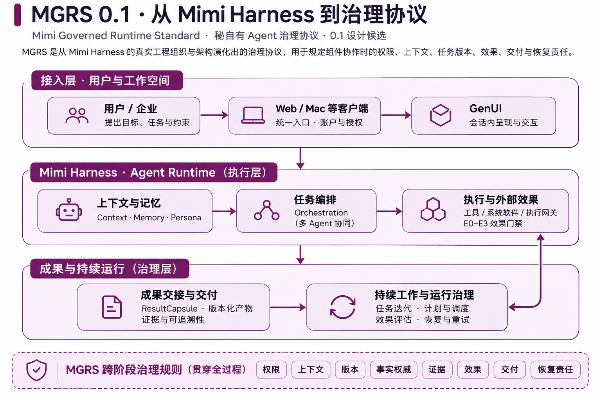

# MGRS 0.1 · 从 Mimi Harness 到治理协议

**Mimi Governed Runtime Standard** · 秘秘自有 Agent 治理协议 · 0.1 设计候选

MGRS 是从 **Mimi Harness 的真实工程组织与架构演化**中提炼出来的治理协议。Mimi 是面向用户的持续工作产品；Harness 复用 Hermes 的原生 Agent Loop，并连接 ProductRuntime、Core、Persona、Memory、Orchestration、执行网关及外部软件；MGRS 则约定这些组件协作时的权限、上下文、任务版本、效果、交付与恢复责任。**它不是另一套独立的 Agent Runtime 或全局管理 Agent。**

[六部分架构说明](#part-1)沿一项工作展开，[十六条治理准则](docs/reference/mgrs-0.1-technical.md)可按主题查阅。

这里按照一项工作从用户入口到实际交付的关系，组织为 **六个部分**。这是理解 Harness 的运行路线，**不是六个必须按顺序执行的服务或新的六级权限架构**。简单请求不必额外启动受管 Worker；权限、事实权威、证据和恢复等治理规则会贯穿需要它们的环节。

## 第一部分 · 用户入口与授权

[打开独立说明：用户入口与授权](parts/01-entry-and-authority.md#part-1)

用户通过 Web、Mac 等客户端进入主会话或工坊，在这些工作空间中通过消息或受管理的界面操作提出请求；可信宿主确定 principal、Profile、scope 和当前 grant，区分用户目标、有效授权、审批与撤回。GenUI 属于这些场景内的呈现与交互机制，不额外提供身份或任务授权。后续环节必须继续遵守这一边界。

关联条文：[治理宗旨与个人主权](spec/01-purpose-and-boundaries.md#mgrs-1) · [六个治理面与运行分工](spec/02-governance-planes.md#mgrs-2) · [十四条核心不变量](spec/03-invariants.md#mgrs-3) · [Profile 与工作环境](spec/10-profile-cache-isolation.md#mgrs-10) · [权威与变更控制](spec/15-conflict-and-change-control.md#mgrs-15)

## 第二部分 · 上下文与请求装配

[打开独立说明：上下文与请求装配](parts/02-context-and-request.md#part-2)

从 Core 事实、Persona、Hermes 会话、任务状态、Skill 和原件引用中选取本轮授权材料。ContextEnvelope 用于描述请求与来源，必须区分保存、选中、真正进入最终模型请求及其语义使用。

关联条文：[ContextEnvelope](spec/04-context-envelope.md#mgrs-4) · [Persona](spec/09-persona.md#mgrs-9) · [Profile / Cache](spec/10-profile-cache-isolation.md#mgrs-10)

## 第三部分 · 决策、规划与协作编排

[打开独立说明：决策、规划与协作编排](parts/03-decision-and-orchestration.md#part-3)

主 Agent 可以直接执行、作一次原生委派，或为需要跟踪依赖、修订与恢复的工作建立受管任务。既定步骤按现行合同推进。需要重新权衡方法或组织工作时，C0 在用户委托范围内作出决定。

关联条文：[任务契约与结果胶囊](spec/05-task-result-capsule.md#mgrs-5) · [执行路径与方法重判](spec/06-task-discipline.md#mgrs-6) · [冲突裁决](spec/15-conflict-and-change-control.md#mgrs-15)

## 第四部分 · 执行与外部效果

[打开独立说明：执行与外部效果](parts/04-execution-and-effects.md#part-4)

Hermes 驱动原生执行循环，搜索策略和 Skill 提供方法。原生工具、MCP、API、CLI 和 GUI 都可以承接实际操作；插件可组织及分发跨生态的能力，由各自适合的执行宿主承接。发现、安装、授权与实际效果分别核验，跨宿主协调保留用户委托和结果责任，支付和关键不可逆事务的最终步骤由用户本人完成。

关联条文：[工具与效果](spec/07-tools-and-effects.md#mgrs-7) · [插件治理](spec/07-tools-and-effects.md#plugin-governance) · [Skill 生命周期](spec/08-skill-lifecycle.md#mgrs-8) · [恢复约束](spec/11-host-and-recovery.md#mgrs-11)

## 第五部分 · 成果交接、验收与交付

[打开独立说明：成果交接、验收与交付](parts/05-evidence-and-delivery.md#part-5)

ResultCapsule 关联结论、证据引用、任务及要求版本；分别核对 Durable、Routed、Consumed 与 Accepted。GenUI 可以呈现流式预览、阶段性成果和交付界面，验收、用户通知与外部发布各自留有可信依据。

关联条文：[ResultCapsule](spec/05-task-result-capsule.md#mgrs-5) · [多端与 GenUI 契约](spec/12-web-mac-contract.md#mgrs-12) · [可靠性度量](spec/13-reliability-and-promotion.md#mgrs-13)

## 第六部分 · 持续工作与运行治理

[打开独立说明：持续工作与运行治理](parts/06-persistence-and-operations.md#part-6)

有效委托在用户离开后仍能按条件推进：已有合同支持直接执行，C0 负责持续决定工作价值、方法与组织方式；后台观察进入受控记忆，程序性经验可以形成可复用的 Skill。Core、Hermes 会话、SessionDB 与持久工作环境共同维持状态延续，断线、重启和跨宿主迁移则需保留当前授权、真实结果与未决效果。

关联条文：[状态延续与恢复对账](spec/11-host-and-recovery.md#mgrs-11) · [持续工作度量与晋级](spec/13-reliability-and-promotion.md#mgrs-13) · [渐进演化与实施分期](spec/14-implementation-phases.md#mgrs-14) · [工程证据与历史基线](spec/16-capabilities-and-gaps.md#mgrs-16)

---

**六部分解释 Mimi Harness 如何运转。十六条治理准则写明，同一项工作跨组件、跨设备或更换实现时，各方仍要遵守哪些约定。** 正式条文以 `spec/` 为准，其中第三条列出 G01 至 G14，第十六条按日期记录工程依据。每条均保留独立地址。[十六条逐条目录](docs/reference/mgrs-0.1-technical.md)

[从真实问题理解设计](docs/FRAMEWORK-INTRO.md) · [专题导读](docs/README.md) · [产品哲学](docs/MIMI-OVERVIEW.md) · [设计决定](docs/DECISIONS.md) · [开放问题](docs/OPEN-QUESTIONS.md) · [研究与版本](docs/PROVENANCE.md) · [参与共创](CONTRIBUTING.md)

MGRS 0.1 是公开讨论中的设计候选，文档组织调整不构成 Mimi Harness 代码实现或运行验收。规范文本按 [CC BY 4.0](LICENSE) 授权，范围见[许可说明](NOTICE.md)。
