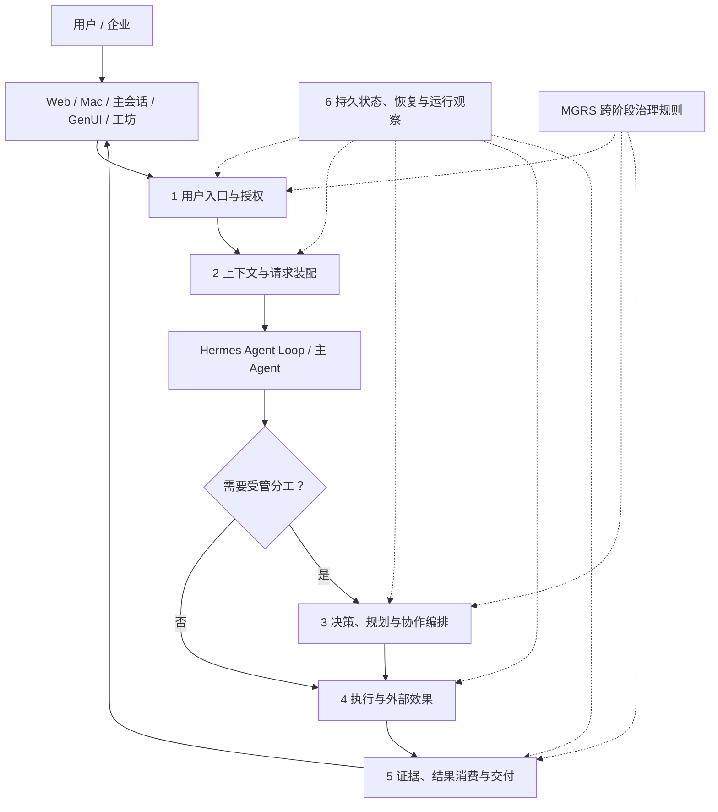

# MGRS 0.1 · 从 Mimi Harness 到治理协议

**Mimi Governed Runtime Standard** · 秘秘自有 Agent 治理协议 · 0.1 设计候选

MGRS 是从 **Mimi Harness 的真实工程组织与架构演化**中提炼出来的治理协议。Mimi 是面向用户的持续工作产品；Harness 复用 Hermes 的原生 Agent Loop，并连接 ProductRuntime、Core、Persona、Memory、Orchestration、执行网关及外部软件；MGRS 则约定这些组件协作时的权限、上下文、任务版本、效果、交付与恢复责任。**它不是另一套独立的 Agent Runtime 或全局管理 Agent。**

这里按照一项工作从用户入口到实际交付的关系，组织为 **六个部分**。这是理解 Harness 的运行路线，**不是六个必须按顺序执行的服务或新的六级权限架构**。简单请求不必额外启动受管 Worker；权限、事实权威、证据和恢复等治理规则会贯穿需要它们的环节。

## 第一部分 · 用户入口与授权

[打开独立说明：用户入口与授权](parts/01-entry-and-authority.md#part-1)

从 Web、Mac、主会话、可操作卡片或工坊进入；由可信宿主确定 principal、Profile、scope 和当前 grant，区分用户目标、有效授权、审批与撤回。后续环节必须继续遵守这一边界。

关联条文：[宗旨与边界](spec/01-purpose-and-boundaries.md#mgrs-1) · [治理面](spec/02-governance-planes.md#mgrs-2) · [不变量](spec/03-invariants.md#mgrs-3) · [隔离](spec/10-profile-cache-isolation.md#mgrs-10) · [变更](spec/15-conflict-and-change-control.md#mgrs-15)

## 第二部分 · 上下文与请求装配

[打开独立说明：上下文与请求装配](parts/02-context-and-request.md#part-2)

从 Core 事实、Persona、Hermes 会话、任务状态、Skill 和原件引用中选取本轮授权材料。ContextEnvelope 用于描述请求与来源，必须区分保存、选中、真正进入最终模型请求及其语义使用。

关联条文：[ContextEnvelope](spec/04-context-envelope.md#mgrs-4) · [Persona](spec/09-persona.md#mgrs-9) · [Profile / Cache](spec/10-profile-cache-isolation.md#mgrs-10)

## 第三部分 · 决策、规划与协作编排

[打开独立说明：决策、规划与协作编排](parts/03-decision-and-orchestration.md#part-3)

主 Agent 自主选择完成方式；需要持久任务或多 Agent 分工时，现有 Orchestration 负责目标版本、依赖、资源、受限 Worker 与工坊。治理不意味着所有请求都要先规划再逐层派工。

关联条文：[任务与交接](spec/05-task-result-capsule.md#mgrs-5) · [任务纪律](spec/06-task-discipline.md#mgrs-6) · [冲突裁决](spec/15-conflict-and-change-control.md#mgrs-15)

## 第四部分 · 执行与外部效果

[打开独立说明：执行与外部效果](parts/04-execution-and-effects.md#part-4)

Hermes 原生工具、MCP、Skill、统一执行端口与受控执行后端产生真实操作。工具发现不是权限，生成内容不是执行效果；外部动作需要授权、回执与必要的去重对账。

关联条文：[工具与效果](spec/07-tools-and-effects.md#mgrs-7) · [Skill 生命周期](spec/08-skill-lifecycle.md#mgrs-8) · [恢复约束](spec/11-host-and-recovery.md#mgrs-11)

## 第五部分 · 证据、结果消费与交付

[打开独立说明：证据、结果消费与交付](parts/05-evidence-and-delivery.md#part-5)

ResultCapsule 关联结论、证据、任务与要求版本；区分 Durable、Routed、Consumed 和 Accepted。Workshop、GenUI 与对外通知让结果可理解、可操作，但不靠模型自述或前端标签确认实际完成。

关联条文：[ResultCapsule](spec/05-task-result-capsule.md#mgrs-5) · [Web/Mac 与后端](spec/12-web-mac-contract.md#mgrs-12) · [可靠性度量](spec/13-reliability-and-promotion.md#mgrs-13)

## 第六部分 · 持久状态、恢复与运行观察

[打开独立说明：持久状态、恢复与运行观察](parts/06-persistence-and-operations.md#part-6)

Core、SessionDB、原生会话和外置材料分别承担真实状态权威。页面退出、压缩、模型切换或宿主重启不会清空逻辑任务；未知外部效果要先对账，并以实际证据评价可靠性。

关联条文：[宿主与恢复](spec/11-host-and-recovery.md#mgrs-11) · [度量](spec/13-reliability-and-promotion.md#mgrs-13) · [实施分期](spec/14-implementation-phases.md#mgrs-14) · [能力与待证边界](spec/16-capabilities-and-gaps.md#mgrs-16)

---

**正式规范与解释如何对应？** 六部分是 **Mimi Harness × MGRS 的架构主线与深度解释**；原 0.1 的 **16 个技术条款仍在 [spec/](spec/01-purpose-and-boundaries.md#mgrs-1) 中作为唯一权威规范**，G01 至 G14、ContextEnvelope 和 ResultCapsule 没有被废弃或降成历史附件。旧单文件地址仍可通过[兼容索引](docs/reference/mgrs-0.1-technical.md)访问。

[从真实问题理解设计](docs/FRAMEWORK-INTRO.md) · [专题导读](docs/README.md) · [产品哲学](docs/MIMI-OVERVIEW.md) · [设计决定](docs/DECISIONS.md) · [开放问题](docs/OPEN-QUESTIONS.md) · [研究与版本](docs/PROVENANCE.md) · [参与共创](CONTRIBUTING.md)

MGRS 0.1 是公开讨论中的设计候选，文档组织调整不构成 Mimi Harness 代码实现或运行验收。规范文本按 [CC BY 4.0](LICENSE) 授权，范围见[许可说明](NOTICE.md)。
