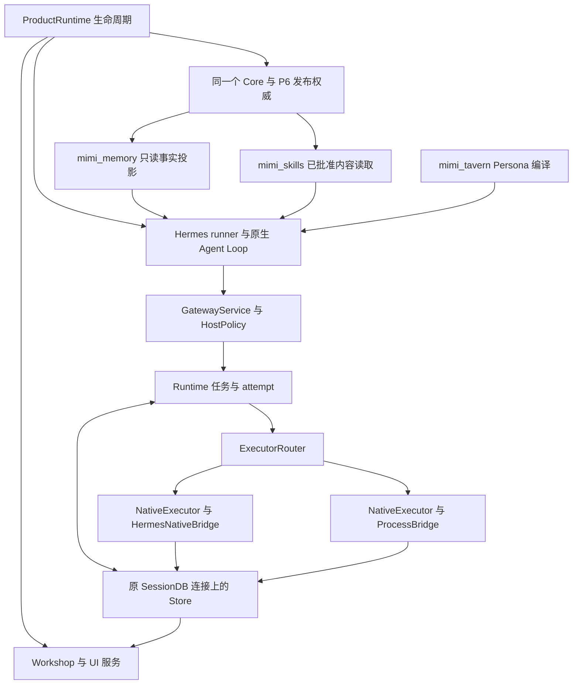
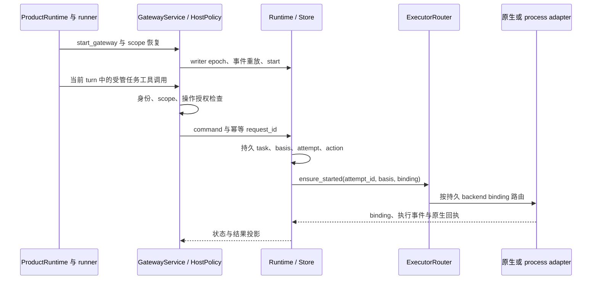
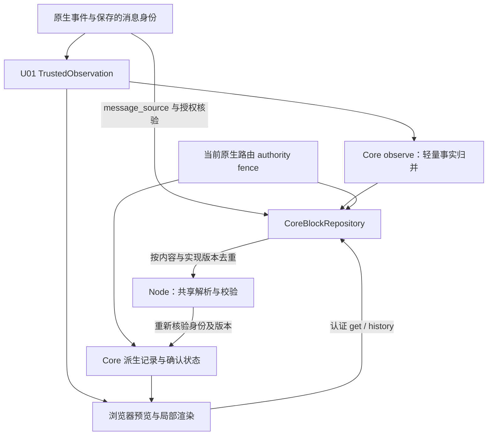
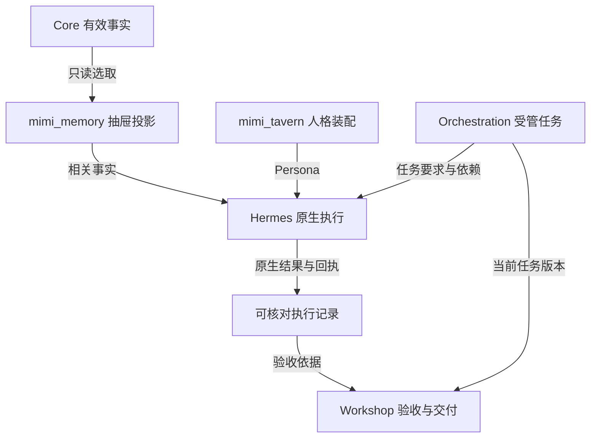

# 002 · 架构与职责：协议怎样落在现有组件上

[首页](../README.md) · [导读目录](README.md) · [完整规范](../MGRS.md)

MGRS 把治理要求落到秘秘已有组件的交界处：事实由谁维护，上下文怎样选取，任务怎样运行，结果怎样验收。读这套架构时，先找每项事实的权威写入方，再看其他组件如何读取和呈现它。

本页是对 0.1 设计候选的说明。图中的关系表达协议职责，不表示这些链路已在当前产品全部接通或完成实测。规范依据是[六个治理面](../MGRS.md#mgrs-2)、[上下文合同](../MGRS.md#mgrs-4)与[单宿主恢复](../MGRS.md#mgrs-11)。

产品组织以 Mimi 自有宿主 ProductRuntime 为根：它装配运行组件与生命周期，Hermes 提供复用的原生执行循环，MGRS 横向规定职责合同。包括统一执行网关、外部软件与推理路径的完整关系，见[产品与系统总览](MIMI-OVERVIEW.md)。

## 2026-11-11 的源码调用与所有权

本节沿用旧 PR #2 的接线范围，当前源码以已合并 assisthub main `230b2758` 固定。其继承 `5e460e04`、GenUI `7bfca12` 与 c291 修复，后续包含 `64a7b420` 的 group/intent/current-authority 修复。源 PR #464 已按普通 PR 路径合并，产品 PR #21 仍开放，生产保留旧 Core 18。下图表达源码接线，运行验证按[本次来源与限制](sources/2026-11-11-integration.md)单独记录。后文原协议职责图和 11 月 9 日记录保留各自日期与范围。

`ProductRuntime.start()` 先准备受管 Skill 视图与 Profile，把 `release_factory` 传给 `CoreServer`，再将 Skill runtime 绑定到这个 Core 的 release service。宿主装配原生 runner、执行目录和 Workshop 服务，关闭时依次清理 UI/连接、enterprise、kernel、Skill、事件循环、MCP、调用宿主和 Core。这里描述源码顺序，关闭期间出错仍需专项恢复证据。

`start_gateway()` 从现有 SessionDB 取得连接与锁，获取 Store writer epoch，装配 Runtime、NativeExecutor、InputAdapter 和 Router，恢复已接受 scope、重放原生事件后启动 Runtime。任务调度写入现有 Store 表，原生 journal 保存执行与请求事实。具体入口见[固定源码索引](sources/2026-11-11-integration.md)。

| 事实 | 源码所有者与写入边界 |
| --- | --- |
| 有效记忆、授权与撤回 | Core；provider 读取当前快照，显式记忆工具调用 Core 写入口 |
| Persona 与本轮编译 | `mimi_tavern` 的 bundle、session side state 与编译报告 |
| 已批准 Skill 的发布头与可读内容 | 同一个 Core 的 P6；原生工具读取受管视图并重新检查 |
| 任务版本、依赖、attempt 与准入 | Orchestration Runtime 和原 SessionDB 上的 Store |
| 执行与请求事实 | NativeExecutor journal、bridge 和 InputAdapter；UI 读取投影 |
| 产物接受与交付 | 具名 result verifier、Workshop 和相应产物/外部效果回执 |

Hermes 是默认任务后端。process 需要显式配置和当前授权，必需输入尚无消费支持时在资源预留前等待能力。受限 `AgyInferencePort.infer_once` 经独立 inference ports 注册，调用与授权入口和完整任务执行分开。自研搜索策略仍通过 `pre_llm_call` 注入方法上下文，底层检索走原生工具。以上接线支持对应源码观察，MGRS 完整符合性仍逐条验收。

## 开发根、配对发布与事实权威

开发权威现位于 assisthub main `230b2758c0e6d42e73619f7cf5141ee555b5594e`，其树等于已测试提交 `774bb96f4f88b5219413d757854b4b78aeec5ffb`。`core/`、`adapters/`、`deploy/` 是根后端，`frontend/` 是唯一产品前端，`mac/` 为宿主集成。发布仓 Mimi-Superagent 的 `backend/` 映射这些根后端路径，再与 `frontend/` 和包装资产配对。`incoming/` 保存导入来源，不能作为另一套活跃后端。这样可避免仅为满足旧发布布局而复制运行实现，或让测试误配旧 UI。

源 PR #463 的 main `c50c425d28c2f12d3de526fc66666c631666229f` 已由 root 核对 tree 等于测试源 `64a7b420c869405ac4e57c51d04b1aa654862ca5`。随后 PR #464 合入六个配对测试 helper 的路径修复、M6 设备说明与静态报告。产品 PR #21 的远端 `1c353eda2d4c09418edf4fbafc6dd60cd5007046` 已映射固定 `230b`；最新映射 5533 项、6 个文档 overlay，12 个排除项保留。已记录映射为 5531 项、6 个 overlay、12 个排除项，原 `64a` 本地提升为 149 项变更、零删除。测试 helper 适配 canonical/发布两种路径，运行实现继续使用同一开发根。前面的宿主/网关图继续表示继承的接线；源码索引区分原发布快照的 `backend/` 与当前开发根。[版本与来源](sources/2026-11-11-integration.md#followup-sources)。

Core 单写者维护业务 SQLite、授权与持久回执，Orchestration 仍拥有原 SessionDB 的任务/attempt 事实。UI 的草稿、抽屉和派生块不构成新业务账本。Core 当前合同为 `1.0`、schema `42`，不意味着线上已升级；总控给定的生产状态仍为旧 Core schema `18` 和旧网关状态。公开文档只记录代际差异。

当前 group 操作保留原 request key 与 provenance，恢复与删除回执沿原请求对账。Core UI 读写捕获当前原生路由 authority fence，并在提交时重新持有和检查它。路径入口与源码验证范围见[固定索引](sources/2026-11-11-integration.md#followup-sources)。

### SSE 事实与按需 UI 物化

逐 token 编译会把 UI 校验进程启动放到模型传输关键路径。当前 `TrustedObservation.publish()` 向 `CoreBlockRepository.observe()` 传递已解析原生事实；后者只归并最终正文、终态与可信身份，delta 不启动 Node，也不拼接权威正文。最终正文来自 `assistant.completed.content`，失败保持 sticky，迟到的成功不能清除失败。

`GET /api/features/gu_renderer/blocks`（有 message_id 调 get，否则 history）在认证读回时按需物化；确认写入经 `PUT /api/features/gu_renderer/state`，携带块/控件身份与 `expected_version`，浏览器不得设置 principal/profile、正文或终态。`projection` 绑定正文 SHA-256、`catalog_version` 与实际配对 JS 的 `validator_version` 摘要；同版本复用结果，同一计算键合并等待，编译在写事务外运行，发布前再检查授权、scope epoch 和内容版本。无效/不可用投影保留相应状态，原生结果保存不以 UI 投影成功为前提。

`ui26_message_identity.py:saved_identity()` 只使用原生 finalizer 明确选中且已持久化的消息对象 `_row_id`，在原 SessionDB 写事务中将 `ui26_chat_identity_v1` 元数据绑定 origin/session/run/stream/message/role 与合法 run_status；`project_identity()` 再核对具体行身份，不从最新一行或文字顺序猜测。

`NativeMessageSource` 读精确 history 行及其 run；仅原生 run 查询返回具名 `run_not_found` / `RUN_NOT_FOUND` 404 时，允许使用该保存行绑定的 `run_status`。其他错误不降级为成功，run/session/status 不一致不恢复执行。

重启后由宿主 `message_source` 从原生保存记录恢复精确消息/run/正文，`message_authorizer` 检查当前可读身份；wire ID、相似正文或浏览器声称的身份均不能替代。旧记录缺少可信证据时保持不可执行。实现入口、身份持久化补丁与测试位置见[来源索引](sources/2026-11-11-integration.md#followup-sources)；真实重启通过的范围另见[验收分层](005-review-and-conformance.md#followup-evidence)。

## 一次任务跨过哪些职责

箭头表示信息或职责关系，不是新增的服务、消息队列或数据库。上下文预算、去重和最终校验的装配边界仍有待商榷，见[Q03、Q04](OPEN-QUESTIONS.md)。图中也没有画出所有控制路径；可信宿主身份和当前授权约束贯穿读取、调用、交接与交付。

**Core** 保持有效业务事实及其作用域、版本和撤回状态。**mimi_memory** 从可读快照选出本轮需要的事实；抽屉、压缩摘要和外置阅读文件都属于派生视图。要改权威事实，仍走已有写入与撤回入口。

**mimi_tavern** 负责 Persona 版本和表达上下文的装配。**Hermes** 继续承担原生 Agent Loop、MCP、Skill 加载和会话压缩。**mimi_orchestration** 处理受管任务的依赖、版本化输入和运行状态，Worker 的执行仍依托原生机制。

**Workshop** 组织结果收取、验收和交付边界，交付还要使用原有产物或外发服务及其回执。**ProductRuntime** 负责组件装配与关闭顺序；它的生命周期职责覆盖运行组件，因此没有被画成又一个任务处理步骤。详细约束分别见[第 4 章](../MGRS.md#mgrs-4)、[第 5 章](../MGRS.md#mgrs-5)与[第 11 章](../MGRS.md#mgrs-11)。

## 六个治理面怎样对应组件

| 治理面 | 关心的问题 | 主要权威或承载组件 |
| :--- | :--- | :--- |
| 身份与授权 | 谁可以对什么执行操作？ | 可信宿主、Core 现有授权、Profile、approval |
| 上下文 | 这轮实际拿到了哪些有效信息？ | Core、mimi_memory、mimi_tavern、Hermes 会话与压缩 |
| 执行 | 当前任务由哪次尝试推进？ | Hermes 原生执行、受管任务 Orchestration |
| 证据 | 哪些事实能够证明执行和结果？ | 原生 session/input/attempt/result/receipt、Core 结果、产物 |
| 交付 | 谁接收了什么，是否满足结果条件？ | Workshop、原有产物与外发服务、授权接收回执 |
| 观察 | 中断后怎样判断状态并恢复？ | ProductRuntime、原生状态、现有日志和验收入口 |

“唯一权威”按事实划分，不要求所有数据放进同一个物理数据库。例如任务版本由任务系统维护，材料的授权由相应业务权威判断，UI 读取这些状态来展示。前端显示“完成”不能反过来改写执行回执，另存一个进度摘要也不能取代任务事实。参见[第 2 章](../MGRS.md#mgrs-2)与[界面契约](../MGRS.md#mgrs-12)。

## 从文档到源码时看哪里

以下路径来自规范第 16 章的历史研究记录，属于 **Mimi 产品仓库**，不是本协议仓的本地目录。原稿产品研究基线为 `a8c5bd8a860888e3fa082d3178f9c6f9c534716f`，Hermes 基线为 `c07501ec411b5364e5b12b7258c25a6a4c758545`。该表保留历史入口；2026-11-11 实际重读的候选路径与范围见本页新增章节及来源索引。

| 核查主题 | 原记录中的入口 |
| :--- | :--- |
| Core 记忆与投影 | `backend/core/assisthub_core/context.py`；`backend/deploy/hermes/plugins/mimi_memory/provider.py` |
| 任务、输入与原生执行衔接 | `backend/deploy/hermes/plugins/mimi_orchestration/` 下的 `runtime.py`、`gateway.py`、`input_adapter.py` |
| Persona | `backend/deploy/hermes/plugins/mimi_tavern/` |
| Skill 批准与发布 | `backend/core/assisthub_core/skills_release/README.md` |
| 管理界面与 MCP 验证记录 | `docs/guide/FRONTEND-INVENTORY.md`；`docs/plans/2026-11-04-mcp-lifecycle/VALIDATION.md` |
| 宿主生命周期 | `backend/deploy/mimi_cli/mimi_product_runtime.py` |

核查实现时，应固定实际源码版本并确认装配、配置和执行证据。某个模块出现在源码中，只能支持对应范围的源码判断；是否被加载、是否能完成真实任务，需要相应验证记录。历史已有能力与待证边界见[第 16 章](../MGRS.md#mgrs-16)，分期路线见[第 14 章](../MGRS.md#mgrs-14)。

## 历史记录 · 2026-11-09 候选中的执行网关与自研搜索

PR #15 已合入 PR #12 的候选分支，当时固定 head 为 `1dd86db66894ecabcd518be1e5cb1aac8d9fc462`。`ExecutionPort` / `ExecutorRouter` 在既有任务、attempt、SessionDB 与回执体系中连接 Hermes 和受管子进程两类任务后端；受限 AGY `infer_once` 是单独注册的推理端口。详见[当前源码入口与 CI](sources/2026-11-09-system-baseline.md#source-runtime)。

同一候选包含 `mimi_search_strategy` 的策略文件、hook 和宿主装配入口。它把秘秘自研搜索方法送入当前模型，工具执行沿用原生搜索与提取能力，详见[自研搜索策略](006-search-strategy.md)。

[上一章：核心概念](001-domain-model.md) · [下一章：上下文与记忆](003-context-and-memory.md)
