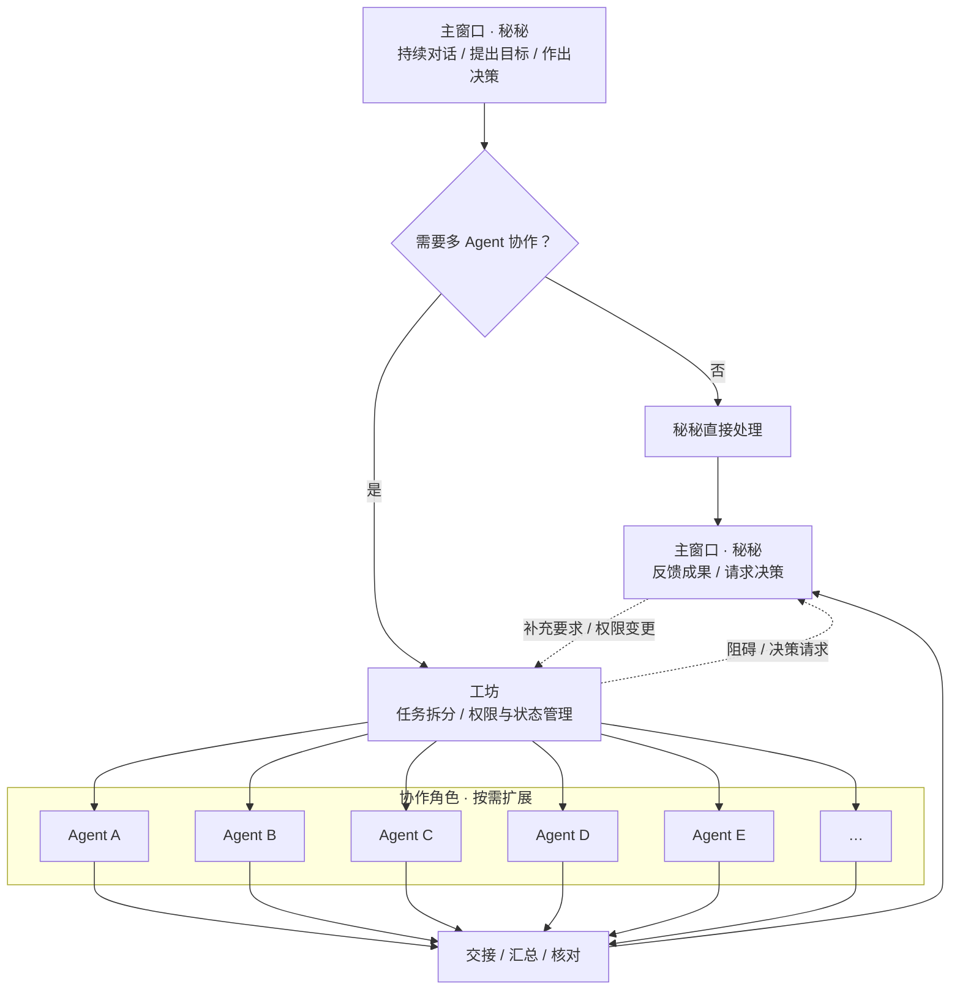

# 002 · 为什么已经有主窗口，还要做工坊？

[首页 · 导读目录](README.md)

我平时就想有事直接跟秘秘讲。一个项目做几个星期，中间顺便问问明天的日程，聊两句别的，过几天想起那个项目还能接着说。可要是这件事需要几个 Agent 配合——一个翻材料、一个写稿、一个核对——全挤在这个窗口里来回交接、改稿，我想翻一下自己昨天说的那句话，得翻到哪里去？

所以我给多 Agent 协作单独开了一个入口，叫**工坊**。但它和主窗口不是互相替代的两个地方，而是同一个项目里分工不同的两面：主窗口是你和秘秘持续对话、提出要求和拿主意的地方；一旦某件事需要多角色配合，秘秘就会把协作的部分组织进工坊，让里面的 Agent 各自执行、交接、汇总。

一个项目完全可以同时留在主窗口和工坊里。你可以随时点进工坊看各个角色做到哪一步了，也可以一直留在主窗口跟秘秘说「这次只写前两部分」——工坊里干活的能收到这句补充。反过来，工坊里写到一半发现你给的材料缺了一页，或者有几个关键判断拿不准，消息也会回到主窗口问你。你想看工坊就进去，不看也不用耽误它们协作。（[我在评论里怎么讲主窗口和工坊](sources/2026-11-09-bilibili-bv1vix26sEzR.md)）

### 两个 Agent 需要看同一份聊天记录吗？

既然进了工坊分工，不同角色就不需要盯着同一份冗长的聊天记录。读材料的 Agent 有自己的窗口，可以慢慢翻原件；至于你昨晚在主窗口跟秘秘闲聊过什么，帮忙写稿的 Agent 完全用不着一起听。

但不共享完整聊天记录，不代表它们各干各的、最后随便拼在一起。一个负责检索，另一个负责写作，写作 Agent 不需要知道检索 Agent 搜索时经历了多少次失败，却必须清楚四件事：

* 这项任务最终要回答什么问题；
* 你提出了哪些具体要求和限制；
* 检索 Agent 实际找到了什么，还有哪几处没解决；
* 哪些结论有原始材料支持，哪些目前还只是初步判断。

这也是工坊背后真正要解决的协作问题：不是把几个聊天窗口简单分开，而是通过明确的任务状态、受管的交接产物和共享约束，让不同角色围绕同一个目标往下推进。至于你平时就有的长期习惯——比如「先讲结论，再附出处」——记在记忆里就行，没必要每开一个协作任务就重新交代一次。（[上下文与记忆](003-context-and-memory.md)）

### 主窗口怎样统筹工坊？

在日常使用里，你不需要自己去工坊里一个个派活。任务的发起、授权、进度同步和结果交接，都由主窗口里的秘秘统一统筹。

你在主窗口提出目标后，秘秘判断是否需要启动协作；如果需要，就把子任务分派进工坊，并在关键节点把遇到的阻碍或汇总成果带回主窗口。你在主窗口补充的新要求、临时收紧的权限，也会同步更新到工坊的当前任务状态里，不会出现「主窗口已经改了主意，工坊还在按旧要求埋头干」的情况。

这套运转背后，我直接复用了 Hermes 的底座来跑工具调用和推理循环；至于每个角色这次能调用哪些权限、访问哪些材料，则由宿主和 Core 管起来——Core 负责管理每个角色的任务权限与可访问材料，不需要把主窗口的全部聊天记录交给它们。（[框架里的协作分工](../MGRS.md#collaboration)）

#### 主窗口与工坊协作流程（示意）

### 什么时候值得分工？

有了工坊，也不意味着什么事都值得拉一屋子 Agent。

有些工作拆开确实省时间。比如两份很长的方案，各找一个 Agent 去读，自己那份都能读得挺细。但你问的是最后该选哪家，总得有一个角色把两份结论放在一起权衡。并行能省下一部分阅读和检索的执行时间，可汇总、对齐上下文、交叉核对和最终判断，依然需要实打实的协调成本。要是原本几分钟就能看完的小事，硬要多叫几个 Agent 分头干，还要等它们互相解释一遍，省的又是谁的时间呢？（[什么时候值得分工](OPEN-QUESTIONS.md#q02)）

---

所以我不想让秘秘动不动就拉几个 Agent 开工。有些事一个 Agent 就能做好，何必再叫几个过来互相解释？但如果真的遇到需要分头处理的工作，工坊就能把这些角色组织起来，让它们各自干活、交接结果。

至于我，还是在主窗口跟秘秘说话就好了。哪个角色负责什么，任务进行到哪一步了，哪里需要我拿主意，这些事情都应该由秘秘协调好。毕竟做工坊的初衷就是为了减少我操心的事情，要是最后还得我自己当项目经理，那我做它干什么？

[上一章 · 同一项任务](001-domain-model.md) · [下一章 · 上下文与记忆](003-context-and-memory.md)
