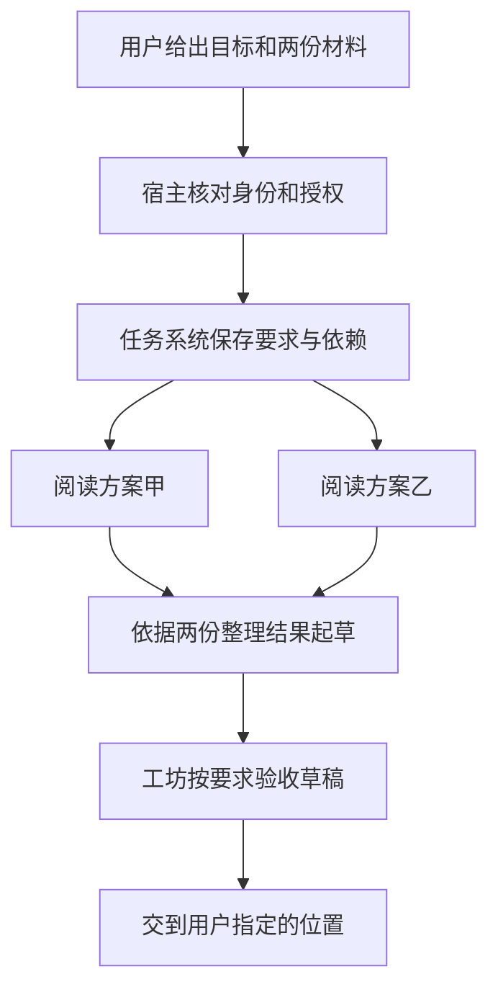

# 002 · 主对话和工坊怎样一起做事

[首页](../README.md) · [导读目录](README.md) · [完整规范](../MGRS.md)

我希望你平时可以一直在熟悉的窗口跟秘秘说话。比如你丢给它两份方案，说“做个两页的比较，草稿先给我看”。它可以在后台读材料，你在主窗口接着聊明天的安排。要是你想看简报写到哪儿了，也可以进工坊（Workshop），单独打开这项工作。对你来说还是在和同一个助手打交道，后台读方案的 Agent 则可以用自己的工作窗口，只拿这件事用得上的资料。[我在评论里怎么讲主窗口和工坊](sources/2026-11-09-bilibili-bv1vix26sEzR.md)

## 一句“先给我看”，后台怎么理解

能读哪两份方案，先由宿主根据你当前的身份、工作配置（Profile）和授权来定。写简报的人可以读原文、出草稿。过一会儿你又说“把这份发给我同事”，它还得知道你指的是哪一份、发给谁，再按当时的权限去做。[身份与授权](../MGRS.md#mgrs-3) · [工具与外部效果](../MGRS.md#mgrs-7)

秘秘的宿主叫 ProductRuntime，Core、Hermes 和工坊这些组件由它装到一起，也由它管理启停。我沿用了 Hermes 的执行循环。Agent 想先看附件，就调工具打开，读完工具返回的内容再决定下一步。Core 管的是另外一些具体的事，比如你可以用哪些资料，之前给过的授权今天还有没有效。[六个治理面](../MGRS.md#mgrs-2)

写作也会用到你平时的习惯。你喜欢先看结论，记忆组件可以从 Core 取到这个偏好。秘秘跟你商量草稿用什么语气，由 Persona 组件管。要是有现成的比较方法，模型也可以去读这次获准使用的 Skill。至于先看甲方案还是先看乙方案，留给做这份简报的 Agent 自己判断就好。[上下文与记忆](003-context-and-memory.md)

## 哪些事可以分开做

一个短问题，主对话里能答就直接答。碰到这份简报，两份方案可以同时读，最后那两页却得等材料读完才能写。任务系统（Orchestration）记住的就是这种先后关系，以及你这次究竟要它交什么。要分工时，宿主核对每项工作的权限，任务系统记下这一次由谁接手，再交给执行后端。秘秘默认沿用 Hermes，需要交给命令行工具做的工作，也可以交给明确配置过、支持这项工作的受管子进程。[任务与团队交接合同](../MGRS.md#mgrs-5) · [源码与职责对应](sources/2026-11-11-integration.md)

读甲、读乙和起草都可以用同一个模型。真正值得分清楚的是，读甲的那个 Agent 发现附件缺了一页，会怎么告诉后面写简报的人？把缺的是哪一页、影响哪项比较一起带过去，起草者就知道该在哪儿留个问号。工坊收稿时，也能翻回那份附件核实。草稿存没存好、后来有没有发给同事，再分别查写文件和发送的回执。[一个任务怎样交接与验收](004-execution-and-evidence.md)

## 关掉窗口以后，什么还在

草稿写到一半，你关掉了窗口。按 MGRS 的设计，第二天重新打开，宿主先确认现在用的是谁的身份，再找回原来的任务和会话。要知道简报用的哪版要求，去任务系统看要求、执行尝试和依赖。要找助手实际读了哪些材料、工具回了什么，查 Hermes 的原生会话和执行记录。至于你昨天撤回的那条偏好，还能不能用，则以 Core 的记录为准。另一个 Agent 接手时也去这些地方查。[单宿主与持久恢复](../MGRS.md#mgrs-11)

屏幕上显示的东西也有来处。文字一边生成，界面就可以一边给你看预览。过一天再打开，界面要按保存的消息和运行记录恢复正文、卡片和控件。你在卡片上改一个值，提交时带上看到的版本，Core 确认后界面才知道哪个值存好了。如果期间有人改过，就得先读回最新的值。对这种交互感兴趣，可以沿着实现记录找到对应代码，以及开发和发布时它分别放在哪个目录。[界面契约](../MGRS.md#mgrs-12) · [实现入口](sources/2026-11-11-integration.md#followup-sources)

[上一章 · 核心概念](001-domain-model.md) · [下一章 · 上下文与记忆](003-context-and-memory.md)
