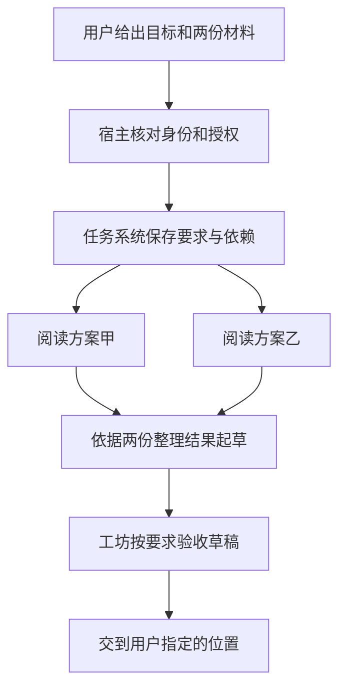

# 002 · 架构与职责

[首页](../README.md) · [导读目录](README.md) · [完整规范](../MGRS.md)

假设你把两份方案交给秘秘，请它写一份两页的比较简报，先给你看草稿。你希望从平常对话的地方看到结果，也希望做这件事的助手只接触这两份材料。秘秘的工坊（Workshop）就是为这样的分工设计的。主对话可以接着聊别的事，工坊里的 Agent 在各自的上下文里读材料、交接结果。两边靠同一项任务取得联系。[产品设计的由来](sources/2026-11-09-bilibili-bv1vix26sEzR.md)

## 谁能看材料，谁来做事

用户提出目标后，运行秘秘的宿主根据当前身份、工作配置（Profile）和已有授权，判断这次可以读哪些材料、动用哪些工具。后台 Agent 按具体分工取得权限。负责比较方案的 Agent 可以读两份原文并写草稿。若用户日后请它把文件发给同事，宿主要按这次指令、目标接收人和当时有效的权限判断能否发送。[身份与授权](../MGRS.md#mgrs-3) · [工具与外部效果](../MGRS.md#mgrs-7)

秘秘自己的宿主叫 ProductRuntime，负责把 Core、Hermes 和工坊等组件装在一起，并管理它们的启动和关闭。Core 保存有效的业务事实、授权和撤回记录。记忆组件从 Core 取出本轮用得到的事实，Persona 组件装配对话角色的表达设定。Agent 需要某种方法时，可以读取当前获准使用的 Skill。模型据此在 Hermes 的原生执行循环里读材料、调用工具、调整下一步。用户交代的目标和可以动用的权限始终有出处，具体采用哪一种比较方法留给 Agent。[六个治理面](../MGRS.md#mgrs-2) · [上下文与记忆](003-context-and-memory.md)

## 一项工作怎样走到工坊

短问题可以在主对话里直接回答。需要分工时，任务系统（Orchestration）保存要求和依赖关系。例如，两份方案可以分别阅读，写简报则要等相关的材料整理结果就绪。宿主检查任务权限，任务系统为获准执行的一次尝试留下记录，再把工作交给执行后端。秘秘的默认后端是 Hermes，显式配置的受管子进程也可以承担与其能力相符的任务。[任务与团队交接合同](../MGRS.md#mgrs-5) · [源码与职责对应](sources/2026-11-11-integration.md)

这张图里的三项工作可以共用一个模型。分工的价值在于上下文和责任各有范围。假如读方案甲的 Agent 发现附件缺了一页，它可以把缺页的位置交给写作者，后者便知道哪项比较应留空。工坊收取草稿时，可以沿着这条关系找到原始材料，检查两页简报是否回答了用户的问题。若交付还涉及写入文件或外部发送，相应服务会留下自己的回执。[一个任务怎样交接与验收](004-execution-and-evidence.md)

## 关掉窗口以后，什么还在

设想草稿写到一半，你关掉窗口，第二天又打开。按照 MGRS 的设计，此时要找回原任务和原会话，由宿主核对当前身份，再从相应记录中读出已经发生的事。任务系统保存的是哪一版要求、哪次尝试和哪些依赖。Hermes 的原生会话和执行记录保存收到的输入、实际调用和结果。Core 保存业务事实，比如一条偏好是否已撤回。每种事实由负责它的组件维护，因此更换前端、刷新页面或接入另一个 Agent 都有同一个查询起点。[单宿主与持久恢复](../MGRS.md#mgrs-11)

界面也有自己的工作。秘秘可以在文字生成时逐步呈现预览，读回历史时，再根据保存的消息和运行标识恢复正文与交互控件。用户修改控件后，界面拿着版本提交，收到 Core 的确认，再显示已保存的值。如果版本落后，就读回最新状态。这解释了为什么原生消息的保存、屏幕上的预览和一次操作的确认要分别处理。实现者可以在带日期的索引里查到对应代码以及开发目录到发布目录的映射。[界面契约](../MGRS.md#mgrs-12) · [实现入口](sources/2026-11-11-integration.md#followup-sources)

[上一章 · 核心概念](001-domain-model.md) · [下一章 · 上下文与记忆](003-context-and-memory.md)
