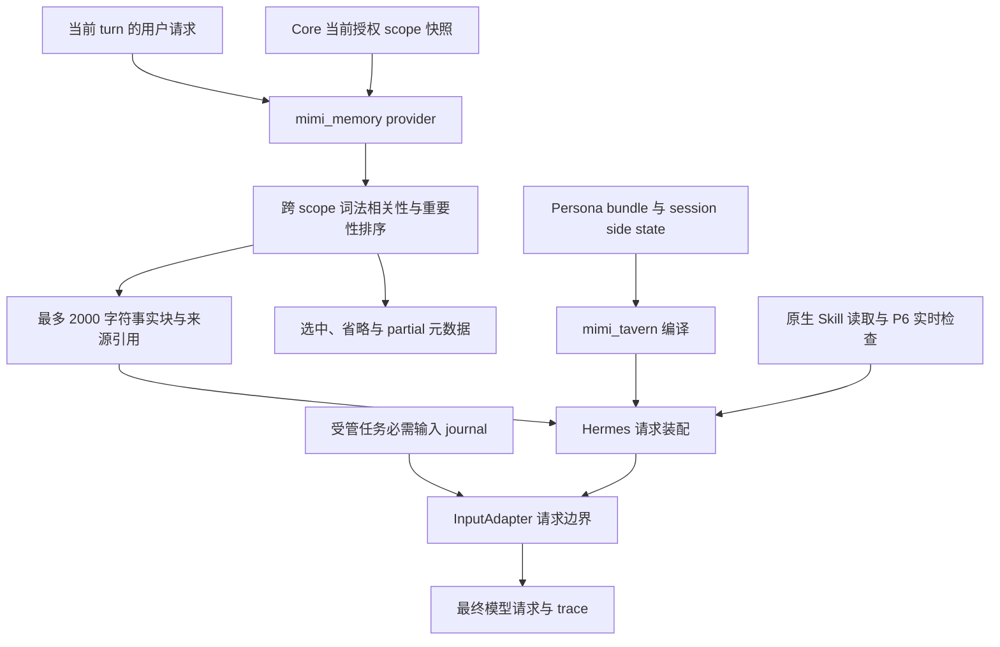

# 003 · 上下文、记忆与 Persona

[首页](../README.md) · [导读目录](README.md) · [完整规范](../MGRS.md)

Agent 接一个长期任务，需要知道你在做什么、哪些要求仍然有效、上一步有什么依据，也需要保留合适的表达方式。MGRS 用“抽屉”解释这些信息怎样进入当前请求：从各自的真实来源取出本轮需要的内容，保留权限、版本和回查入口。抽屉本身是只读视图。

本篇解释 MGRS 0.1 的设计候选，依据主要是[规范第 4 章](../MGRS.md#mgrs-4)。文中的装配过程描述协议要求与拟议合同，不表示所有环节已经实现或验收。

## 五类信息，各自从哪里来

| 来源 | 本轮提供什么 | 保留什么边界 |
| :--- | :--- | :--- |
| 人物锚点 | Persona 的身份、声音、场景和表达示例 | 由 `mimi_tavern` 装配；不保存任务验收或外部操作结果 |
| 事实抽屉 | 稳定偏好，以及与当前话题有关的有效事实 | 从 Core 当前快照选取；事实的写入、撤回和版本仍由 Core 管理 |
| 任务抽屉 | 当前要求、用户修正、依赖关系和上游结果 | 来自现有任务系统；必需修正保留独立入口，不争用普通事实配额 |
| 方法抽屉 | 已批准 Skill 的名称、边界和版本 | 使用时再由原生 loader 读取正文；工具描述由原生工具层提供 |
| 历史与原件 | 原生会话、原始材料和可回查引用 | 需要时读取，不默认把全部历史塞进每次请求 |

例如，用户要求“继续修改昨天的研究简报，并保留刚才更正的研究范围”，稳定写作偏好可以来自事实抽屉；研究范围来自当前任务要求；上一版结论来自版本化结果；引文仍需回到材料原件。把这些内容分开，接班 Agent 才能知道哪部分可以沿用，哪部分必须重新核对。

## 先检查能不能用，再选择要不要放

规范的投影顺序从有效权限开始。先确定当前主体、Profile 和可读对象，排除已撤回、过期、历史版本或已失去授权的内容，再对可选事实进行相关性选择。某条记忆很相关，并不能让它越过权限边界。

本轮用户要求、宿主授权规则和任务契约中的必需约束需要保留。任意记忆文本不能给自己加一个“永久置顶”标记来获得这种地位。可选事实则按实体或路径命中、当前语境相关度、重要性和非重复度等因素选择，并记录省略原因。模型看到的是部分视图；没被选中不代表原始信息不存在。[对应条款：G07、G08、G11](../MGRS.md#mgrs-3)。

**2000 字符是事实抽屉的首版预算，不是整个模型上下文的容量，也不是 2000 token。** 人物锚点、任务约束、Skill 正文和历史材料有不同的装配职责。必需内容超出可用预算时，应保持含义地压缩表述、分阶段读取或拆分任务；仍无法容纳时明确报告受阻。完整的跨来源预算分配与最终装配边界仍列在 [Q03、Q04](OPEN-QUESTIONS.md) 中。

拟议的 `ContextEnvelope` 记录本轮身份绑定、任务版本、来源版本、选中与省略项目，以及渲染摘要等信息，供宿主追溯。它是审计合同，不是已经发布的 API，也不要求把全部元信息发给模型。模型接收完成当前任务所需的授权内容与引用，私人原文不进入通用日志。[结构示例见规范第 4 章](../MGRS.md#mgrs-4)。

## Persona 管表达，Skill 管方法

Persona 可以让同一个角色在不同场景保持连续的声音。它不能替任务制造完成记录，也不能凭一句人设描述获得更多数据或工具权限。“表达自然”和“记忆准确”需要分别评价，尤其不能用虚构共同经历来补连续感。[依据：第 9 章](../MGRS.md#mgrs-9)。

Skill 提供可复用的方法。看见名称、读到正文、执行脚本、得到可靠结果，是四件需要分别观察的事。读取一份 `SKILL.md` 不会签发 shell 或 MCP 权限；脚本能力仍经过原有宿主门禁，技能版本沿用既有批准与发布机制。[依据：第 7、8 章](../MGRS.md#mgrs-7)。

秘秘自研搜索策略也属于方法层，但当前以独立 `mimi_search_strategy` 插件的 `pre_llm_call` hook 注入本轮上下文，并非由 Skill loader 加载的普通技能包。它定义查询、阅读和证据判断的方法，实际检索继续走 Hermes 原生工具；用户来源限制与宿主权限保持各自的约束。详见[006 · 秘秘自研搜索策略](006-search-strategy.md)。

## 缓存、压缩和冷启动怎样接续

缓存需要绑定身份、Profile、会话、授权代次和相关来源版本等条件，取用时还要检查到期时间。授权撤销、材料到期、用户修正或已验证结果变化时，应立即刷新相关装配内容，不能为了缓存命中继续使用旧权限。依据见[第 4 章](../MGRS.md#mgrs-4)与[第 10 章](../MGRS.md#mgrs-10)。

压缩继续复用 Hermes 原有能力，保留原始会话、工具配对和可回查引用。摘要可以帮助恢复上下文，却不能改写任务事实。冷启动时，规范要求先确认身份与权限，恢复原生会话和任务标识，再读取持久任务、对账旧尝试与未决效果，随后获取有效记忆快照、编译 Persona、投影本轮抽屉，继续同一个逻辑任务。[依据：第 4、11 章](../MGRS.md#mgrs-11)。

外置 `memory.md` 或 `context.json` 可以作为带版本和来源的可读视图。人工编辑若要改变权威事实，应走既有 Core 写入、撤回和版本比较流程。这样可以保留文件的可读性，同时避免文件与数据库互相覆盖、各说各话。

## 2026-11-11 候选中的实际装配

以下观察固定在 `77c853f1`，依据[源码索引与证据范围](sources/2026-11-11-integration.md)。前文规范要求继续保留，拟议 `ContextEnvelope` 与候选已有诊断字段分别核对。

图中多源箭头表示来源关系，各插件的全局顺序仍由原生装配与 patch 决定。`InputAdapter.final_request()` 检查最终 payload 的包含事实。Persona 的 `evidence_stage=compiled` 记录编译产物，实际发送与响应使用请求 trace 证据核对。

### 事实投影

`on_turn_start()` 取本轮 query，切换或初始化 session 时清空 query。`system_prompt_block()` 每次重取所有授权 read scopes 的快照，任一读取失败即清空投影；写入后读回未知时暂不提供事实块。Core 决定有效性与到期撤回，投影对已授权有效集合进行排序。

`projection.rank_facts()` 对规范化英文词、中文相邻双字与路径命中加权，再按重要性和稳定身份排序。`select_prompt()` 将 header 与完整事实记录共同计入 2000 个 Python 字符，容不下的记录标记 `budget` 并继续选择。报告含来源、版本、相关性及省略元数据；`prefetch` 保持空内容。词法分数用于选择，相关性质量仍需任务样本测量。它和全来源预算协调、完整上下文审计合同分别保留状态。

### Persona 连续性

`MimiContextEngine` 复用 Hermes `ContextCompressor` 和原压缩配置，`PersonaSession.select()` 产生本轮消息及报告，记录实际 bundle revision/hash、profile、session 与 `compiled` 阶段。新普通 session 读取更新或回滚后的 bundle；相同 home/profile 在压缩边界有未完成 turn 时保留既有 bundle 与 workspace。`clone_for_agent()` 保留不可变 bundle，隔离 session state 并清除报告。人格加载或编译出错可降级为原请求，需观察告警及空报告，表达质量另行验收。

### 已批准 Skill 的读取链

`SkillRuntime` 仅为 `default` 与 `ai-daily` 绑定现有 P6。缺少私有发布配置时 disabled，无效配置使启动报错；真实源生产者身份、批准和可信场景检查仍由既有发布流程提供。

原生 `skills_list` / `skill_view` 通过 `mimi_skills` 的 tool override 调用 `native_read()`。读取校验当前发布头、源授权、Profile、路径和内容身份，读前读后重新检查；发布或撤回改变会使原生发现缓存失效。正文与引用读取、预处理和写入防护沿用同一宿主绑定。Skill 的全面三级披露及工具全面检索仍在后续范围，当前接线没有替它们签发验收结论。

[上一章：002 架构关系](002-architecture.md) · [下一章：004 执行与证据](004-execution-and-evidence.md)
