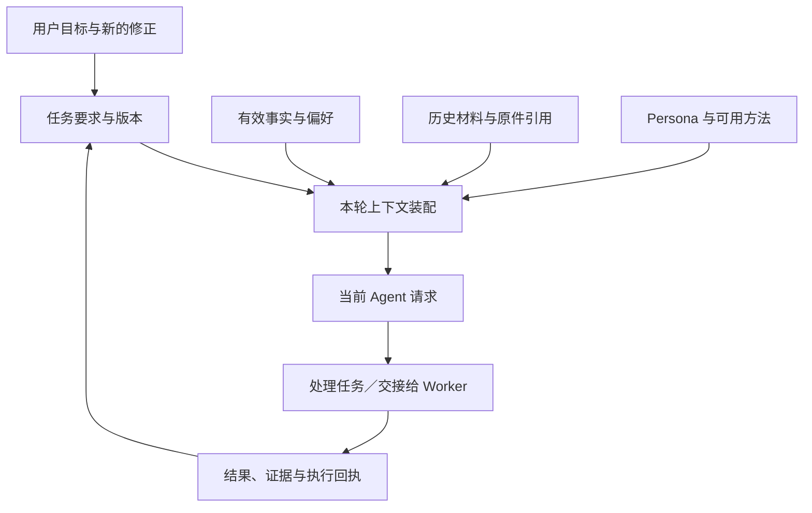

# 003 · 上下文、记忆与 Persona

[首页](../README.md) · [文档导航](README.md) · [完整规范](../MGRS.md)

当一个 Agent 从回答问题发展到连续处理生活与工作，它要面对的便不再是一段聊天，而是大量不断变化的事实、要求与执行结果。用户几天前提出的偏好可能仍然有效，刚刚修改的任务要求必须立刻生效，某份研究资料可能已经更新，另一个 Agent 则可能只完成了工作的一部分。

问题在于：**模型这一轮应该看到什么，又凭什么相信它看到的内容仍然有效？**

MGRS 把这个问题放在上下文治理中讨论。它借用「抽屉」来描述一种组织方式：长期保存的信息继续留在各自的权威来源里，每次执行任务时，系统从这些来源取出当下需要的部分，组成可追溯的工作视图。这一层与长期记忆、会话历史和任务执行相连，也为多 Agent 之间的协作提供共同的事实基础。

## 当任务跨越多次对话

设想用户让秘秘整理一份研究简报，先收集资料，再交给另一个 Agent 起草。第二天，用户发现研究范围应缩小，于是补充：「只讨论某一种组织，不再使用昨天那组样本。」

这里至少发生了三件不同的变化。用户的研究偏好可能没有变，任务要求已经改变，而昨天的检索结果仍作为历史材料存在。假如系统把这三者压成同一段「用户最近在做研究」的摘要，后继 Agent 很容易沿着旧范围继续写；假如所有材料原样塞入上下文，新旧要求又会同时出现，模型需要自行猜测哪一个有效。

因此，长期任务需要一套能够区分**稳定事实、当前任务和历史记录**的组织方式。模型上下文只是一次执行所需的工作面，不应该独自承担所有长期信息的保存与更新。

## 抽屉：从不同来源装配一次工作

MGRS 所说的抽屉，并不要求建立四个新的数据库。它描述的是不同类型的信息如何进入当前请求。信息可以存放在不同组件中，装配时按照各自的权威和用途取得。

| 信息来源 | 在当前任务中的作用 | 由谁维护 |
| :--- | :--- | :--- |
| 人物锚点（Persona） | 维持角色的身份、语气、表达方式与情境习惯 | Persona 的版本化来源与编译机制 |
| 事实与偏好（Memory） | 提供当前相关、仍然有效的长期事实 | 具有作用域、来源、版本和撤回机制的事实库 |
| 任务状态 | 带入用户当前目标、最近修正、依赖与待处理工作 | 任务合同、版本和执行系统 |
| 方法与工具（Skill/MCP） | 让 Agent 知道哪些方法可用、何时需要读取操作说明 | 已批准的 Skill、工具与宿主授权机制 |
| 历史与原件 | 在需要核查时找回旧对话、材料和执行回执 | 原生会话、材料存储及结果记录 |

这一划分首先解决的是「什么信息由谁负责」。例如，用户更改研究范围，改变的是任务要求；用户纠正个人偏好，改变的是相应事实；某个 Worker 完成资料整理，形成的是与任务版本绑定的结果。三者都可能影响下一轮回答，但它们的写入、读取与失效方式并不相同。

抽屉只负责把相关内容带到工作面上。**没被选进这一轮上下文的信息仍保留在其原始来源中，下一轮可以重新召回。** 由此，记忆容量、模型上下文长度与真正能够长期保存的信息不再被当作同一个问题。

## 一次请求怎样形成

在 MGRS 的设计中，一轮请求的组织可以理解为四个相连的动作。

首先，可信宿主根据当前用户、Profile 与任务确定信息的可用范围。用户可以让 Agent 使用自己的研究材料，但一次授权不会自动延伸到其他人的资料，也不会因为某段旧聊天提到过权限就重新生效。

接着，运行时从当前有效的来源取得事实、任务要求和必要材料。任务中的最新修正具有明确版本；长期事实则按照本轮关联程度选取。摘要与检索结果应尽量带着回到原件的线索，避免传递多次后只剩一个无法核对的说法。

随后，Persona、记忆视图、任务输入与方法说明在各自的装配位置进入模型请求。模型可以依据任务选择处理路径，但系统需要保证关键任务修正能够进入实际请求。其他信息即使暂时省略，也应有明确原因及重新获取的途径。

最后，Agent 的工作可能生成新材料、调用工具或交给另一个 Worker。新结果须回到负责该结果的任务和证据系统，而不是直接写进一个无来源的长期记忆摘要，供后续 Agent 不加区分地继承。

图中各来源可以由不同组件提供。MGRS 要建立的是它们之间可追溯的关系，不要求所有 Harness 都采用同一套记忆算法、存储产品或模型。

## 多 Agent 协作为什么尤其需要这层治理

单个 Agent 使用过时信息，往往可以通过重新提问纠正。多个 Agent 并行工作时，问题会被放大：一个 Worker 依照旧要求找到材料，另一个 Worker 使用这些材料写出了结论，主控最后只看到「任务完成」。

上下文治理要让接收方知道：这份结果对应哪个任务版本、用过哪些材料、有哪些尚未核查的部分。用户修改要求后，旧结果仍可以作为历史参考，但它是否适用于新任务，必须重新判断。只有保存了这些关联，系统才能区分「结果已经送达」和「下游确实依据正确版本完成工作」。

MGRS 为此提出请求级的 `ContextEnvelope`：用身份、任务版本、来源版本、选择记录等描述本轮上下文的组成。这份合同服务于宿主与组件之间的检查，模型本身只需获得完成当前任务所需的授权内容。相关条款见[规范第 4 章](../MGRS.md#mgrs-4)，结果交接如何验证见[004 · 执行与证据](004-execution-and-evidence.md)。

## Persona、Memory 与历史为何不能合并

长期陪伴需要连续的人格与记忆，但不同信息的变化速度并不相同。Persona 负责角色如何表达和回应，Memory 记录用户与环境中可延续、可修正的事实，任务系统维护正在推进的工作，而原始对话与材料保存事情曾经怎样发生。

如果把所有内容不断追加到同一份人设或记忆文本中，临时任务容易淹没稳定偏好，旧错误也可能被一次次继承。更重要的是，删除某条显示文本并不等于撤回它在其他缓存、摘要与任务中的影响。分开维护后，每类信息都能按自身规则更新，并在装配下一轮请求时取得有效版本。

对于跨会话的 Agent，这种连续性来自**事实可以被纠正、任务可以被接续、历史可以被回查**，而不只是模型每次都能复述一段相同的人物设定。

## 压缩与恢复：让长期任务接得上

长对话不可避免地需要选择、压缩和按需读取。压缩可以减少反复传入的材料，但摘要可能省去限定条件，也可能保留已经过时的要求。因此，MGRS 将原始会话、任务状态、材料来源与派生摘要分开：摘要便于继续工作，必要时仍能根据引用回到原文。

当 Agent 重启、切换设备或更换模型时，系统可以先恢复原任务及其当前版本，对账已经执行但结果尚不明确的操作，再装配最新的有效事实、Persona 和上下文视图。这样，冷启动是**继续同一个任务**，而不是让新会话根据一段旧总结重新猜测任务进度。

缓存与预算仍然是实际工程的重要问题，但它们服从同一原则：为了节省上下文或命中缓存，不能让撤回的数据重新可用，也不能悄悄舍弃决定任务方向的修正。[相关不变量 G07、G08、G11](../MGRS.md#mgrs-3)。

## 在秘秘中的实践

秘秘以现有 Hermes 会话与执行循环为基础，由 Core 维护长期事实及其作用域和版本，`mimi_memory` 提供按本轮任务选取的事实视图，`mimi_tavern` 负责 Persona 编译；任务系统和原生工具分别提供当前要求、材料、方法与结果记录。这些组件共同服务于上述上下文治理目标。

这里介绍的是设计分工。具体装配接口、当前投影预算、源码实现、测试及历史调参数据保留在[带日期的技术核查](sources/2026-11-11-integration.md)与[早期上下文评测记录](sources/2026-11-12-context-evaluation-baseline.md)中，便于需要实施或复核的人继续阅读。

对 MGRS 而言，抽屉设计的意义在于让 Agent **按任务取用信息、按来源确认事实、按版本延续工作**。当任务经历长时间、多轮对话或多 Agent 交接时，系统不必把一切寄托在一段不断增长的聊天记录里。

[上一章：002 架构关系](002-architecture.md) · [下一章：004 执行与证据](004-execution-and-evidence.md)
