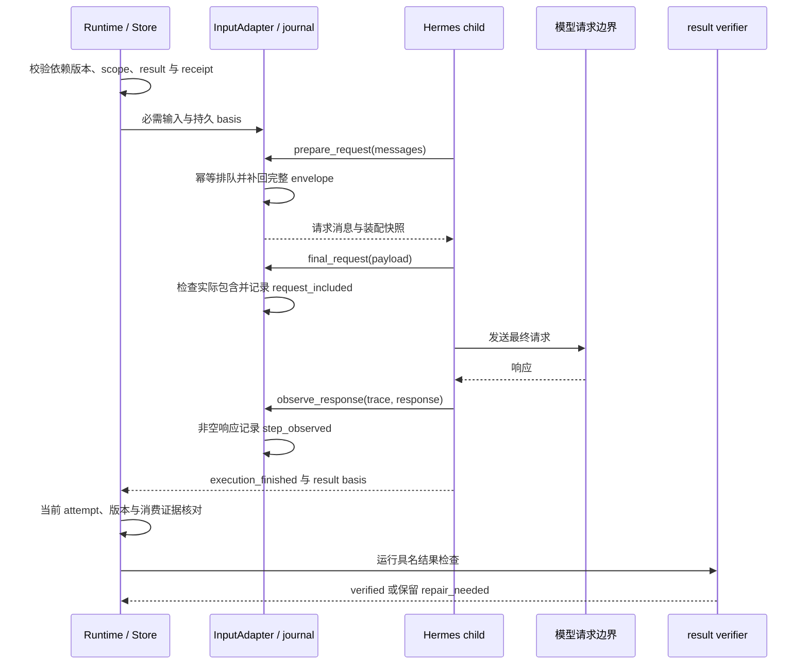
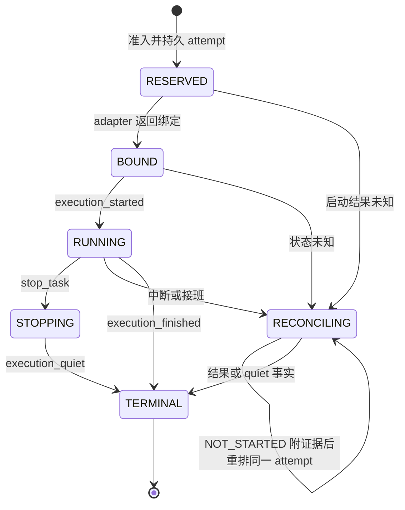

# 004 · 一个任务怎样交接与验收

[首页](../README.md) · [导读目录](README.md) · [完整规范](../MGRS.md)

多 Agent 协作最容易含糊的地方，是“交给下一个 Agent 了”究竟意味着什么。结果可能只写进了数据库，也可能已进入接收者的请求，但内容是否满足任务要求还需要另外判断。MGRS 把这些区别写进任务与结果合同，使交接能够追溯到具体要求、具体尝试和具体证据。

下面是**虚构的教学示例**，用于解释 MGRS 0.1 设计候选。编号、任务和检查均为示意，不是实际运行日志、现有 API 或测试通过记录。依据见[规范第 5、6 章](../MGRS.md#mgrs-5)。

## 从一份研究简报开始

假设用户要求：“把我给的两份方案整理成两页比较简报，注明依据，先交草稿。”任务可以拆为材料整理、结论复核和草稿编写。是否并行取决于真实依赖与授权，不为凑人数额外创建 Worker。各 Worker 只获得当前任务需要的材料、工具与写入范围。

以材料整理任务为例：

| 对象 | 示例 | 它帮助区分什么 |
| :--- | :--- | :--- |
| `task_id` | `T-materials` | 持续跟进的是哪项工作 |
| `requirement_revision` | `1` | 这次工作按哪一版要求进行 |
| `attempt_id` | `A-materials-1` | 哪一次执行产生了记录 |
| `result_id` | `R-materials-1` | 哪份结果可被引用 |
| 材料引用 | 两份方案的版本化引用与定位 | 结论究竟依据哪个原件 |
| `receipt` | 与该尝试关联的原生记录 | 实际观察到了什么操作或结果 |

任务合同还说明目标、接受条件、执行环境、资源和依赖。例如本示例约定：比较项应对应两份材料中的具体内容；没有依据的判断应保留为疑问；交付物是草稿。Worker 说“整理完成”只是一条陈述，接收者仍要读取结果及必要原件。[依据：第 5 章与 G02、G03](../MGRS.md#mgrs-3)。

## 用户中途改变要求时

假设用户随后补充：“比较范围只保留数据隐私，性能部分先去掉。”受影响任务要记录新版本要求。原结果 `R-materials-1` 仍属于第 1 版；它不能仅靠修改显示标签，就变成满足第 2 版要求的结果。

已经引用旧结果的相关下游依据失效并等待确认。原始材料在权限仍有效时可以继续读取，但旧结果不满足新版本要求，不能把它重绑为新版本已经验收的成果。用户修正写入输入记录以后，还需区分它是否进入后续实际模型请求；“已经收到修正”本身不能证明 Worker 按修正执行。[依据：G05、G06](../MGRS.md#mgrs-3)。

## 结论胶囊带走什么

材料整理者向复核者交接时，`ResultCapsule` 提供一份带来源的结果投影：任务与要求版本、执行尝试、结论、证据引用、适用条件、未决问题，以及产物引用与摘要。后继 Agent 可以据此读取必要原件，无需复制全部上游聊天。

例如胶囊可以写明“方案甲明确描述了数据删除流程”，同时引用对应原文；若方案乙材料未说明，则保留“材料中未找到说明”，不能升级为“方案乙不支持删除”。这里解释的是如何保留论断与依据的关系，不预设材料的实际内容。胶囊字段完整，也不会自动获得 `verified` 状态。[依据：第 5 章](../MGRS.md#mgrs-5)。

| 回报层级 | 在这个例子里意味着什么 |
| :--- | :--- |
| Durable | 结果已持久保存，并归属于正确的执行尝试 |
| Routed | 结果送到获授权的复核者，目标会话可追溯 |
| Consumed | 结果进入实际模型请求，并观察到相应响应 |
| Accepted | 后继产物满足已声明的具名检查，冲突与未决问题得到保留 |

前三层证明保存、路由与消费发生过，不能自动证明研究结论正确。示例中的接受检查可以是逐项核对原文位置、比较范围和草稿要求；实际任务采用什么检查，由它自己的合同确定。Worker 的自评与独立验收分别记账，不要求每个普通消息都再调用一个评审模型。

## 草稿、验收和外发分别记录

简报内容通过检查，只能支持对应的内容验收结论；用户是否收到、文件是否写入目标位置、是否对外发布，需要各自的回执。原请求只要求草稿，不能从“写好了”推导出外发授权。[依据：第 7、12 章](../MGRS.md#mgrs-7)。

再假设用户后来明确授权发布到一个具体共享位置，宿主检查通过后开始执行，但网络断开，无法确定外部写入是否成功。此时应保留未知状态，按原 `request_key` 或 `effect_id` 查询同一次效果的回执并回读目标。直接换一个新 ID 重发，可能制造重复外部作用。恢复会话或重启宿主也不能抹去这次未决执行。[依据：G04、G14 与第 11 章](../MGRS.md#mgrs-11)。

这样，一份交付记录能够分别回答：按哪版要求做了什么，哪些结论有依据，哪些问题仍未解决，以及交付到了哪里。具体语义验收边界仍需结合任务讨论，见 [Q05](OPEN-QUESTIONS.md)；本例没有替这些开放问题作出新的决定。

## 2026-11-11 候选的真实结果链

本节为 `77c853f1` 源码观察，与前文虚构例子分别阅读。`Runtime._basis()` 取得当前有效且已验证的依赖结果，`_ensure_dependency_inputs()` 将其绑定为不可变 `mimi_dependency_result/1` 输入，复用任务 inputs 与原生 inbox。其字段只覆盖已有实现，规范 `ResultCapsule` 仍保留更完整的设计合同。[固定源码与限制](sources/2026-11-11-integration.md)。

`QUEUED`、`HISTORY_STORED`、`REQUEST_INCLUDED`、`STEP_OBSERVED` 是 delivery 投影层级。当前 adapter 的 inbox 持久化记录为 `input_queued`，不会仅凭 journal 写入生成 `HISTORY_STORED`。最终请求检查匹配宿主生成的完整 envelope；响应 trace 匹配后记录 `step_observed`。这些事实证明输入包含和响应观测，语义接受继续依赖具名 verifier 与实际产物。

修订上游要求会使旧依据失效。公开输入 ID 禁用 `dependency:` 前缀，依赖输入由可信宿主生成；旧 scope、旧 basis 或晚到事件须经过相同绑定检查。压缩后缺失的必需输入会重新补入请求。process 后端当前遇到必需输入直接 `WAIT_CAPABILITY`，在预留资源前退出准入，独立 process 任务和 process 结果交给原生下游另按各自能力处理。

## 停止、重试与恢复的不同状态

图为 attempt phase 的主要路径。`quiet` 是独立布尔事实，`TERMINAL` 可能仅说明结果已结束；资源释放与新 attempt 准入还要核对 quiet。任务层另有 `OPEN`、`SATISFIED`、`CANCELLED` 和 waiting reason，二者需同时读取。

- `stop_task()` 检查 generation，写入取消意图并使下游依据失效，再派送 stop。stop 回执未知时沿同一 stop ID 继续对账。`resume_task()` 检查 revision，旧 attempt quiet 且已观察后才恢复后继准入。
- adapter 返回有证据的 `NOT_STARTED` 时可重试同一 attempt；启动跨界未知进入 `RECONCILING`。原生 provider 的 retry policy 继续由原执行层拥有。
- 结果 verifier 失败会保留结果和 `repair_needed`，通常等待修复。必需输入已知未消费时，旧执行 quiet 后允许每个逻辑输入一次显式 handoff；重复输入故障继续等待修复。
- writer 接班按 epoch 观察旧 attempt，并重放事件。相同进程里的 bridge 保留 child/进程句柄，InputAdapter 改绑新 Runtime。硬重启后原生持久结果可恢复 finished 事实，缺少 live ticket 或持久 timeout 仍不足以证明 quiet。

任务恢复、原生 receipt 与外部非幂等效果对账分别取证。具体未知状态和完整恢复通过情况见[审查入口](005-review-and-conformance.md)及[来源记录](sources/2026-11-11-integration.md)。

[上一章：003 上下文与记忆](003-context-and-memory.md) · [下一章：005 审查与符合性](005-review-and-conformance.md)
