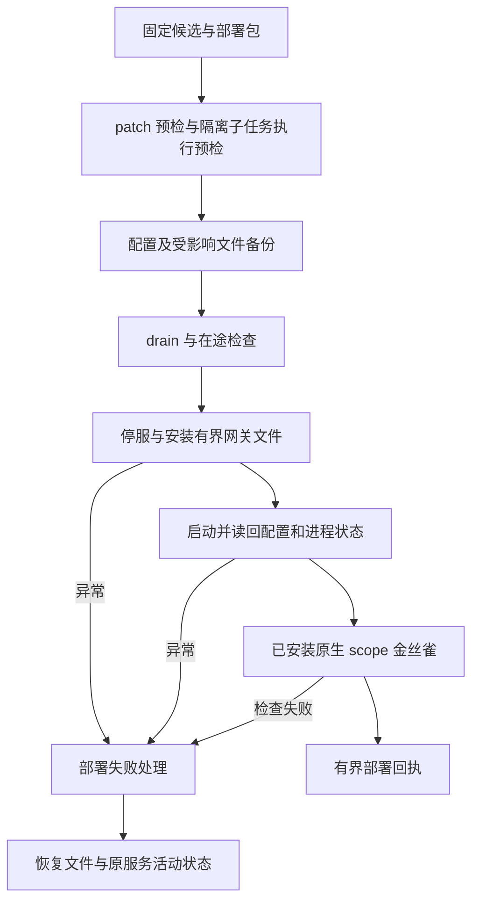

# 005 · 审查与符合性

[首页](../README.md) · [导读目录](README.md) · [完整规范](../MGRS.md)

MGRS 0.1 是设计候选。审查它时，需要分别回答：规则是否清楚、实现是否遵守规则、执行证据能支持多大范围的判断。本页把这几个入口放在一起，依据[规范第 13 至 16 章](../MGRS.md#mgrs-13)整理。

## 当前有哪些材料

| 材料 | 可以据此判断什么 | 阅读入口 |
| :--- | :--- | :--- |
| 16 章规范与 14 条治理不变量 | 协议要约束哪些行为，合同与责任如何划分 | [MGRS.md](../MGRS.md) |
| 编号导读与任务示例 | 怎样理解条款及其相互关系 | [导读目录](README.md) |
| 固定研究记录 | 当时读取了哪些代码与资料，哪些设计有何依据 | [RESEARCH.md](RESEARCH.md) |
| 决定记录与开放问题 | 哪些方向已有明确决定，哪些边界还在讨论 | [DECISIONS.md](DECISIONS.md)、[OPEN-QUESTIONS.md](OPEN-QUESTIONS.md) |
| 原稿与来源清单 | 文本从哪里来，后续如何变化 | [PROVENANCE.md](PROVENANCE.md)、[archive](../archive/README.md) |

原研究的产品基线为 `a8c5bd8a860888e3fa082d3178f9c6f9c534716f`，Hermes 基线为 `c07501ec411b5364e5b12b7258c25a6a4c758545`。规范中的历史实现观察应连同这些版本阅读。此次导读维护没有重新运行产品、调用模型或测试生产环境。

### 历史记录 · 2026-11-09 的候选与证据更新

本次产品总览补核了当前 PR、固定源码与既有 CI 日志，完整来源见[工程基线](sources/2026-11-09-system-baseline.md)。它与上面的原研究基线分别保留。

| 项目 | 当日核实状态 |
| :--- | :--- |
| PR #12 | Open / Draft，head `1dd86db66894ecabcd518be1e5cb1aac8d9fc462` |
| PR #15 | 已合入上述候选；已有跨平台回归及 paired-source 检查成功，真实供应商 CLI、沙箱、全部工具路径与 24h 运行仍按记录验证 |
| PR #14 | 原设计文档 PR 仍为 Open / Draft；独立 MGRS 仓的维护另有自己的提交 |
| 自研搜索策略 | PR #453 已合入实验仓，当前产品候选含策略源码与装配；已有桌面后台单题成功记录，不能抹去或扩写成所有入口已验收 |

本次行为是读取已有证据，没有将复读日志记为新测试。产品与部署目标集中在[总览](MIMI-OVERVIEW.md)，具体搜索策略见[006](006-search-strategy.md)。

## 2026-11-11 组合候选与部署边界

本次文档审阅重读组合候选 `77c853f1` 源码和现有实施记录，更新 002 至 005 的实际调用、所有权和恢复说明。组合候选尚未接受、合并或部署。旧记录中的测试、专项接受和部署事实保留原版本与范围，本轮源码观察标为 `SOURCE_PRESENT`。[本次索引与限制](sources/2026-11-11-integration.md)。

| 核查面 | 本次可确认的源码行为 | 仍需相应运行证据 |
| --- | --- | --- |
| 上下文 | 当前授权快照、跨 scope 词法选择、partial/省略报告 | 真模型最终装配、相关性质量、完整预算协调 |
| Persona | 实际 bundle 编译报告、session 与压缩连续性处理 | 表达质量、内容变更体验、全部失败降级 |
| Skill | 同 Core P6 接线、两 Profile、发布头与授权实时读取检查 | 私有宿主真实配置、批准与场景、全面三级披露 |
| 结果消费 | 依赖输入持久化、最终 envelope 包含与响应 trace | 真模型链路、语义接受、所有入口覆盖 |
| 执行与恢复 | 默认 Hermes、可选 process、epoch/事件重放、取消与 quiet 对账 | 硬崩溃、未知外部效果、长运行及真实供应商矩阵 |
| 部署 | 有界网关部署脚本与完整产品安装入口各有源码 | 当前候选正式部署、设备与生产 API 收单验收 |

总控随后执行的组合回归、安装检查与原已安装模块官方API验证见[实际验证补充](sources/2026-11-11-integration.md#actual-verification)。各自范围不扩张为候选部署或完整符合性。

### 部署脚本实际覆盖的范围



该图简化 `mimi-vnext-deploy.sh` 的门禁关系，备份在 drain 与实际替换前执行。此脚本部署 Orchestration 插件和相关原生 patch，其 payload 范围与 ProductRuntime 完整安装清单分别审查。PR #19 的预检在 drain/停服和替换前执行 staged child 路径，PR #17 的 memory/Skill/Persona 文件需要完整产品安装路径覆盖。脚本包含失败回滚并保留数据库记录，数据库 schema 不随文件回滚；成功的 scope canary 仍保留生产 API intake 为 `UNVERIFIED`。

部署源码存在和历史部署记录不能替代组合候选的实际部署回执。生产验证应固定安装版本、目标环境、进程与配置读回、具名场景、失败恢复和交付事实。公开文档仅保留技术关系与证据范围，私有宿主配置和原始状态由既有私有回执承载。

## 规范中的证据层级

[第 13 章](../MGRS.md#mgrs-13)使用下列标签。它们标识证据覆盖的范围，一个层级不会自动证明下一个层级成立。

| 标签 | 含义 | 阅读时要核对的内容 |
| :--- | :--- | :--- |
| `SOURCE_PRESENT` | 对应源码存在 | 固定提交、路径、相关逻辑 |
| `CONFIGURED` | 能力已经配置 | 目标环境、实际生效的配置与范围 |
| `CONTROLLED_PASS` | 受控验证通过 | 用例、版本、断言、结果与失败样本 |
| `PROVIDER_PASS` | 真实模型验证通过 | 模型与配置、实际请求范围和结果 |
| `DEVICE_PASS` | 真实客户端或设备验证通过 | 设备、入口、执行过程与观测条件 |
| `PRODUCTION_PASS` | 生产环境实际验证通过 | 工作负载、观测时间、失败与恢复记录 |

`NOT_RUN` 表示尚未运行，`UNKNOWN` 保留未知结果。结果持久化、进入请求、被模型响应提及与下游产物通过检查，仍要按[结果交接合同](../MGRS.md#mgrs-5)分别记录。

## 怎样写一项可以复核的判断

可以采用下面的记录格式。它是提交审查材料的写作辅助，不是新增 API、存储 schema 或强制仪式。

```text
涉及条款：Gxx / 章节
检查的主张与范围：
源码与配置版本：
环境、模型或设备：
执行入口与时间：
样本 / 分母 / 具名检查：
观察到的结果：
证据路径或回执引用：
失败、例外与未覆盖部分：
本次判断及适用边界：
```

例如，检查用户修正是否进入后继请求，至少要能对上任务版本、输入记录和实际请求包含关系；要进一步声称结论已经正确调整，还需要检查实际产物。两项判断的证据不同，不能只凭“已追加上下文”的回执同时确认。具体区分见 [G05 / G06](../MGRS.md#mgrs-3)。

## 哪些边界仍需继续讨论或验证

| 主题 | 当前明确的范围 | 仍需解决的部分 |
| :--- | :--- | :--- |
| 上下文与抽屉 | 现有规范描述只读投影、授权过滤和事实视图首版 2000 字符预算 | 最终装配权、预算协调见 Q03 / Q04；相关性与成本收益需实测 |
| 多 Agent 交接 | 按任务版本与证据区分持久、路由、消费和验收 | 不同复杂任务的语义接受标准见 Q05 |
| 验收与主控判断 | 真实回执、用户目标与验收条件各有边界 | 内部验证方法的自主调整范围见 D05 / Q01 |
| 单宿主运行 | 规范要求恢复旧任务、对账未知效果、保留历史 | 生命周期政策见 Q09；真实长运行能力需规定工作负载后测试 |
| 隐私与部署 | 协议规定授权、隔离、撤回与证据要求 | 零访问加密推理为待证技术路径；2C4G 为体量目标，见 D10 |
| 对外材料与许可 | 规范仓库已公开，定位为内部专有协议 | 可公开测试材料与许可边界见 Q12 / NOTICE |

Q 编号对应[开放问题](OPEN-QUESTIONS.md)，D 编号对应[决定记录](DECISIONS.md)。表格说明待决处，不表示对应产品能力都不存在或全部测试失败。

## 文档检查覆盖什么

在仓库根目录运行：

```sh
python3 scripts/verify_archive.py
```

已有脚本核对两份原始 Git blob 和 SHA-256、16 个规范章节、14 条不变量、Markdown 本地链接及显式锚点、规范内 JSON 示例，以及发布清单中的文件。它离线执行，仅依赖 Python 3。

这个检查的通过结果适用于文档完整性。性能、模型行为、设备体验和产品符合性，仍使用对应实现仓库的实际验证入口。也不要将新增导读中的示例当作已经执行的用例。

## 常见阅读问题

| 问题 | 说明 |
| :--- | :--- |
| 可以安装这个仓库来运行秘秘吗？ | 这里是协议、研究与审查材料；产品执行代码属于原产品仓库。阅读和编辑 Markdown 即可参与当前讨论。 |
| ContextEnvelope / ResultCapsule 已经是可调用 API 吗？ | 规范将两者标为拟议合同与结果投影。接入时需对照具体实现、版本和字段映射。 |
| 导读中的任务过程必须全部走一遍吗？ | [第 6 章](../MGRS.md#mgrs-6)允许普通任务简化；复杂度与效果风险决定需要的检查。 |
| README 的架构说明能证明功能已上线吗？ | 它解释协议责任关系。实现状态需回到固定源码、有效配置和执行证据。 |
| 仓库公开后，许可是否随参考项目变化？ | MGRS 保持自己的定位与许可边界，见 [NOTICE.md](../NOTICE.md)。 |

提出修改时，优先给出具体条款、实际失效场景、证据与替代文字。维护方式见 [CONTRIBUTING.md](../CONTRIBUTING.md)。

[上一章：004 · 执行与证据](004-execution-and-evidence.md) · [下一章：006 · 自研搜索策略](006-search-strategy.md) · [回到完整规范](../MGRS.md)
