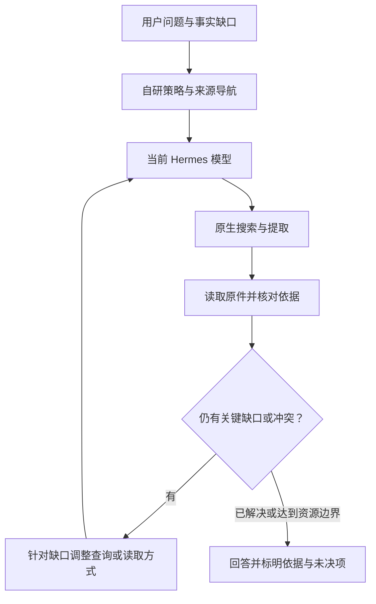

# 006 · 秘秘自研搜索策略

[首页](../README.md) · [文档导航](README.md) · [产品与系统总览](MIMI-OVERVIEW.md) · [工程依据](sources/2026-11-09-system-baseline.md#source-search)

**秘秘自研搜索策略，是项目作者为 Mimi 自主设计的搜索与证据获取方法。** 它规定 Agent 什么时候需要搜索、怎样构造查询、如何定位和读取原件、怎样判断材料能够支持的结论，以及何时继续追查、何时停止并回答。

这套策略已有对应的 `mimi_search_strategy` 插件、`policy.md` 和来源导航配置，并已进入当前产品集成候选。它通过 Hermes 原生 hook 接入正在工作的模型，检索与提取继续使用已配置的 `web_search` / `web_extract`。策略设计和工具执行分别承担自己的职责；复用工具接口不改变秘秘自研策略的归属。[固定源码与历史记录](sources/2026-11-09-system-baseline.md#source-search)。

## 自研策略具体负责什么

| 环节 | 策略中的工作方法 |
| :--- | :--- |
| 搜索触发 | 根据时效、不确定性、明确核查要求和材料访问情况决定是否查询；用户材料足够的改写可直接完成 |
| 查询组织 | 分清实体、地区、时间、版本与事实缺口，先定位，再用正式名称、标题、文号或精确短语收窄 |
| 原文阅读 | 把搜索标题、摘要和链接作为候选，选择能够直接回答问题的原件，读取后定位相关段落与表格 |
| 来源判断 | 区分发布者陈述、独立实测、原始研究、综述和个案体验，根据材料能支持的主张使用它 |
| 按缺口追查 | 后续查询针对未解决的问题、冲突或缺失部分；提取失败时处理访问与读取路径，保留已获得的有效结果 |
| 停止与表达 | 核心问题已有直接证据且重要冲突已处理时回答；预算用尽时交付已知部分并说明具体缺口，引用实际取得的来源 |

这些规则构成一个连续的方法体系。来源语言只是其中一个选择因素，不能概括成单一的“英文优先”。

## 资料语言、来源导航与用户限制

查询语言根据资料产生地、正式名称和当前证据缺口选择。国际技术资料保留原始英文术语，跨地区问题分别查阅对应原文；处理中国内地或港澳台主体时，按实际需要保留当地名称、文号和语言变体。回答语言不机械决定查询语言。

用户明确的来源与语言限制继续约束当前任务。来源导航只在任务相关、用户允许时使用。当前配置包含政策法规、统计数据、公司披露、学术技术、产品软件和新闻社会经验六类导航；域名是帮助定位的线索，不能自行赋予访问权限或证明内容真实。

对研究材料的判断同样按问题而定。社区记录可以支持一个人的体验和表达；统计比例需要适合的样本与口径；公司对自身产品的介绍可以说明其主张，独立效果仍需相应证据。这些区别都属于秘秘自研搜索策略的认识质量要求。[策略原文](https://github.com/mor765504-gif/Mimi-Superagent/blob/1dd86db66894ecabcd518be1e5cb1aac8d9fc462/backend/deploy/hermes/plugins/mimi_search_strategy/policy.md)。

## 怎样接入现有 Harness

| 层次 | 负责内容 | 当前入口 |
| :--- | :--- | :--- |
| 自研策略层 | 搜索工作方法、来源导航与停止规则 | `policy.md`、`source_guides.json` |
| 请求装配层 | 将策略和相关导航加入当前轮上下文 | `register(ctx)` 注册 `pre_llm_call`，返回临时 `context` |
| 模型与工具层 | 当前模型根据问题推进查询、阅读和后续动作 | Hermes 原生 Agent Loop、`web_search`、`web_extract` |
| 检索与提取后端 | 执行网络检索和正文获取 | 宿主已配置的 provider |
| 权限与事实层 | 确定可读取的资料、可调用的能力及真实执行记录 | 既有宿主授权、工具门禁与原生回执 |

插件在本地读取策略文件，最多附加两个匹配的来源导航。它不另起规划模型或持久研究账本。搜索引擎与索引由实际 provider 提供；本项目的自研范围是搜索策略、来源导航与宿主接入。

ProductRuntime 中已有检查、复制插件并追加启用项的装配路径。源码存在、宿主配置生效和一次请求实际使用策略，仍分别用相应证据说明。[实现与装配入口](sources/2026-11-09-system-baseline.md#source-search)。

## 一次搜索怎样推进

下图是对现有策略的工作过程说明，不新增运行服务或强制状态机。

模型负责根据问题选择具体方法；宿主负责实际工具调用与权限。读取局部材料时说明访问范围，无法取得原件时保留缺口，不把搜索摘要或转述写成亲读全文。这与 MGRS 对输入消费、结果依据和证据层级的要求相接，参见 [G06 / G09 / G13](../MGRS.md#mgrs-3)。

## 当前代码与证据状态

核查日期为 **2026-11-09，北京时间**。以下同时保留已经完成的工作与实际验证范围。

| 项目 | 已确认内容 | 证据范围 |
| :--- | :--- | :--- |
| 实验仓集成 | [assisthub PR #453](https://github.com/mor765504-gif/assisthub/pull/453) 已合入 `main` | 合并时间 2026-11-03 02:58:08，合并提交 `90d1adc2e885c0a6f62f27a57f31347ccaca0320` |
| 产品候选 | PR #12 的 `1dd86db6` 包含策略、hook、manifest、来源导航与宿主装配入口 | 固定候选源码核查；不等同于所有运行入口均已验收 |
| 历史请求注入 | 2026-11-02 CLI 记录证明策略进入实际模型请求 | 同次工具调用被既有入口守卫拒绝，保留为独立事实 |
| 历史搜索链路 | 随后的原生桌面后台单题记录包含两次搜索、两次原文提取与最终回答 | 已有实际链路记录；本次未重新运行，不扩写成全部题型或 GUI 点击验收 |
| 后续生产配置 | 2026-11-03 历史记录包含重启后的插件启用配置读回 | 配置与进程记录不代替生产 gateway 每个真实搜索请求的独立证据 |

历史记录来自固定候选内的插件 README，本次没有读取其私有原始会话。四个策略运行文件与原实测基线 `c6f79ed132631fc53a99f565ff0fb108162038af` 的 Git blob 一致，详见[核验索引](sources/2026-11-09-system-baseline.md#source-search)。

自研策略的设计归属、已有代码与已有链路记录可以明确说明；搜索质量、延迟与成本的改进幅度，需要对应任务样本的比较证据。后续讨论可围绕已有规则和具体失败样本继续完善。

[上一章：005 · 审查与符合性](005-review-and-conformance.md) · [产品与系统总览](MIMI-OVERVIEW.md)
