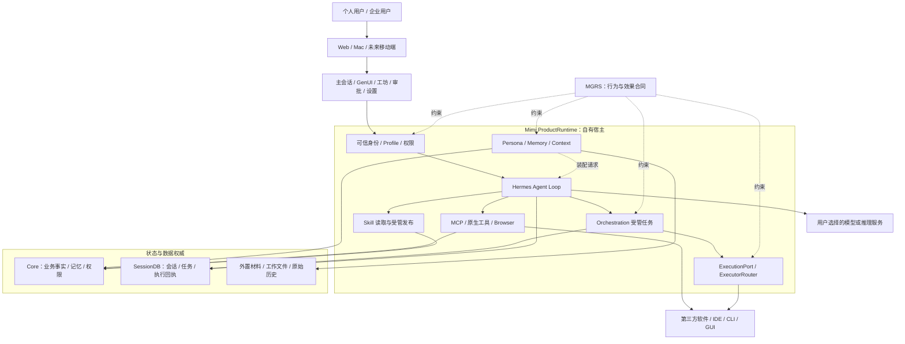
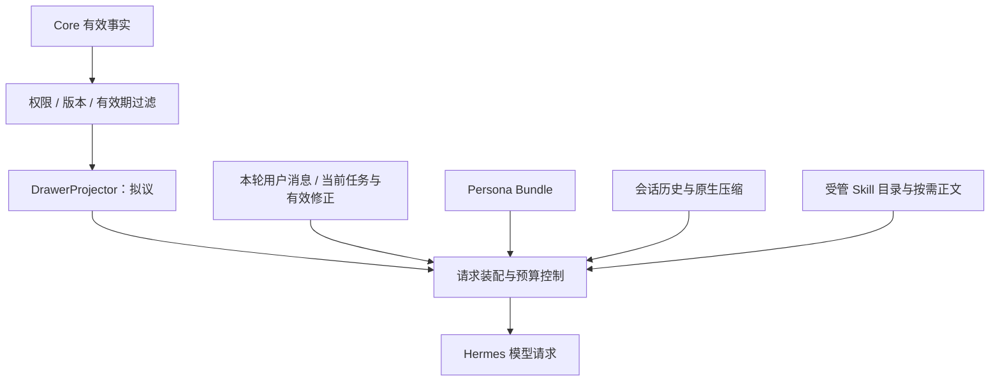
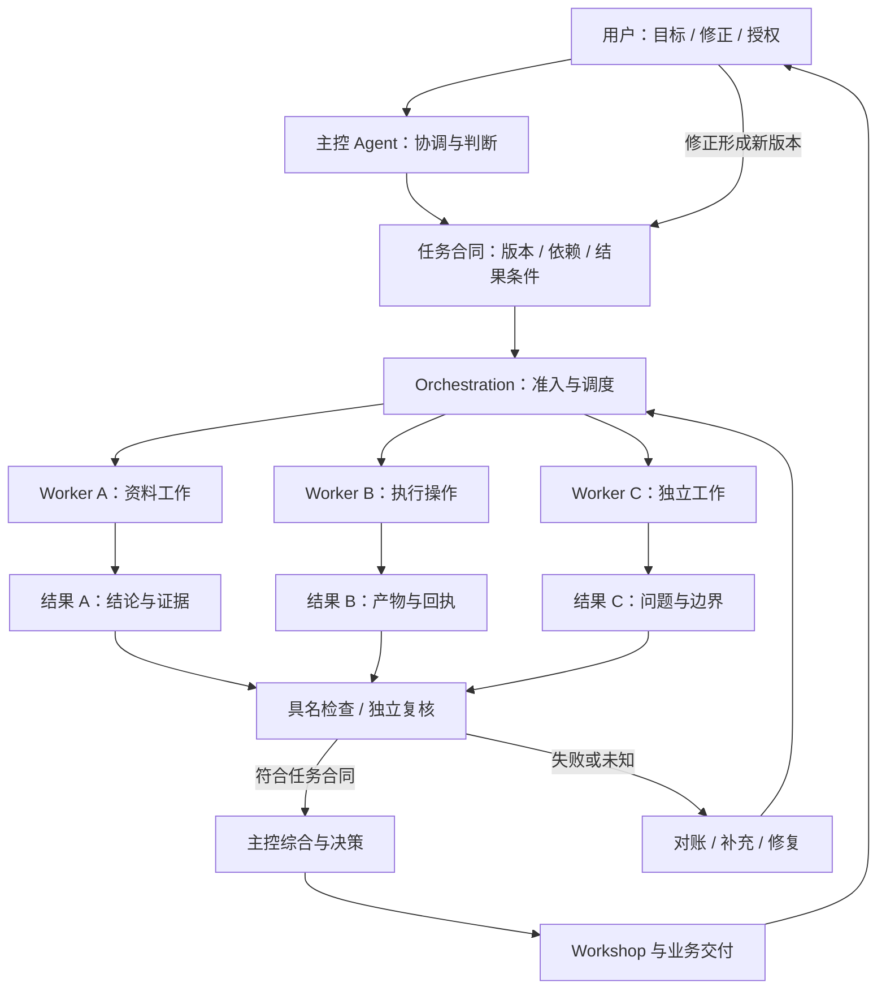
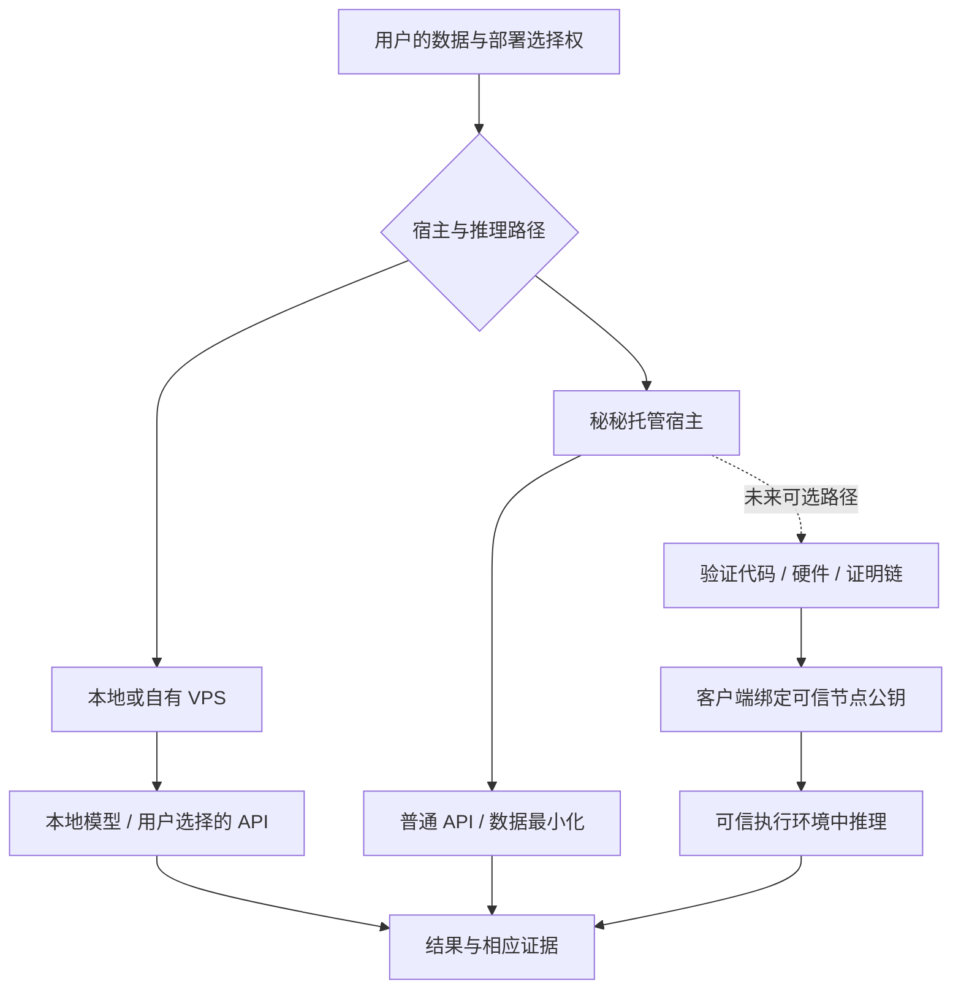

# 秘秘 Mimi：产品哲学、系统架构与 MGRS 治理协议

[首页](../README.md) · [文档导航](README.md) · [MGRS 规范](../MGRS.md) · [自研搜索策略](006-search-strategy.md)

**更新日期：2026-11-09，北京时间。** 本文整理项目所有者确认的产品方向、现有系统分工和 MGRS 0.1 的治理主张。工程状态以本次固定源码与 GitHub 记录为依据；设计目标、拟议合同和需要继续验证的能力在对应位置说明。

## 三个相互关联的对象

**Mimi 是产品。** 它面向个人与企业，提供持续运行的 AI 工作空间，将交互、记忆、任务执行、跨软件协作和结果交付组织在一起。

**Mimi Harness 是技术实现。** 它通过自有宿主集成 Hermes 内核、Core、Persona、Memory、MCP、Skill、工坊和统一执行网关，负责模型与真实环境之间的运行关系。

**MGRS 是治理协议。** 它约束组件和 Agent 的可观察行为、权限、交接、执行效果、验收与恢复，不规定模型内部必须采用怎样的思考过程。

三个对象各有职责。MGRS 可以约束秘秘各项能力之间的关系，其执行仍由已有宿主和业务组件承担，不增加一个单独运行的“超级管理 Agent”。

## 目录

- [一、秘秘的产品哲学](#overview-1)
- [二、实际工程基线](#overview-2)
- [三、完整组织架构](#overview-3)
- [四、Persona、Memory 与上下文治理](#overview-4)
- [五、MCP、Skill、自研搜索策略和统一执行网关](#overview-5)
- [六、多 Agent 协作与工坊](#overview-6)
- [七、机密计算与数据自主权](#overview-7)
- [八、MGRS 怎样约束整套系统](#overview-8)
- [九、个人端、企业端与商业模式](#overview-9)
- [十、工程问题与验收重点](#overview-10)
- [十一、对外讨论的核心论述](#overview-11)
- [十二、MGRS 的审查材料与推进方向](#overview-12)

## 一、秘秘的产品哲学

秘秘是一种以用户自主权为中心、能够持续理解和执行任务的 AI 工作空间。它通过长期记忆与人格系统维持交互连续性，通过多 Agent 协作和跨软件操作完成复杂工作，通过可视化界面降低信息理解与操作成本，并通过可选择的部署方式和可验证的隐私技术，让用户尽可能保留对数据、模型、工具及计算资源的控制权。

秘秘支持用户继续使用既有软件生态，也让用户能够按需要选择部署方式。用户可以自行部署，或选择付费托管服务，无须为了使用 Agent 先购买昂贵的本地模型设备。更高等级的机密计算能力，是需要独立验证和逐步实现的目标。

这套产品方向可以分为六项原则。它们首先说明用户应当获得什么体验，具体能力的实现与验收仍按各自证据判断。

| 产品原则 | 希望改变的体验 | 对应技术 |
| :--- | :--- | :--- |
| 连续性 | 用户不必每次重新介绍自己、项目和之前的决定 | Persona、Memory、Session、上下文治理 |
| 行动能力 | 用户提出目标后，系统能够调用工具和软件实际工作 | Hermes、MCP、CLI、GUI、浏览器 |
| 协作可靠性 | 多个 Agent 分工后，不丢任务、不虚假完成、不重复执行，并使任务、要求、结果和实际效果持续可追溯 | MGRS、Orchestration、Workshop |
| 生态自由 | 用户可以选择模型和软件，不被迫作排他性生态选择 | 多模型配置、连接器、统一执行网关 |
| 信息可理解性 | AI 提供可阅读、可操作的信息，帮助用户掌握复杂工作 | GenUI、流式渲染、证据卡片、工作区 |
| 数据自主权 | 用户可以选择部署、迁移、服务商和隐私保护方式 | 自部署、用户数据域、权限、未来机密计算 |

### Personal Agent 与 IDE 的产品层次

Personal Agent 围绕一个人的长期工作、生活、项目和信息环境组织交互。IDE 主要围绕软件开发对象和开发工作流组织交互。两者可以连接，也可以在同一项工作中各自发挥作用。

IDE 可以成为秘秘调用的工具或工作场景。秘秘可以通过 MCP、CLI、GUI、文件与原生接口连接开发工具，保留 Personal Agent 的持续交互、上下文和任务组织方式。

### 人格、记忆与交互连续性

秘秘所追求的“人味”，是一种具有事实依据的交互连续性：保有相对稳定的表达风格，识别当前谈话与过往经历的关系，在工作、玩笑、困难和纠错时作出不同而连贯的反应。

Persona 组织交流方式与角色连续性；Memory 为正确理解交谈背景提供事实基础。二者需要合作，同时保留各自的来源、写入职责和验证方式。固定口头禅或亲切语气，不能替代对实际背景的理解。

### 生态中立与跨工具协作

秘秘希望在获得授权后，帮助用户跨工具完成任务。Microsoft、Google、飞书、企微和其他既有工具，都可以成为用户工作环境的一部分。模型供应商与宿主供应商也应尽可能可替换。

这项原则表达的是用户选择权。它不以其他产品无法实现相同功能为成立条件，也不要求用户放弃已有的软件投入。

### 部署选择与数据自主权

用户可以在本地宿主、自有 VPS、托管资源和未来可信计算服务之间选择。秘秘软件本身免费；付费托管对应用户选择的计算资源、部署和运维服务，不按传统 SaaS 的功能或席位许可收费。Agent Payment 仍属于技术探索，不属于当前已确认商用接入的能力。

产品希望提供托管便利，同时让用户保有数据、模型与迁移选择。若进一步提出“服务商技术上无法访问推理明文”的保证，则需要机密计算系统给出独立证据，普通云托管不能直接代替这项保证。隐私路径见[第七节](#overview-7)。

## 二、实际工程基线

本次更新区分集成候选、已合并代码、规范提案与运行验收。固定提交和核验入口集中保存在[工程基线记录](sources/2026-11-09-system-baseline.md#source-prs)。

| 对象 | 截至本次核查的状态 | 适用范围 |
| :--- | :--- | :--- |
| Mimi-Superagent PR #12 集成候选 | Open Draft，head `1dd86db66894ecabcd518be1e5cb1aac8d9fc462` | 产品整合仍在 `release/mimi-rc-20261105` 候选分支，不能当作 `main` 或生产版本 |
| Mimi-Superagent PR #15 统一执行网关 | 2026-11-08 21:27:11 已合并到 PR #12 的候选分支，merge 为 `1dd86db66894ecabcd518be1e5cb1aac8d9fc462` | 网关代码已进入整合候选；合并记录不代表生产启用 |
| Mimi-Superagent PR #14 MGRS 规范 | Open Draft，head `ad62b7f1301fa96474c160a7e58d2188785d7311`，base 为 `main` | 原产品仓中的协议与抽屉设计提案；本独立仓维护规范编辑版与讨论材料 |
| assisthub PR #453 自研搜索策略 | 2026-11-03 02:58:08 已合并，merge 为 `90d1adc2e885c0a6f62f27a57f31347ccaca0320`；当前整合候选包含相关实现 | 自研策略有源码与历史运行依据，本轮复读记录，未重跑产品测试 |

时间均为北京时间。这里的 Hermes、Core、Persona、原生多 Agent 调度和统一执行网关，都有对应的源码或历史实现依据；它们的集成状态、受控测试、真实模型测试和生产运行分别记录。

PR #15 已记录统一执行网关的跨平台回归通过，同时保留真实供应商 CLI、OS 沙箱、全部终端调用路径和 24 小时运行的待验收边界。后续工作继承这些已有成果与具体边界，不能重新归类为尚未开发，也不能把局部回归升级为全部产品能力已完成商用验收。[验证范围与来源](sources/2026-11-09-system-baseline.md#source-prs)。

## 三、完整组织架构

秘秘以自有宿主作为产品组织根节点。Hermes 提供原生 Agent Loop；产品身份、数据、权限、业务功能、运行生命周期和最终交付，由宿主与各业务组件共同承担。

下面的图表示主要职责和信息关系。实线表示运行或数据联系，虚线表示协议约束或上下文装配；它不是进程部署图，也不表示图中每项能力都已完成当前产品验收。DrawerProjector 与完整 MGRS 合同仍属于设计提案。

图中最重要的是各组件的权威边界。ProductRuntime 负责装配与生命周期，Hermes 负责模型的工具调用循环，Core 负责业务事实与相应数据权限，Orchestration 负责受管任务，Workshop 负责工作的观察、验收与交付。MGRS 规定它们之间必须满足的条件，其规则由这些现有组件实现。[运行组件依据](sources/2026-11-09-system-baseline.md#source-runtime)；[规范第 2 章](../MGRS.md#mgrs-2)。

### Harness 的职责

Harness 是管理模型与真实环境交互的运行系统。模型负责理解目标、生成行动方案、判断何时使用工具和解释结果；Harness 负责提供可用工具、管理会话、约束权限、实际执行、记录回执和处理故障。

| 部分 | 职责 | 工程或规范入口 |
| :--- | :--- | :--- |
| Mimi ProductRuntime | 统一启动、配置、装配和关闭 | `mimi_product_runtime.py` |
| Hermes | 原生推理循环、工具调用、会话机制和委派 | 固定版本 Hermes 内核 |
| Core | 业务事实、持久记忆、用户操作和授权 | `assisthub_core` |
| Mimi Plugins | 对原内核作有边界的扩展 | `mimi_tavern`、`mimi_memory`、`mimi_orchestration` 等 |
| MGRS | 规定组件间的行为合同与验收条件 | [MGRS 0.1 规范](../MGRS.md) |

这些源码路径属于 Mimi 产品实现，固定版本与完整位置见[基线记录](sources/2026-11-09-system-baseline.md#source-runtime)。

秘秘继续复用 Hermes 的 LLM Agent Loop。自主控制的重点是其上的产品组织、上下文策略、权限、协作与交付体验。模型能力与 Harness 能力也分别判断：模型可以提出调用工具，但当前调用是否获准、执行是否重复、结果是否需要回读，必须由宿主机制与实际证据决定。

## 四、Persona、Memory 与上下文治理

Persona、Memory 和 Context 一起支持长期交互连续性，又各自回答不同问题：人物怎样交流，系统掌握哪些事实，以及当前请求实际包含什么。

### Persona：秘秘以怎样的身份和方式交流

现有 `mimi_tavern` 的工程基础包括 Character Card、配置叠加、Lorebook、条件示例、会话侧状态和请求编译机制，并复用 Hermes 原生压缩能力。当前组件与装配证据见[运行基线](sources/2026-11-09-system-baseline.md#source-runtime)。

Persona 可以从三个方面组织：

| 部分 | 内容 | 需要保留的边界 |
| :--- | :--- | :--- |
| 身份核心 | 长期稳定的交流方式、行为边界和角色连续性 | 人物描述不签发数据或工具权限 |
| 场景切面 | 日常沟通、研究、工作、企业操作等语境下的表达 | 切换表达不改写当前任务事实 |
| 会话侧状态 | 本轮语境与表达连续性 | 临时状态不直接写成长期记忆 |

Prompt 表达语言、人物特征与示例；JSON 表达版本、触发条件、场景、预算和来源。两种表示应当对应同一份受管理的人格来源，避免维护互相冲突的人格事实。

独立候选使用公开中性 Persona 模板，与原有私人人格存在不同配置来源。正确加载哪份人物内容，仍需要明确的受管配置与迁移规则。模板的表现不能直接代表原有私人人格的效果，也不能通过覆盖未迁移配置来绕开冲突。[装配核查入口](sources/2026-11-09-system-baseline.md#source-runtime)；[规范第 9 章](../MGRS.md#mgrs-9)。

### Memory：秘秘知道并能够回忆什么

记忆分层优先依据数据性质，而非固定时间长度。长期事实、事务状态、会话历史和本轮视图，具有不同的更新频率与权威来源。

| 层次 | 应存放的信息 | 实际权威 |
| :--- | :--- | :--- |
| 长期事实 | 用户明确稳定的偏好、关系、项目背景、长期决定 | Core Memory |
| 事务状态 | 任务、日程、等待事项、当前项目进度 | Core 业务模块与 Orchestration |
| 会话历史 | 用户与 Agent 的实际对话、工具观察、上下文摘要 | Hermes Session 与历史材料 |
| 本轮抽屉 | 当前需要的事实、任务依据、相关经历 | 从现有来源生成的只读投影 |

抽屉要回答的是：当前任务应从前面几层取什么给模型。它保留原始事实和材料的权威归属，不新增另一本可写记忆账本。

本次所对照的记忆投影实现中，`_rebuild_prompt()` 按 `read_scopes` 顺序遍历，每个 scope 内的 facts 按 `subject_key` 排序，在包含 header 的 `len()` 2000 字符预算内选择自动记忆，尚未按当前问题完成相关性排序。这里存在可以集中在局部实现的优化空间。2000 的单位是字符，限于事实视图首版预算，不代表整个模型上下文容量。[实现与访问范围](sources/2026-11-09-system-baseline.md#source-runtime)；[上下文导读](003-context-and-memory.md)。

### Context：模型这一轮实际看到了什么

上下文治理把当前用户消息、任务合同、Persona、有效事实、历史和方法目录装配到一轮请求中。下图是拟议的职责关系，不新增独立上下文服务；跨来源预算与最终装配权仍需按现有开放问题细化。

装配时，稳定系统规则和 Persona 核心应尽量保持稳定，避免无谓破坏前缀缓存。本轮明确要求和未消费的任务修改具有更高保真要求，不能与普通记忆竞争排序。情境记忆按相关性进入有界预算，原件和 Skill 正文保留读取入口，需要时展开。

授权撤销、到期、用户修正与已验证结果变化时，相关装配必须立即刷新。必需约束超出预算时，应保持实质含义地压缩、分阶段读取或拆分任务；仍无法容纳就明确报告受阻，不静默删除要求。[规范第 4 章](../MGRS.md#mgrs-4)。

### 冷启动和滚动压缩

每次请求可以重新投影抽屉，原生会话在达到既定条件时才执行压缩。两者的触发条件和责任不同，不需要每轮重新压缩全部历史。

会话达到预算门槛时，继续使用 Hermes 原生机制滚动压缩。任务、来源材料与原始会话记录保持可回查的持久身份，压缩后重新装配当前 Persona、有效任务要求和记忆。冷启动则先确认身份与权限，恢复原生任务和会话，核对未决效果，再重建本轮视图。

用户体验上的连续性，需要原件、版本引用、必要约束和按需回读共同支持。摘要无法单独保证保留任意细节。产品目标可以表述为：**让计算上下文可以更换，让人的工作连续性不必随之中断。** [规范第 4、11 章](../MGRS.md#mgrs-11)。

## 五、MCP、Skill、自研搜索策略和统一执行网关

这些组件分别处理工具连接、工作方法、信息检索、执行后端与推理隐私，边界需要保持清楚。

| 组件 | 核心问题 | 能力边界 |
| :--- | :--- | :--- |
| MCP | 如何连接和调用外部工具？ | 提供工具接口与传输，调用仍需当前授权 |
| Skill | 遇到特定任务应该怎样工作？ | 提供方法、流程与知识，不签发执行权限 |
| 秘秘自研搜索策略 | 如何组织查询、选择来源并核对信息？ | 自研策略层指导查询、阅读与核验，当前模型经宿主调用检索工具 |
| 统一执行网关 | 一项受管任务应由哪个执行后端执行？ | 选择执行端口，沿用原有任务调度与持久状态 |
| 隐私推理网关 | 数据在外部算力上怎样获得隐私保障？ | 处理推理数据的安全边界，与执行网关分工不同 |

### MCP 的连接与调用职责

秘秘复用 Hermes 原生 MCP 管理和工具调用。MGRS 要求工具真正执行前经过宿主当前权限判断，并保留对应效果回执。

前端发现某项工具、Skill 提到某项工具、模型准备使用某项工具，分别是可见性、方法与行动选择层面的事实。它们都不能替代执行授权。工具已安装也不意味着该服务中的所有操作获得同一权限。[规范第 7 章](../MGRS.md#mgrs-7)。

### Skill 作为可复用的工作方法

探索设计、表达编辑和监督检查，可以由秘秘自己的技能体系承载。探索性设计支持比较方案，编辑支持保留原意与证据强度，复杂工程任务支持主动检查验收依据。是否使用某个技能，取决于当前工作需要，不将它们变成每轮对话的固定步骤。

现有 Skill P6 已建立候选、验证、批准、发布与恢复的治理基础，并有历史真实发布及原生消费记录。需要继续核对的是：当前整合宿主实际读取了哪些批准目录，自动学习形成的候选如何经过受管发布进入运行环境。历史成果、当前装配和自由自动改写是不同范围的事实。[运行与历史依据](sources/2026-11-09-system-baseline.md#source-runtime)；[规范第 8 章](../MGRS.md#mgrs-8)。

### 秘秘自研搜索策略

**搜索策略是秘秘自研的策略能力。** 它组织查询、选择资料产生地和原始语言、安排来源核验及结果使用方法，并结合用户的明确来源限制。其设计归属不因调用现成检索接口而改变。

这套策略通过 Hermes 现有的 `web_search`、`web_extract` 等工具取得和读取材料。底层工具负责检索或提取，秘秘自研搜索策略负责决定搜索什么、怎样搜索、优先查哪些来源，以及哪些材料能够支持相应结论。自研范围是这一方法与策略层，不能由此推导已经自建全网爬虫、索引和搜索引擎基础设施。

“英文信息源优先”可以表达某些场景下的来源偏好。实际策略更具体：依据资料产生地、原始语言、来源可靠性和用户明确限制选择检索方式；专业问题优先核查原始资料。这里说明的是自研策略内部怎样作判断，不改变其自研属性，也不把来源质量简化为单一语言排序。

实验仓 PR #453 已合并相关策略工作，当前整合候选也包含实现。既有 README 记录了 2026-11-02 原生桌面后台单题“搜索 → 提取 → 回答”的成功流程，2026-11-03 的生产启用记录包含该插件。这些是已有源码与历史运行证据，本次维护复读了相应记录，未重新执行该流程，也不由单题记录推导整体搜索效果排名。固定策略文件、加载位置与候选接线范围，见[自研搜索策略专页](006-search-strategy.md)和[搜索实现证据](sources/2026-11-09-system-baseline.md#source-search)。

### 统一执行网关

统一执行网关把实际执行后端抽象为 `ExecutionPort`，再通过 `ExecutorRouter` 为已接收的任务绑定执行端。当前 Router 包含 `hermes` 与 `process` 两类任务后端：原生 Hermes 继续作为默认后端，CLI 子进程通过宿主显式配置的 process 端口接入。

`AgyInferencePort` 使用同一配置与授权体系，通过 `runner._mimi_inference_ports` 注册并提供单独的 `infer_once` 推理入口。它的职责与完整任务执行端口不同，不能计作 Router 的第三种完整 Agent 后端。

同一任务的要求版本、attempt、结果和恢复继续依赖原有持久状态。执行后端变为某个 CLI 时，任务仍属于原有治理合同，不生成一套独立调度系统。

PR #15 已合入整合候选。真实供应商 CLI、全部工具路径统一、OS 沙箱和生产启用，继续按各自验收范围判断。[固定代码与验证边界](sources/2026-11-09-system-baseline.md#source-prs)。

## 六、多 Agent 协作与工坊

多 Agent 的核心问题已经超出并行产生输出：系统需要在分工、修正、验证和恢复过程中，维持同一项工作的正确性。

工坊的组织方式是由一个持续负责的协调者，按任务需要调用零个、一个或多个独立 Worker。任务依赖、写入范围、资源和结果条件决定分工方式。验证是一项职责，可由确定性检查或适当的独立复核承担，不必为所有任务常驻一名监督 Agent。

下图展示复杂任务的职责关系，不要求普通请求完整经过所有节点，也不引入新的调度器或数据库。

### 三项责任

**协调者负责规划、综合与决策。** 它判断怎样拆分工作、怎样处理相互冲突的结论，以及何时需要用户决定。协调判断不能改写真实执行历史，也不能把未通过验收的产物标为已验证。开发治理中的 C0 与产品运行角色应保持具体映射，不把工程控制台的名称和容量硬编码给所有用户。[规范第 1、5、6 章](../MGRS.md#mgrs-5)。

**Worker 负责边界明确的执行。** 它可以有自己的上下文、模型、工具和工作目录；这些能力按具体任务授予。收到任务不代表继承主控的全部权限或私人信息。

**验证者负责对照合同与证据作判断。** 简单任务可使用确定性检查，复杂交付可独立复核。验收强度由任务目标和实际效果决定，不依赖固定的多模型投票流程。[规范第 6、13 章](../MGRS.md#mgrs-13)。

### Agent 之间怎样交接知识

现有工程包含输入版本、执行回执、任务依赖，以及 `request_included`、`step_observed` 等机制。它们区分消息被保存或排队、进入实际请求和产生相应响应等事实。实现范围见[运行基线](sources/2026-11-09-system-baseline.md#source-runtime)。

MGRS 进一步提出 `ResultCapsule` 结果投影，让下游知道上游完成了什么、证据来自哪里、判断在哪些条件下成立、哪些问题仍未解决，以及产物对应哪个版本。这一拟议合同优先复用已有结果与材料字段。

| 交接层级 | 能够证明什么 |
| :--- | :--- |
| Durable | 正确执行尝试的结果已经持久保存 |
| Routed | 结果已到达正确的授权接收路径，会话可以追溯 |
| Consumed | 内容进入实际模型请求，并观察到相应响应 |
| Accepted | 接收者的后续产物通过既定合同中的具名检查 |

前三层说明交接过程中发生了什么，第四层才涉及后续产物是否满足结果条件。模型产生了回答，不能单独证明它正确吸收了上游所有判断。

任务要求发生变化时，要形成新版本。旧 result 不能满足新 requirement，相关下游依据失效并等待确认，不能悄悄重绑依赖。原始材料可以在授权有效时继续读取，但材料复用不能替代新版结果的有效性判断。依据见 [G05](../MGRS.md#mgrs-3) 与[结果合同](../MGRS.md#mgrs-5)。

MGRS 因而围绕真实结果、证据和版本组织团队推进方式，不要求 Agent 为了满足形式而互相发送固定数量的消息。

## 七、机密计算与数据自主权

秘秘希望让普通用户在不购买昂贵模型服务器的情况下，也能使用质量合适的推理服务并获得尽可能强的数据保护。不同部署路径提供不同的控制权与信任边界，必须分别说明。

### 路径一：自部署

用户自行持有宿主、数据、密钥和系统控制权，决定使用本地模型还是外部模型 API。这条路径减少对秘秘托管服务的依赖。

推理服务的选择仍影响数据可见范围。若调用普通外部 API，宿主自部署并不能证明推理明文对该 API 提供方不可见。

### 路径二：托管与普通模型 API

秘秘可以提供服务器、部署、运维和统一模型入口，降低配置与维护成本。在这一路径中，可以使用数据最小化、权限控制、传输加密、敏感字段脱敏和日志保护。

这些措施各自有价值，但不能据此声称运营方技术上绝对无法接触明文。“托管一个 Agent”与“提供具有硬件隔离保证的私密推理”，需要分别描述和验证。

### 路径三：可证明的机密推理

要实现算力运营方无法任意查看用户推理明文，需要完整的可信计算边界。验证实际运行的代码和硬件环境，使密钥只释放给符合证明条件的节点，并限制管理员、日志、调试与中间网络层等访问路径，都是这条链中的具体问题。

技术说明还需要交代可信硬件、固件、侧信道和供应链等残余信任与风险。平台支持某种机密计算能力，不能直接证明应用自己的客户端加密、密钥释放、模型部署和工具调用全部满足目标。

### Mac Studio 与专用机密计算基础设施

普通 Apple Silicon Mac 中的 Secure Enclave 是隔离的安全子系统，提供密钥等敏感操作的保护。它的存在不能直接证明通用模型推理所使用的 CPU、GPU 或统一内存已经获得面向运营方的远程 TEE 隔离。

Apple Silicon 版 Private Cloud Compute 使用专用服务器硬件、强化的软件栈、受限制的运维能力与可验证机制。Apple 也于 2026-06-08 宣布向 Google Cloud 与 NVIDIA 平台扩展 PCC。因此，PCC 的具体能力需要按实际硬件与部署方案判断，不能把它概括为任意 Apple Silicon 设备自动具备的属性。普通 Mac Studio 上启动 MLX 服务，与完整复现 PCC 的安全属性之间，需要独立的工程与证明。Mac Studio 可以承担低功耗模型部署实验，但推理性能与运营方零访问保证应当分别取得证据。[Apple 官方依据](sources/2026-11-09-system-baseline.md#source-privacy)。

云端 Confidential GPU 也是需要纳入验证的技术候选。Google Cloud 于 2026-10-21 宣布 Confidential G4 GPU 实例正式可用，其 GPU 为 NVIDIA RTX PRO 6000 Blackwell Server Edition。该支持范围不能泛化为 6000D 或任意多卡组合。供应商能力应被视为构建应用全链路保证的基础条件，不能替代秘秘自身的客户端加密、密钥释放、模型部署、日志与工具调用验证。[云端机密计算依据](sources/2026-11-09-system-baseline.md#source-privacy)。

### 将隐私承诺转成可核验条件

秘秘希望把尽可能多的隐私承诺转化为可验证的技术条件，使用户不必完全依赖运营方的自我声明。

这仍需要明确可信根、实现版本、证书和证明链、日志、软件更新及运营制度。技术验证能够减少某些依赖，不能消除所有信任问题。MGRS 对这类能力的作用，是要求声明与实际证据、适用条件和故障处理相对应。[证据要求](../MGRS.md#mgrs-13)。

## 八、MGRS 怎样约束整套系统

**MGRS（Mimi Governed Runtime Standard）是秘秘面向自主 Agent 与多 Agent 协作设计的专有治理协议。它通过可验证的身份与权限、版本化任务契约、可追溯的上下文交接、执行效果回执及故障恢复规则，使 Agent 在保持自主决策能力的同时，其协作过程、外部行为和交付结果能够被审查、纠正与可靠恢复。MGRS 约束 Agent 的可观察行为及实际效果，不强制规定模型内部必须采用何种思考过程、规划顺序或特定模型架构。**

这一主张需要落实为可由代码执行、可用证据检查的合同。当前规范集中在 [MGRS.md](../MGRS.md)，本页解释产品、实现与协议之间的联系。

### 六项核心保证

下表中的“保证”是协议要求实现满足的目标，不是对当前产品全部符合性的宣告。

| 保证 | MGRS 要求的行为 | 实现仍保留的选择 |
| :--- | :--- | :--- |
| 身份与权限 | 当前主体、资源与操作均经过可信授权 | 不同 Agent 可以使用不同模型与受授权工具 |
| 任务与版本 | 任务修改具有新版本；旧结果不能满足新要求，相关下游依据失效并等待确认 | 普通请求可以采用轻量任务路径 |
| 上下文交接 | 必需输入来源明确，可以确认是否进入最终请求 | Worker 按需要获得上下文，不要求共享全部历史 |
| 执行效果 | 非幂等操作具有稳定标识，未知效果能够对账 | 已有有效授权内直接推进，按影响等级使用审批 |
| 结果验收 | 成功依据具名合同和真实证据 | 确定性检查、原件复核或适当独立评审 |
| 故障恢复 | 重启、压缩和切换后保留正确的任务与回执连续性 | 在满足原有合同和对账要求后重试或更换执行后端 |

这些要求对应[治理不变量](../MGRS.md#mgrs-3)、[任务纪律](../MGRS.md#mgrs-6)与[恢复规则](../MGRS.md#mgrs-11)。

### 自主性与治理的关系

**Agent 的自主性体现于选择方法；治理的约束体现于权限、事实、责任和效果。**

协议可以要求 Worker 把结论、依据和适用条件交给下游，而不规定必须先进行某种固定头脑风暴、规划顺序或多模型投票。它可以禁止未经验证的结果被标记为已验证，同时保留模型在合法范围内寻找方案、发现问题和提出修复的能力。

MGRS 不承诺模型的所有判断都正确。它要求系统具备追溯工作依据、检测特定错误、保留未解决事项和核对实际效果的机制。每项能力仍需由具体实现和执行证据支持。

### 治理复杂度放在哪里

基础不变量始终生效，例如身份与权限、任务版本有效性、非幂等效果的稳定标识和对账。它们应由现有宿主与数据权威实现，尽量采用轻量、确定性的逻辑。

高级协作规则按任务需要启用，例如多 Worker 依赖、跨 Agent 结果胶囊、独立审核、复杂恢复和长任务交付。一个人查询今天的安排，可以走直接路径；一个团队要求跨资料、跨软件并包含外部写入的交付，则需要相应的任务合同与证据。

这样的分工把治理成本放到真正需要承担责任的操作上。具体轻量与完整路径仍按[规范第 6 章](../MGRS.md#mgrs-6)以及[开放问题](OPEN-QUESTIONS.md)中的任务边界细化。

## 九、个人端、企业端与商业模式

个人端与企业端可以共享底层能力，但对组织关系和工作对象的要求不同。

| 路径 | 主要体验与需求 | MGRS 的作用 |
| :--- | :--- | :--- |
| C 端个人 Agent | 长期记忆、Persona、生活与工作场景连续性、低门槛使用与部署 | 降低记忆错误、任务中断、重复操作与失实完成报告的成本 |
| B 端企业工作区 | 团队身份、客户与文件权限、工作分派、资料来源、审批和持续交付 | 明确授权与执行主体，保留结果依据、交付回执和恢复路径 |

两端可以复用 Hermes、Core、Skill、MCP 与工坊合同，数据权限仍按真实主体、业务对象与授权分别处理。共享底座不能扩大企业客户资料或个人信息的可读范围。

秘秘的软件产品本身免费，用户可以自行部署；当用户选择托管服务器、云资源和相应运维服务时，按所选服务付费。这一商业模式同时服务个人与企业，不把 Agent 功能或用户席位作为传统 SaaS 许可收费入口。

产品增长路径是：个人端积累交互和持续任务需求，企业端对权限、可靠性和确定性交付提出更复杂的要求，两端在共用底座上推动能力成熟。这是需要验证的增长假设，后续应观察用户留存、托管选择率、企业试点、服务成本与实际交付质量，而不提前宣称两端转化已经成立。

## 十、工程问题与验收重点

后续工作应继承现有成果，围绕当前缺口选择具体验证范围。下面的“已有基础”包含固定源码与历史验证，不代表每条能力都已在最新候选、所有终端或生产环境完成验收。版本与证据见[本次工程基线](sources/2026-11-09-system-baseline.md)。

| 领域 | 已有基础 | 关键验证问题 |
| :--- | :--- | :--- |
| Persona | Character Card、场景切面、`mimi_tavern` | 正确加载私人人格后，跨会话能否保持自然表达与一致性 |
| Memory | Core 记忆版本、作用域、撤回与刷新 | 抽屉相关性与实际召回效果，是否避免无关事实挤占预算 |
| 上下文 | Hermes 原生压缩与历史、Persona 装配 | 压缩后关键要求与原件能否恢复，缓存成本是否合理 |
| Harness | 固定 Hermes 与 Mimi 自有宿主 | 是否存在重复 Prompt、重复轮询、不必要常驻资源或无效调用 |
| MCP | 原生工具管理与调用授权 | 冷暖工具延迟、目录选择、连接与实际调用权限 |
| Skill | 原生加载、P6 发布治理、历史消费记录 | 当前候选是否完整接通自动候选、受管发布与实际使用 |
| 自研搜索策略 | 策略文件、实验仓合并与加载机制 | 当前候选加载范围、实际检索行为、来源选择和证据质量 |
| 多 Agent | 依赖、任务版本、输入消费证据与结果回执 | 下游能否使用正确版本的结论与证据，复杂结果怎样可靠验收 |
| 统一执行网关 | PR #15 已进入整合候选 | 真实供应商 CLI、沙箱、更多调用路径与故障恢复 |
| 单宿主 | ProductRuntime、Mac 候选与生命周期机制 | 24 小时运行、崩溃恢复、资源占用与服务独立性 |
| 机密计算 | 研究与技术构想 | 真实 TEE、证明链、密钥释放、性能和零访问边界 |
| 前端与 GenUI | 已有功能目录、流式 UI 与业务 API | 最终候选的真实操作是否完整映射后端状态与结果 |
| MGRS | 完整设计规范与不变量 | 形成可运行的符合性测试及有版本的实现映射 |

轻量宿主应尽可能适配类似 2 核 4 GB VPS 的环境。这里指控制面和相应轻量工作负载的目标配置，不默认包含本地运行超大模型、浏览器重负载或大量并发 Worker。真实资源测试才能确定适用范围。

评估改造时，需要同时记录任务质量、失败与重试、总 token 与缓存成本、延迟、资源占用以及恢复行为。某一步变快或某轮输入变短，不能单独代替整项任务的改进证据。[规范第 13 章](../MGRS.md#mgrs-13)。

## 十一、对外讨论的核心论述

秘秘的出发点，是让 AI 从一次性的信息问答转向能够持续参与个人与组织工作的智能体系统。在这个系统里，模型提供理解和推理能力，Harness 负责将能力连接到真实环境，Persona 和 Memory 维持交互与事实的连续性，Skill 提供可复用的工作方法，秘秘自研搜索策略组织检索与来源核验，MCP、CLI 与 GUI 使智能体能够跨越软件边界，多 Agent 工坊负责复杂任务的分工执行。

当智能体能够长期运行、调用外部工具并自主分派任务时，系统必须回答一组具体问题：任务是否真正执行，Agent 是否使用同一版本的要求，用户修正是否进入实际请求，执行中断后怎样核对已经发生的效果，最终交付又由什么证据支持。

MGRS 正是秘秘针对这些问题提出的治理协议。它约束可观察行为和实际效果，在任务、权限、上下文、证据、验收和恢复之间建立可核验的关系；模型仍可以在这些边界内选择方法、形成判断并寻找解决方案。

在产品层面，秘秘希望这种持续工作的能力能够适配用户选择的模型、软件生态与部署形态。用户可以使用本地设备、自有服务器或托管资源，也可以在未来选择经过验证的机密计算方案，获得更强的推理隐私保障。

目标是使个人和组织以合理成本，获得持续、可控、可审查并能真正完成工作的 AI 能力。已实现能力、未来技术方向和市场假设，分别由各自的版本、测试与使用证据支持。

## 十二、MGRS 的审查材料与推进方向

身份验证、任务编排、执行回执和恢复机制都有既有技术基础。MGRS 的潜在贡献，在于将这些机制组织为适合长期自主 Agent 的一致治理合同，并在秘秘实际工作流中验证其作用。

一份可供开发者审查的标准，应能沿同一条证据链找到下列内容：

| 材料 | 应当回答的问题 | 当前入口 |
| :--- | :--- | :--- |
| 规范性要求 | 哪些行为必须保持，哪些属于建议或按需能力？ | [完整规范](../MGRS.md) |
| 失效场景 | 缺少某项治理会出现什么具体错误？ | [执行与证据示例](004-execution-and-evidence.md)、[可靠性条款](../MGRS.md#mgrs-13) |
| 实现映射 | 哪个组件负责落实相应规则？ | [架构导读](002-architecture.md)、[工程基线](sources/2026-11-09-system-baseline.md) |
| 测试与反例 | 哪些真实执行或故障注入能支持判断？ | [审查与符合性](005-review-and-conformance.md)及具体实现仓证据 |
| 版本与适用范围 | 当前验证了什么，尚未覆盖什么？ | [来源说明](PROVENANCE.md)、[决定记录](DECISIONS.md)、[开放问题](OPEN-QUESTIONS.md) |

后续应把条款、责任组件、失效场景与具名检查逐项关联，使符合性能够随实现版本演进。新增概念或模块，应当由它解决的实际问题和可验证收益来说明。

整套产品与协议可以统一在一个核心哲学上：**把模型能力转化为用户能够持续使用、自由选择并验证实际效果的行动能力。**

秘秘负责产品交互与工作体验，Harness 负责执行，Persona 与 Memory 支持连续性，工具、Skill 和自研搜索策略扩展行动与信息处理能力，多 Agent 负责分工，MGRS 约束协作和结果的可信性，机密计算进一步探索数据在外部算力上被使用时的信任边界。

这些层次相互支持，同时保留清晰的责任与事实权威。现有成果、待决问题与下一项验证，都应沿着这套关系继续推进。

---

本文所用的固定源码、PR 状态、搜索策略文件与外部官方资料，见[2026-11-09 系统基线与来源记录](sources/2026-11-09-system-baseline.md)。规范条款以 [MGRS.md](../MGRS.md) 为准，后续变更见[变更记录](../CHANGELOG.md)。
