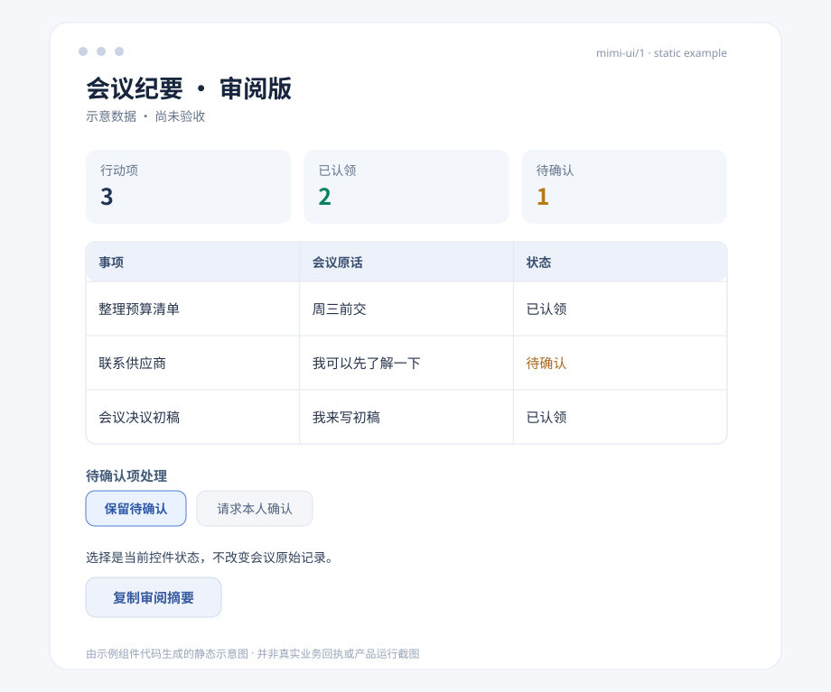
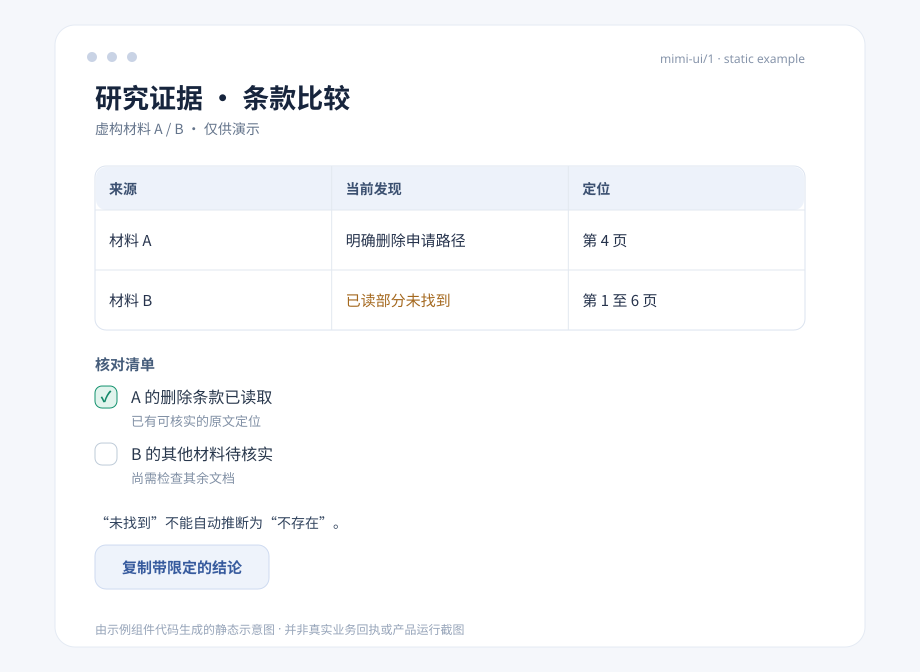
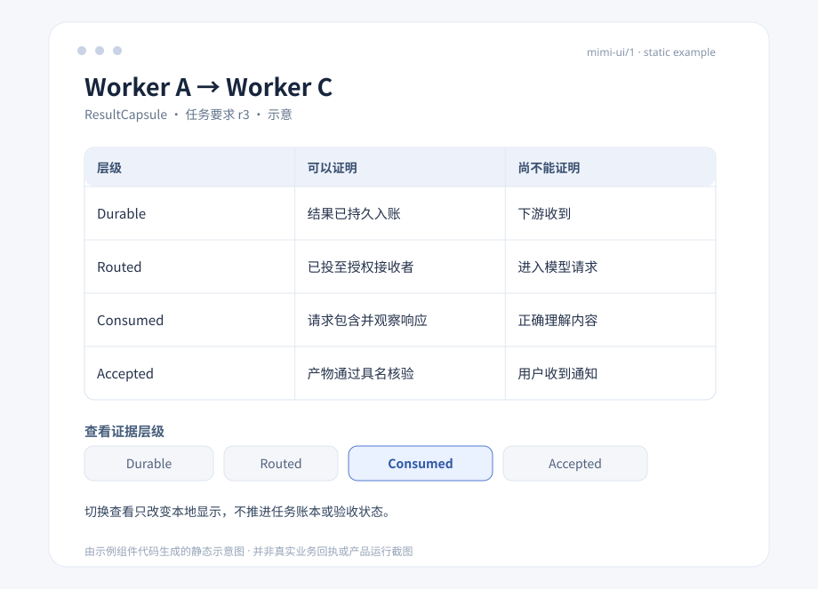
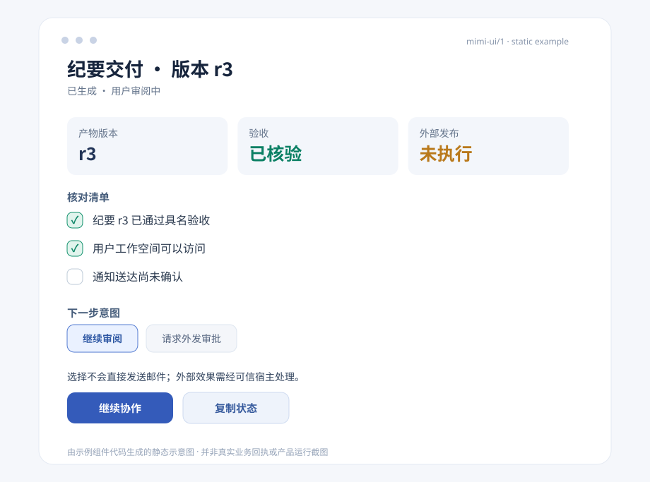
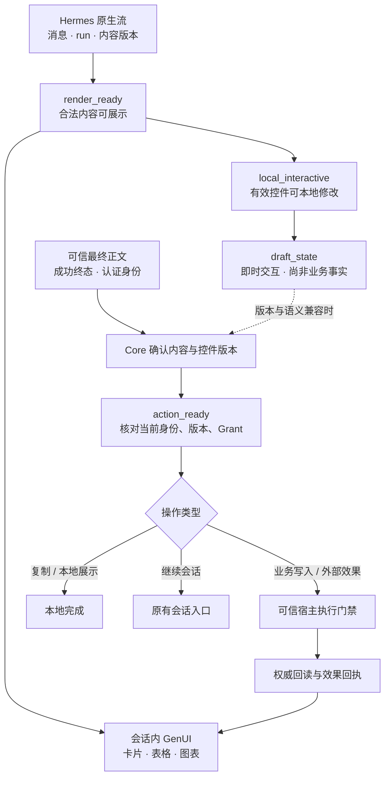

# GenUI 原生组件示例与静态预览

[返回第五部分](../../../parts/05-evidence-and-delivery.md#part-5) · [返回 MGRS 总览](../../../MGRS.md)

这些示例使用秘秘 `mimi-ui/1` 组件目录的原生标签编写（`Card`、`Table`、`Tr`、`Row`、`Stat`、`Choice`、`Checklist`、`Item`、`Text`、`Actions`、`Button`）。每组配有由同一份示例数据生成的 SVG 静态图。

**重要区别：** GitHub 不会直接执行 `mimi-ui` fenced block。下面的 SVG 是代码生成的视觉示意，**不是 Mimi 运行时真实渲染截图**；示例中没有实际账户、权限、任务、会议资料或执行回执。按钮上的文案表示 `mimi-ui/1` 的 `copy` / `turn` 动作语义，不会在 GitHub 上执行。真实动作仍由可信宿主及对应权限核验。

SVG 由仓库内的 `examples.json` 和 `render-previews.mjs` 生成，可使用 `node docs/examples/genui/render-previews.mjs` 重新生成。此脚本是文档图例生成器，不替代秘秘的原生渲染器。

## 示例一：会议纪要审阅

原始发言与负责人草稿分离。示例的数据与对象均为虚构。



原生 `mimi-ui/1` 组件标记：

```mimi-ui
<Card title="会议纪要 · 审阅版" sub="示意数据 · 尚未验收">
  <Row>
    <Stat label="行动项" value="3"/>
    <Stat label="已认领" value="2" tone="ok"/>
    <Stat label="待确认" value="1" tone="warn"/>
  </Row>
  <Table cols="事项|会议原话|状态">
    <Tr hl>整理预算清单|周三前交|已认领</Tr>
    <Tr>联系供应商|我可以先了解一下|待确认</Tr>
    <Tr>会议决议初稿|我来写初稿|已认领</Tr>
  </Table>
  <Choice name="followup" label="待确认项处理" options="保留待确认|请求本人确认" value="保留待确认"/>
  <Text muted>选择是当前控件状态，不改变会议原始记录。</Text>
  <Actions>
    <Button copy="审阅摘要：供应商联系仍待确认；处理方式：{followup}">复制审阅摘要</Button>
  </Actions>
</Card>
```

## 示例二：证据回读卡

原件引用、判断范围与未决问题。示例的数据与对象均为虚构。



原生 `mimi-ui/1` 组件标记：

```mimi-ui
<Card title="研究证据 · 条款比较" sub="虚构材料 A / B · 仅供演示">
  <Table cols="来源|当前发现|定位">
    <Tr hl>材料 A|明确删除申请路径|第 4 页</Tr>
    <Tr>材料 B|已读部分未找到|第 1 至 6 页</Tr>
  </Table>
  <Checklist name="checks">
    <Item done="true" sub="已有可核实的原文定位">A 的删除条款已读取</Item>
    <Item sub="尚需检查其余文档">B 的其他材料待核实</Item>
  </Checklist>
  <Text muted>“未找到”不能自动推断为“不存在”。</Text>
  <Actions>
    <Button copy="材料 A 明确说明删除路径；在已读材料 B 中未找到相应条款，尚不能排除其他说明。">复制带限定的结论</Button>
  </Actions>
</Card>
```

## 示例三：多 Agent 交接证据

已入账、已路由、已消费与已验收并非同一事实。示例的数据与对象均为虚构。



原生 `mimi-ui/1` 组件标记：

```mimi-ui
<Card title="Worker A → Worker C" sub="ResultCapsule · 任务要求 r3 · 示意">
  <Table cols="层级|可以证明|尚不能证明">
    <Tr hl>Durable|结果已持久入账|下游收到</Tr>
    <Tr>Routed|已投至授权接收者|进入模型请求</Tr>
    <Tr>Consumed|请求包含并观察响应|正确理解内容</Tr>
    <Tr>Accepted|产物通过具名核验|用户收到通知</Tr>
  </Table>
  <Choice name="inspect" label="查看证据层级" options="Durable|Routed|Consumed|Accepted" value="Consumed"/>
  <Text muted>切换查看只改变本地显示，不推进任务账本或验收状态。</Text>
</Card>
```

## 示例四：成果交付与持续协作

可访问、验收、通知和外部发布分别记账。示例的数据与对象均为虚构。



原生 `mimi-ui/1` 组件标记：

```mimi-ui
<Card title="纪要交付 · 版本 r3" sub="已生成 · 用户审阅中">
  <Row>
    <Stat label="产物版本" value="r3"/>
    <Stat label="验收" value="已核验" tone="ok"/>
    <Stat label="外部发布" value="未执行" tone="warn"/>
  </Row>
  <Checklist name="delivery">
    <Item done="true">纪要 r3 已通过具名验收</Item>
    <Item done="true">用户工作空间可以访问</Item>
    <Item>通知送达尚未确认</Item>
  </Checklist>
  <Choice name="next" label="下一步意图" options="继续审阅|请求外发审批" value="继续审阅"/>
  <Text muted>选择不会直接发送邮件；外部效果需经可信宿主处理。</Text>
  <Actions>
    <Button turn="请根据纪要 r3 继续处理：{next}">继续协作</Button>
    <Button copy="纪要 r3：已验收，外部发布未执行。">复制状态</Button>
  </Actions>
</Card>
```

## GenUI 在交付中的交互流程

以下图示区分 `render_ready`、`local_interactive` 与 `action_ready`。它们是不同层次的能力，不是每个请求都必须依次经过的三阶段审批。



对于需要持续编排的任务，结果与证据交接依照 [第五部分 5.3](../../../parts/05-evidence-and-delivery.md#53-从结果入账到下游产物验收) 的工作流程；本图只关注界面层如何与模型、Core 和可信宿主衔接。
