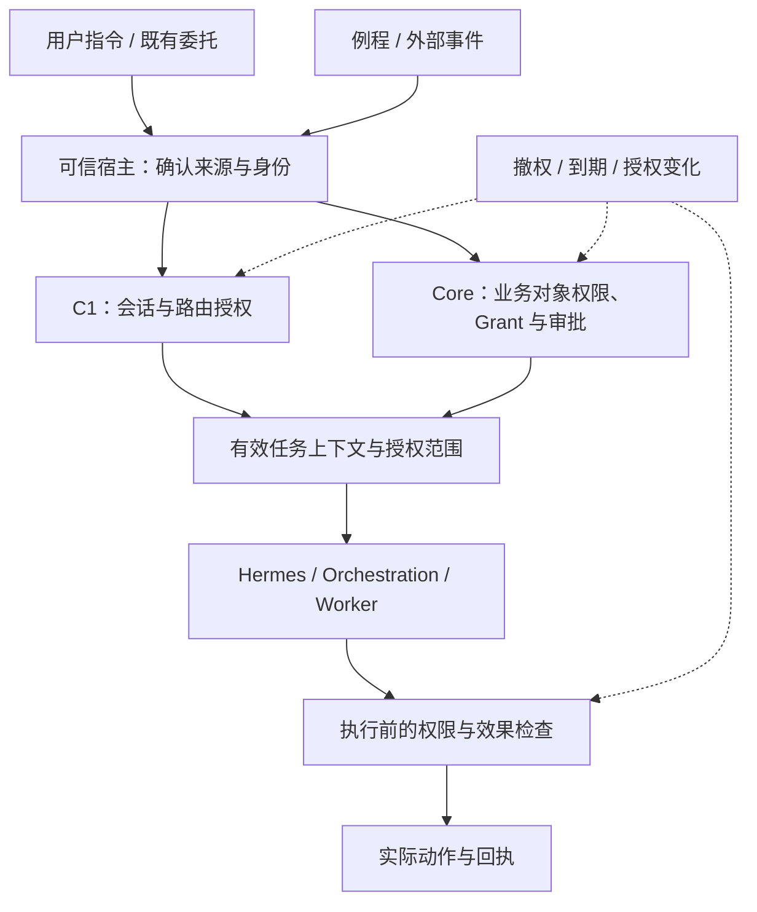

[返回 MGRS 六部分索引](../MGRS.md) · 第一部分 / 六

# 第一部分 · 用户入口与授权

一次工作从用户的真实意图开始，而不是从 Agent 自己声明的身份开始。用户通过 Web、Mac 等客户端进入主会话或工坊，在其中以消息或受管理的界面操作提出请求。GenUI 是会话内的生成式呈现与交互机制，不是独立接入渠道。需要提交到会话或触发业务动作的操作，仍由现有宿主依据可信身份、Profile、scope、状态版本和有效授权处理；仅改变本地显示或复制内容的交互不会自动创建任务。**提出目标和授予执行权限是两件事。**

## 先辨认谁在做事

| 对象 | 在 Harness 中的作用 |
| --- | --- |
| 用户、account、principal | 确定请求由谁发起，以及谁有权修改要求 |
| Profile 与 scope | 区分个人资料、团队资料、不同任务可见的对象 |
| grant、有效期、authorization_generation | 判断当下可读写和可执行的具体范围，以及撤权后的版本 |
| session 与用户当前补充 | 定位原生会话、交互来源和当前生效的要求版本 |
| 审批、效果级别 | 区分查资料、编草稿与发送、删除等外部操作 |

例如用户说“帮我腾出周五下午”，秘秘可以在已授权范围里查看日历、提出时间方案；不能因为目标是“腾出”就自行推断它可以给所有参会者发送改期邮件。用户临时说“周五那场别动”，后续的受管任务也得按最新要求继续。

## 入口不是单次登录检查

授权并不会在进入模型后自动永久有效。第二部分选择记忆时要按当下 scope 过滤；第三部分的 Worker 不能继承主 Agent 的所有权限；第四部分真正调用工具时要检查外部效果；第五部分交付给谁也取决于权限；第六部分恢复时还要核对撤权、到期与授权代次。

模型回复、浏览器参数、Skill 文件和前端按钮均不自行签发权限。看到一个 MCP 工具，不意味着这个任务被批准调用它；按既有授权可直接执行的普通任务，也不应被治理流程无谓拖成反复确认。

## 这一部分输出什么

不是一份“万能许可”，而是接下来能用的身份及有效授权条件，并将原始要求与后续修订继续关联到同一个任务语境。用户意图、审批、数据读取边界和外部动作边界应能分别核对。

**正式约束：** [宗旨与边界](../spec/01-purpose-and-boundaries.md#mgrs-1) · [六个治理面](../spec/02-governance-planes.md#mgrs-2) · [G01、G02、G07、G09、G12](../spec/03-invariants.md#mgrs-3) · [Profile 与隔离](../spec/10-profile-cache-isolation.md#mgrs-10)。

**工程背景：** [Mimi 的产品入口](../docs/MIMI-OVERVIEW.md) · [11 月 9 日系统基线](../docs/sources/2026-11-09-system-baseline.md)。这里描述治理要求与组件关系，不声称所有入口已经通过生产验收。
