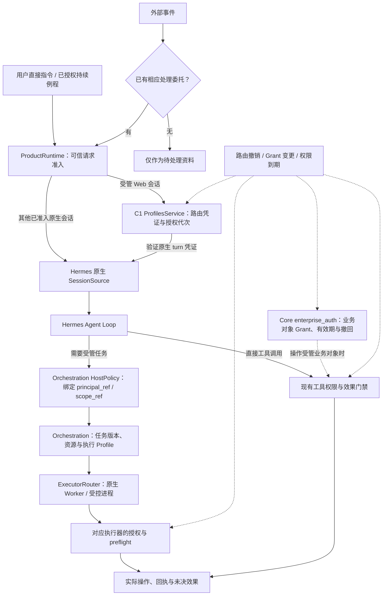

[返回 MGRS 规范总览](../MGRS.md) · 第一部分 / 六

# 第一部分 · 用户入口与授权

所有受管工作的起点，都是用户向个人 Agent 让渡的一部分事务、信息访问权与行动决定权。

**用户不必在完全自主和完全受控之间二选一。MGRS（Mimi Governed Runtime Standard）允许用户分别委托信息访问、方法判断与实际行动的权力，再由 Mimi Harness 在持续任务中维护这些边界。**

与传统软件“点击即触发单一确定操作”不同，个人 Agent 需要在多轮对话、跨天例程与多步工具调用中持续代表用户行事；与“全天候无差别监听”的持续感知型产品也不同，Mimi 的设计目标是复刻人类顶级秘书的协作分寸感——在明确边界内充分自主，在越界边缘主动止步。

因此，MGRS 第一部分不局限于传统的“入口身份校验”，而是回答一个更根本的治理问题：**用户通过什么方式建立委托、交出了哪些层面的权力，以及 Mimi Harness 如何在任务持续、多 Agent 分工与用户改口撤权的过程中维持这些边界。**

---

## 1.1 有效委托的来源与触发边界

在 Mimi 的系统结构中，触发一次 Agent 任务的来源并不等同，其背后携带的委托强度与权威依据也完全不同。Harness 在接手任何工作前，必须先区分请求究竟源自哪一类合法委托：

- **直接指令（Direct Instruction）**：用户通过 Web、Mac 等可信客户端或会话内 GenUI 交互界面主动发起的请求，经可信宿主签名并绑定身份、会话归属、请求摘要与有效期。其中，GenUI 仅作为会话内的富交互呈现与确认界面，负责承载用户的意图选择或审批动作，本身不构成绕过核心鉴权的独立执行通道。
- **持续例程（Recurring Routine）**：用户预先设定的周期性或条件触发任务（例如“每天早上整理当天的会议邀请”）。次日例程启动时，通过任务绑定（如 `job ID`）关联既往长期委托，并在实际执行前重新核验当前身份、用户偏好与授权状态，而非凭系统自发动机运行。
- **活跃任务延续（Active Task Continuation）**：用户在既有任务上下文中进行的追问、补充约束或目标修订（例如在安排日程中途补充“改发给陈顾问，不要抄送其他人”）。系统通过校验预期任务版本（`expected_revision`）、递增修订版本号并使受影响的下游依赖失效来更新任务契约，在既定边界内修正要求，而不允许借自由文本暗中扩大权限。
- **外部事件触发（External Event Trigger）**：新邮件到达、日历变更或外部输入推送。**“接收到外部事件”与“获得处理权限”必须严格分离——系统能够观察到或读取某个事件，绝不等于用户已经授权 Agent 持续监控该事件并自主采取行动。** 除非存在明确生效的长期委托或独立签署的处理授权（`processing_authority`），否则外部事件在 MGRS 中仅作为待查阅的被动信息，上传或读取事件更不能被改称为审批。

---

## 1.2 三维权能模型：有权知道、有权决定、有权行动

用单一的“用户已授权该任务”来覆盖 Agent 的全部行为，是导致越权与信任崩塌的主要原因。即便是同一句“帮我管理日程”，不同用户的信任边界也截然不同：有人愿意开放完整日历读取并允许 Agent 自主协调时间，但坚持亲自确认每一封对外消息；也有人只开放单个项目的日程，却授权 Agent 直接发送例行改期通知。

MGRS 将 Agent 所获得的委托拆解为三个正交的权能维度。这一三维模型是 MGRS 对现有运行时权限与约束机制的统一治理抽象，在工程上分别对应不同的执行约束，而非替换底层数据结构：

1. **有权知道（Information Access）**

   在工程上对应数据域 `Grant`、Memory `scope`、`MaterialRef` 与具体读取能力。它限定 Agent 可以读取哪些数据域、记忆分区与外部资料，以及这些信息仅限用于哪项任务。获得工作资料的读取权，不代表可以跨界检索私人通信；单次任务中的临时数据访问，也不自动转化为跨任务长期记忆。

2. **有权决定（Decision Autonomy）**

   在工程上对应用户目标（`goal`）、任务要求版本（`revision`）、方法选择空间与不可修改的实质约束（如 `result_rule`），核心在于区分**方法自主**与**目标锁定**。Agent 可以自主选择检索路径、工具组合与草稿组织方式，但不得借任务修订或自由文本擅自篡改用户设定的目标、扩大执行环境与资源边界，或改变对外承诺的实质口径。

3. **有权行动（Execution Authority）**

   在工程上对应工具能力、隔离执行环境、Effect 风险分级（`E0–E3`）、审批凭证及实际效果检查。系统严格区分“不产生外部副作用的内部准备”（如检索信息、生成改期邮件草稿）与“产生外部或高权限影响的实质动作”（如发送邮件、修改共享日程、变更系统配置）。高风险动作必须匹配相应的授权凭证或人类审批；同时，对于已被用户明确纳入长期委托的常规动作，运行时也应直接放行，避免用无意义的重复弹窗消耗用户注意力。

---

## 1.3 信任传导链：从可信来源到持续执行门禁

在 Mimi 的架构中，用户信任不是由某个单一模块在入口处静态判定的，而是由可信宿主、会话路由授权与核心业务授权共同确立边界，并在任务委派、权限扩展及实际外部效果发生前持续核验：

在这条治理链路中，各核心机制承担明确的职责分工：

- **`ProductRuntime` 与 `C1`（会话归属与路由授权）**：`ProductRuntime` 核验请求通道与原生消息上下文的可信归属；`C1`（`ProfilesService`）区分会话路由的修订版本（`revision`）与**授权代次（`authorization_generation`）**。`authorization_generation` 管理对应会话路由的授权生命周期，撤销或变更路由会递增该路由的授权代次，并使尚未使用的请求凭证即时失效。
- **`Core`（对象级业务授权）**：`enterprise_auth` 独立维护业务对象的精确授权策略（按 `domain`、`principal`、`role`、`object_kind`、`object_id` 与 `action` 匹配），并持续检查有效期与撤回状态，支撑“有权知道”与“有权行动”的细粒度控制。
- **`Profile` 与受控数据边界**：不同 `Profile` 与工作空间按照有效授权划定数据访问边界（例如不同 Profile 各自独立隔离原生会话存储，同时可通过显式授予的 `shared` Memory `scope` 与 `Grant` 共享指定事实）。未获授权的数据不得因会话、模型或执行环境共用而跨域访问。
- **边界绑定与持续校验**：Mimi Harness 将当前三维权能边界绑定至执行上下文，并在任务委派、权限扩展、执行器预检（preflight）以及实际外部效果门禁发生前持续核验其有效性，确保授权约束贯穿整个执行过程。

---

## 1.4 委托的持续、多 Agent 收窄与撤回

真实的个人助理工作很少在单轮对话内结束，委托关系必须经受住时间跨度、任务拆解与用户意图变化的考验：

- **跨周期持续与复用**：当长期委托在次日触发例程时，Harness 必须重新核验当前身份归属、用户偏好、`C1` 对应会话路由的 `authorization_generation` 以及 `Core` 对象 `Grant` 的有效性。只有全部满足，既往授权才能被安全复用。
- **多 Agent 委派与执行器权限收窄**：当主控 Agent 在 `Orchestration` 中拆解复杂任务并派发给子任务或 `Worker` 时，**Worker 绝不自动继承主控 Agent 的全部权限**；受控执行器具有独立授权检查，外部进程桥接（如 `ProcessBridge`）也不会将主控或 `Core` 的原始凭据直接交给外部 CLI。例如，主控 Agent 可能拥有读取用户完整工作目录的权限，但负责提取两篇指定文献摘要的 Worker，应仅获得这两份指定文献的只读访问能力，其检索属于 `E0` 只读效果；任务结果通过受管交接合同返回，不能由此取得额外的文件写入或对外发布权限。
- **撤权对执行资格与在途任务的约束**：授权变更或撤回后，**受影响的执行资格立即失效**。这一机制严格区分“执行资格”与“任务事实本身”——撤权不意味着删除历史任务，也不意味着取消已经完成的客观事实。后续的数据访问、任务启动与外部效果门禁必须重新满足当前授权；而撤权前已经发生或处于状态未知（`UNKNOWN`）的操作则保留原有回执，由恢复与对账机制处理。

---

## 1.5 规范映射与效果风险分级

### 与现有 Mimi 设计规范的对应关系

上述委托治理模型直接统合了 Mimi 既有的核心规范机制：

| 既有规范 | 在委托治理模型中的职责 |
| --- | --- |
| **`G01` 可信来源绑定** | 确保所有任务均可追溯至可信宿主与 `C1` 确认的合法委托来源，杜绝未认证入口伪造用户意图。 |
| **`G02` Worker 权限收窄** | 强制多 Agent 协作与外部执行器遵循最小权限原则，Worker 仅获得当前子任务所需的狭义权能，禁止全量复制主控权限或透传底层凭据。 |
| **`G07` Profile 与受控数据边界** | 落实“有权知道”的边界，按有效 `Scope` 与 `Grant` 隔离不同 Profile 的数据域，允许受控共享并防止越界写入长期记忆。 |
| **`G09` 能力发现与执行授权分离** | 区分“Agent 知道某个工具存在”与“Agent 获准在当前任务中实际调用该工具”，防止能力暴露直接转化为执行权。 |
| **`G12` 豁免冗余重复确认** | 保障“有权行动”的流畅性，对已落入有效 `Grant` 覆盖范围内的常规动作免除重复审批。 |

### 效果风险分级（`E0 – E3`）

`E0` 至 `E3` 是衡量行动后果风险的客观分级标尺（而非三维权能之外的第四类权力），用于决定一项实际执行在门禁处需要匹配何种授权强度与审批约束：

| 效果等级 | 风险定义 | 典型行为与门禁要求 |
| --- | --- | --- |
| **`E0`** | **只读（Read-only）** | 信息检索、文献读取与状态查询，不改变系统或外部世界状态；满足有效读取授权即可放行。 |
| **`E1`** | **有界可逆（Bounded & Reversible）** | 局限于受控工作区内、可回滚或可覆盖的局部变更（如生成邮件草稿、写入受管中间产物）。 |
| **`E2`** | **对外或难以逆转的效果（External or Hard-to-Reverse Effects）** | 跨越系统边界产生对外影响或撤销成本高昂的操作（如发送外部邮件、修改共享日程）；需匹配明确任务授权或人类审批。 |
| **`E3`** | **高权限操作（High-Privilege Operations）** | 涉及敏感数据域变更、权限与系统配置修改、高风险执行环境调用或关键不可逆事务的操作；强制触发严格门禁校验与显式授权。 |

---

明确了“Agent 凭什么代表用户知道、决定和行动”以及“运行时如何持续校验这些委托边界”之后，下一步的工程问题便是如何在每一次模型推理前，把这套动态有效的授权约束与任务契约精确装配为模型可见、不可越界的上下文——这正是第二部分（`ContextEnvelope`）的核心职责。
