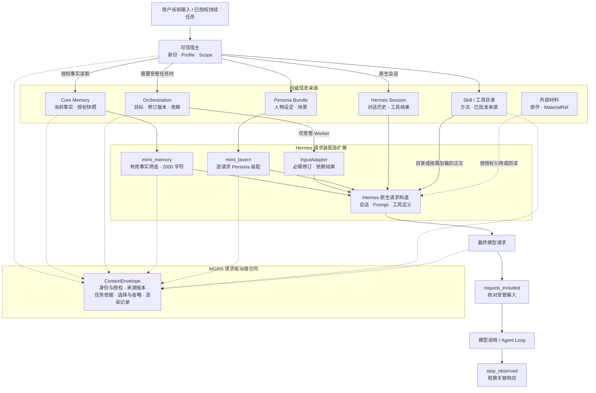

[返回 MGRS 规范总览](../MGRS.md) · 第二部分 / 六

# 第二部分 · 上下文与请求装配

确立了用户委托的合法来源与三维权能边界之后，Mimi Harness 面临的下一个核心工程问题是：**在单次模型推理前，如何从分散的系统组件中取得当前有效状态，将其装配为既充分又受控的模型请求？**

**系统保存了什么、当前允许读取什么、本轮检索选择了什么，以及最终实际送入模型的是什么，是四件不同的事。**

个人 Agent 的工作跨越数日与多轮交互，用户不会每次重复完整背景。然而，上下文装配绝不是把历史聊天与记忆库一股脑塞进提示词。MGRS 第二部分规范了从权威数据源到单次模型请求的装配链路：在第一部分确立的授权边界内，按需投影有效事实、锁定最新受管任务契约、正交加载语境与方法，并通过请求级治理记录确保每一次模型输入均可追溯。

---

## 2.1 状态主权分离：六类信息源的职责边界

长期运行的 Agent 最容易陷入的状态混乱，是把所有历史痕迹统称为“记忆”，导致过期指令、未验证的聊天摘要与当前有效事实混为一谈。在 Mimi 架构中，不同信息拥有各自的生命周期、权威来源与治理边界：

| 信息来源 | 在请求装配中的权威职责 | 治理与隔离边界 |
| --- | --- | --- |
| **`Core Memory`** | 保存可跨会话持久化、支持纠正与撤回的用户事实及偏好，按已授权 `scope` 提供当前有效快照。 | 事实有效性的唯一权威；已撤回或过期记录不得借历史缓存重新进入请求。 |
| **`Orchestration`** | **受管任务要求的权威**：维护当前目标（`goal`）、要求版本（`revision`）、依赖拓扑、执行状态与有效结果；受管任务的后续执行必须以该任务的当前合同为依据。 | 仅约束受管任务（普通对话和直接工具调用仍走 Hermes 原生请求路径，由当前可信用户指令确立本轮要求）；任务状态不由模型回忆决定。 |
| **`外部材料与 MaterialRef`** | 保存论文、文档、邮件与附件等原件或其可回查引用标识。 | 仅在任务与材料授权范围内按需读取，不将整份外部原件盲目内联至常驻上下文。 |
| **`Hermes 原生 Session`** | 保留单轮及多轮对话消息、工具调用轨迹与压缩状态，维持原生 Agent Loop 的交互连续性。 | 保留当前交互及其历史依据，但不能代替 `Core` 事实有效性判定或受管任务的结果验收。 |
| **`Persona / mimi_tavern`** | 依据当前 `Profile`、Persona Bundle 与交互场景装配角色设定与表达语境。 | 仅调节交互风格与角色语境，不得替代 `Core` 中的用户事实或修改任务验收标准。 |
| **`Skill 与工具目录`** | 向模型声明当前可用的方法目录，并在调用时按需加载对应方法说明。 | 方法的发现或加载仅提供“如何做”的知识，不自动赋予实际执行权限（`G09`）。 |

这一分工确立了一条基本原则：**对话历史不等于当前事实，模型口头声明不等于任务完成。** 聊天记录可以保留用户昨天“暂定采用三个案例”与今天“删去第三个案例”的全部表达，但受管任务必须依据 `Orchestration` 的最新修订版本推进；同样，某个 Worker 在对话中声称“分析已完成”，只有当任务系统登记了有效回执与结果引用时，下游才能将其作为可信输入消费。

---

## 2.2 记忆投影：在 2000 字符预算内按需提取有效事实

Mimi 不在每轮推理前向模型倾倒全量 `Core` 数据，而是通过受控的事实抽屉（Memory Projection）按本轮需求生成局部只读视图：

- **授权边界前置**：在现有实现中，`mimi_memory` 通过 Hermes 原生 `MemoryProvider` 接口接入 `Core`。宿主预先绑定当前允许读写的 `scope`，模型只能在已获授权的分区内访问事实。每次装配前，`MemoryProvider` 都会重新获取 `Core` 的当前有效快照，阻断已撤回或过期事实通过旧缓存回流。
- **检索依据与任务语境协同**：现有投影器（`on_turn_start` / `rank_facts`）以本轮输入文本为检索依据，使用确定性词项匹配（覆盖英文词语、中文连续字词片段以及路径与文件标识）筛选相关事实，并结合事实重要性排序。这种筛选决定的是**哪些有效事实值得占用本轮上下文空间**，而非重新判断事实是否真实。在受管任务场景中，MGRS 进一步要求上下文选择与当前任务语境相协调——例如当用户仅说“继续”推进一份既定研究报告时，单靠“继续”二字难以召回相关背景，投影机制需结合当前任务线索协同定位有效事实。
- **硬性字符预算与省略记录**：单次记忆投影的预算为 **2000 字符**（按字符数而非 token 计数，也不等同于模型总上下文上限），该预算同时容纳必要的来源、授权 `scope`、版本元信息与入选事实正文。当可用事实超出预算时，投影器（`selection_report`）在保留高优先级条目的同时，明确记录因 `budget` 容量限制而被省略的条目。**未被选入本轮视图不代表事实遭到删除，也不妨碍 Agent 在后续轮次中按授权重新读取。**

因此，事实抽屉不承担存储职责——它是 `Core` 当前有效事实在单轮请求中的**只读、可重建、可回查视图**。

---

## 2.3 任务契约与交接：确保修订要求与上游结果不丢失

对于跨轮次或多 Agent 协作的长期任务，比“回忆相关偏好”更关键的，是确保**用户最新修订的任务要求**与**上游有效成果**准确进入执行者的下一次模型请求，而不是湮没在长对话或会话压缩中：

- **区分材料补充与任务修订**：`Orchestration` 清楚区分 `append_context` 与 `amend_task`。前者负责补充背景材料，不直接改变任务要求版本；后者用于修改任务实质要求（包括 `goal`、`context_refs` 与 `result_rule`）——系统校验预期任务版本（`expected_revision`）、递增修订版本号，并使受影响的下游依赖失效。
- **任务契约优先于一般记忆排序**：事实抽屉可以按相关度决定哪些偏好进入本轮，但用户最新确认的任务目标、当前有效的结果规则（`result_rule`）以及必要的上游依赖结果，必须根据任务合同进入受管请求路径，不能依赖关键词检索碰巧召回（结果规则可经由合法的任务修订更新，但不得由 Agent 擅自篡改）。
- **结构化交接与执行器输入门禁**：多 Agent 协作时，下游接收的不是上游 Agent 的整段对话，而是携带任务标识、要求版本、结果编号与回执来源的**受管结果引用**（下游可按需回读原件）。由于“已投递给 Worker”不等于“执行者实际收到要求”，运行时针对不同执行器采取差异化的交接保障：对 Hermes 原生受管 Worker，`InputAdapter` 为受管输入建立可追踪的逻辑消息，在请求装配时检查并补回因会话压缩而遗漏的关键修订或依赖结果，完成请求级交接验证；而对于尚不具备相同输入消费确认能力的外部进程执行器，当任务绑定包含必需输入标识（`required_input_ids`）时，调度器会返回等待状态（`WAIT_CAPABILITY`）阻止其直接启动，避免在未经验证的情况下默认执行者已收到全部要求。若关键材料不存在或当前无权读取，Harness 同样转入回查、分阶段执行或受阻状态，不让模型在条件不完整时擅自假设条件已满足。

---

## 2.4 语境、历史与方法的正交装配

完成事实筛选与任务契约锁定后，Harness 继续依托 Hermes 原生扩展接口分别装配角色语境、交互历史与可用方法，而不另起炉灶重造 Agent Loop：

- **角色语境（`Persona`）**：`mimi_tavern` 实现 Hermes 的 `ContextEngine` 接口，按当前 `Profile`、Persona Bundle 与交互场景注入人物设定与表达示例，并与 Hermes 的 `ContextCompressor` 协同工作，使日常秘书、研究协助与系统维护等场景的表达切换不破坏底层事实与任务约束。
- **对话连续性（`原生 Session`）**：Hermes 维护消息与工具调用历史，并在上下文接近上限时执行压缩。会话压缩用于管理窗口容量，既不能重新签发授权，也不能将旧摘要提升为新的任务权威。
- **方法按需加载（`Skill`）**：`Skill` 通过 Hermes 原生机制按需加载。模型通过目录感知可用方法，仅在实际需要使用时读取正文；对于 Mimi 受管 Skill（`mimi_skills`），加载过程还需要满足当前 `Profile`、批准版本及来源授权。方法知识进入上下文后，仍受第一部分确立的执行权限与效果门禁约束。

---

## 2.5 ContextEnvelope 与最终请求交接边界

同一用户、同一项任务，在不同时刻可能拥有不同的有效记忆快照、任务修订版本与材料范围。即使原始问题相同，一旦用户撤回授权或修改任务要求，Harness 也不能无条件复用先前的上下文。

在真实装配路径中，承担具体组装工作的仍然是 **Hermes 原生请求机制及其扩展接口**（`MemoryProvider`、`ContextEngine`、`InputAdapter`）。MGRS 引入的 **`ContextEnvelope`** 是宿主侧的**请求级治理合同**，负责将分散在可信宿主、任务系统与装配组件中的身份、授权、版本和选择依据关联为可追溯的请求级记录，而不是替代原生装配器的集中式处理器：

模型侧遵循最小暴露原则——授权细节、完整审计元数据与不必要的私人原文留存于治理记录中供回查，无需全部塞入模型提示词：

| 合同维度 | 记录的核心治理依据 |
| --- | --- |
| **身份与授权** | 当前 `principal`、`Profile`、原生 `session` 及关联的授权版本状态。 |
| **请求与任务** | 当前逻辑轮次、关联任务标识、要求修订版本（`revision`）与唯一请求标识。 |
| **事实与方法来源** | 参与本轮投影的 Memory `scope` 及版本、`Persona` 与已加载 `Skill` 的来源版本。 |
| **授权过滤与选择记录** | 分层关联两类记录：**授权过滤记录**由对应的事实来源与权限机制负责（拦截未授权、已撤回或过期条目）；**上下文选择记录**由投影器负责（记录入选项及因 `budget` 容量省略的条目），并标明任务合同纳入的必需输入。 |
| **最终装配依据** | 本轮实际生成的请求内容结构及可回查的装配快照标识。 |

### 最终请求才是实际交接的边界

上下文装配并没有在信息写入数据库、命中缓存或出现在界面上时结束。**任务系统确认要求已经修改，与执行者实际收到修改之间，必须存在可以检查的交接过程。**

在现有实现中，`InputAdapter` 会在准备请求时查找当前任务要求的必需输入，必要时重新注入；在最终请求装配阶段通过 **`request_included`** 确认相关受管输入已实际包含在请求中；随后在模型调用完成并观察到对应响应后，通过 **`step_observed`** 形成消费证据，并为未完成交接的输入保留后续恢复所需的状态。两者共同支持输入交接的工程验证，但不会因为模型返回了响应，就证明它正确理解了要求。

需要明确的是，`request_included` 与 `step_observed` 专门针对**受管任务输入**的交接验证，并不替代整个模型请求中每一段 `Persona`、`Memory` 或 `Skill` 内容的统一消费证明（后者仍由各自组件承担相应的观测记录）。

至此，第二部分确立了各组件在请求装配中的完整分工：`Core` 决定哪些事实当前有效，`Orchestration` 决定受管任务依据什么要求继续，`Persona` 与 `Skill` 提供语境与方法，`Hermes` 及其扩展接口负责实际请求装配与 Agent Loop，`ContextEnvelope` 让每一次装配的来源、版本与选择过程可追溯，而真正的行为边界仍由可信宿主与各层执行门禁共同维护。

当目标、约束与上下文已准确送达模型后，下一步的治理问题便转向执行决策：**面对一项明确目标与约束的任务，主 Agent 如何决定自己完成、拆分工作或委派受限 `Worker`，并确保这些决定不破坏原有任务合同？** 这正是第三部分（任务规划与多 Agent 委派）所要规范的内容。
