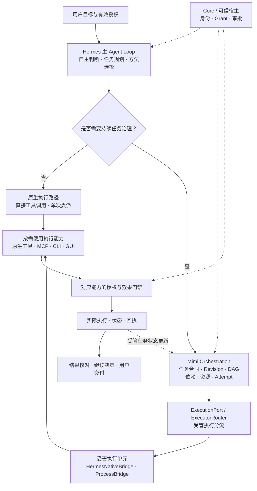

[返回 MGRS 规范总览](../MGRS.md) · 第三部分 / 六

# 第三部分 · 决策、规划与协作编排

确立了用户委托的权能边界与单次请求的上下文装配规范之后，MGRS 第三部分解决的是运行时的核心协作问题：**面对一项具体工作，Agent 如何决定自主执行、单次分工还是启动受管多 Agent 编排，以及如何保证长期协作不偏离用户最新要求？**

Mimi 只有一套统一的运行时（Mimi Harness），并非在 Hermes 之外并行运转另一套框架。在工程实现上，Mimi Harness 以 Hermes 的核心源码作为运行底座，并在同一运行期内嵌入了身份授权、受管任务合同与效果门禁，使 Agent 能够长期、可信地替用户完成工作；MGRS 则是从这套统一架构中提炼出的协作治理协议。

**直接复用 Hermes 源码作为底座，是因为其原生执行机制已经成熟；在其上嵌入治理约束并清理不匹配的原生路径，是因为长期代表用户工作，必须让任务要求、委派权限、实际结果和后续决定收敛在同一套权威结构下。** MGRS 治理的是这些关系，而不接管模型的内部思考。

## 3.1 为什么 Mimi Harness 选择 Hermes

构建个人 Agent 系统的常见误区，是从零重写模型请求循环、工具调用调度、会话压缩与后台守护进程。Mimi Harness 在架构演进中确立了一项明确的工程边界：**不从零重写执行内核，而是直接复用 Hermes（基于固定版本 `c07501ec`）的核心源码作为运行底座**，将自建精力集中在个人助理最关键的信任边界、长期任务连续性与协作结果可靠性上。

这一选择背后是一条清晰的职责划分原则：

> **能力靠工具，判断靠模型，习惯靠记忆，经验靠 Skill，只有安全边界与受管状态靠规则。**

换言之，**模型负责判断和选择方法，Harness 负责让这些方法在正确的身份、任务与授权条件下执行。** 无论是更换底层推理模型，还是接入不同的外部 CLI 执行器，执行引擎都可以按需替换，但任何单一模型或工具进程都不应接管秘秘的任务账本与授权中枢。同时，在简单事务中，复用的 Hermes 原生能力可以直接闭环完成工作——额外启动协调角色、规划器或子 Worker，绝不应成为形式上的必经步骤。

## 3.2 对 Hermes 源码的架构取舍：复用、改造与淘汰

以 Hermes 作为源码基础，不代表 Hermes 原生功能都会被保留，也不代表源码库存中存在的能力就是秘秘正式采用的永久架构。围绕最终要形成的统一运行时，Mimi Harness 遵循一条核心架构原则：

> **复用执行机制，不意味着继承全部产品设计。Mimi Harness 可以保留 Hermes 的 Agent Loop，同时移除不符合自身治理结构的原生功能。**

在开发仓（`assisthub`）的实际架构收敛中，Mimi 对 Hermes 源码划分为三个明确的处理层次：

| 架构处理层次 | 涉及的源码模块与机制 | 治理定位与演进方向 |
| --- | --- | --- |
| **保留并复用** | `Agent Loop`、`delegate_task`、`Session`、`ContextCompressor` 及基础工具/插件加载机制 | 直接作为 Mimi Harness 的底层执行内核，承担模型推理循环、子代理并发执行、历史会话维护与上下文窗口压缩。 |
| **改造与治理适配** | 宿主入口、工具/MCP 调用、Skills 加载、上下文装配与任务执行 | 保留基础运行能力，但状态与权限语义全面适配 Mimi 合同：由 `ProductRuntime` 绑定可信身份，`Core` 实施对象级 Grant 与效果回执，`skills_release` 管控受管 Skill 版本与准入，`mimi_memory` / `mimi_tavern` / `InputAdapter` 接管受控上下文装配，`mimi_orchestration` 维护受管任务契约。 |
| **逐步淘汰与清理** | 原生 `Kanban` 路径及其他与 Mimi 权威重叠的遗留功能 | 与已确立的权威来源重复、缺乏实际接入必要或增加维护负担的原生功能，不作为长期架构保留。例如原生 `Kanban` 与 `mimi_orchestration` 在任务状态上存在结构重叠，二者并非永远共存的两套系统，前者将在确认消除剩余依赖后逐步清理。 |

通过这一三层取舍，系统避免了多套互相冲突的调度账本，收敛出单一的运行时权威边界：**受管编排任务账本由同一宿主 `SessionDB` 中的 `mimi_orchestration` 持有，`Core` 负责业务事实与对象授权，统一执行网关仅承担能力路由与执行门禁，不保留平行的任务队列或双份业务任务板。**

## 3.3 原生协作与持续任务治理之间的缺口

既然复用的 Hermes 底座已经提供了 `delegate_task` 异步委派与基础子代理运行能力，为什么 Mimi 仍然需要构建 `mimi_orchestration`？根本原因不在于底层缺少子代理启动机制，而在于**原生子代理的运行语义，与个人 Agent 长期代表用户工作的治理合同并不完全重合。**

以一个典型协作场景为例：用户要求秘秘整理一份研究报告，主 Agent 派发两个 Worker 分头检索资料，第三个 Worker 负责综合撰写。在这一过程中，除了“子代理是否运行结束”，系统还必须回答四个治理问题：

- **中途改口后的版本有效性**：用户突然收窄研究范围或删去某个对比案例，此前 Worker 已经产出的中间结果中，哪一部分在最新要求版本（`revision`）下仍然有效，哪一部分必须作废重跑？
- **下游消费的证据确定性**：第三个负责综合的 Worker 在下一次模型推理中，是否真正收到了修改后的任务要求以及上游经过核验的证据引用（而非仅仅因为调度器发出过通知）？
- **超时尝试的悬挂与资源释放**：某个执行尝试（`Attempt`）因网络或进程卡顿超时后，底层外部任务究竟已经终止，还是仍在后台运行并占用资源？
- **外部副作用的幂等防重**：若任务失败触发重试，此前已经发出的外部邮件或已写入的日程变更，如何避免被再次执行？

单纯依赖“子代理返回 `completed`”无法回答上述问题。因此，MGRS 在复用 Hermes 原生执行机制的同时，通过受管任务合同在同一运行时内补齐了要求版本追踪、必需输入交接验证、受控资源隔离与未知状态恢复四项治理语义，使工程实现既继承成熟的执行循环，又完全收敛到 Mimi 的统一治理结构之中。

## 3.4 决策、规划与任务分解

面对一项新请求，主 Agent 依据任务复杂度、跨度与外部风险，自主选择最轻量的可行执行路径，而不是将所有工作一律重型化：

- **直接执行（Direct Execution）**：对于单轮可解、或仅需数步只读查询与常规工具调用的请求，主 Agent 直接在复用的 Hermes 原生 Agent Loop 中调用工具、MCP 或已加载的 Skill 完成，无需创建受管编排任务。
- **单次轻量分工（Lightweight Delegation）**：对于目标明确、无需跨轮修订追踪、且相互独立的并行子任务（例如同时检索两份公开资料并当场汇总），主 Agent 可直接调用原生 `delegate_task` 完成即时分工。
- **持续受管工作（Governed Orchestration）**：当任务需要跨会话持续推进、具有多阶段依赖、要求版本管理、多 Worker 接力或执行恢复需求时，主 Agent 通过 `mimi_orchestration` 建立受管任务合同。执行能力的选择与任务治理相互独立，外部效果无论通过哪条路径产生，都必须遵守对应的授权与效果门禁。

在这一决策体系中，**C0 是承担任务协调与方法判断的治理角色，而不是所有用户请求都必须额外经过的“超级管理模型”。** 简单对话与直接工具调用由当前主会话直接响应；只有当工作进入多角色协同与复杂任务编排时，C0 的协调职责才显式介入，负责拆解子目标、分配执行边界与审视阶段结果。

## 3.5 Mimi Orchestration 与原生 Delegation 的协作

在执行层，`mimi_orchestration` 与复用的 Hermes 原生 `delegate_task` 并非两套互斥的子 Agent 系统，而是同一运行时内“任务治理合同”与“底层执行机制”的上下游衔接：

这条协作链路由四个核心机制衔接：

- **受管任务图（`submit_plan`）**：主 Agent 提交任务规划后，`mimi_orchestration` 在 `SessionDB` 中登记任务有向无环图（DAG）、各节点的输入输出依赖、目标要求版本以及执行环境 Profile。
- **受管输入交接（`InputAdapter`）**：在任务派发前，`InputAdapter` 核对当前节点声明的必需输入（`required_input_ids`）与最新修订版本。对于原生受管 Worker，装配器确保必需输入进入最终模型请求（记录 `request_included`）；对于尚不具备输入消费确认能力的外部进程执行器，调度器返回等待状态（`WAIT_CAPABILITY`），阻止其在条件未就绪时提前启动。
- **统一执行分流（`ExecutionPort` / `ExecutorRouter`）**：任务就绪后，统一执行路由根据任务绑定的执行器类型分流——原生子 Agent 任务通过 `HermesNativeBridge` 调用底层复用的 Hermes 委派机制执行；需要独立进程隔离的外部脚本或 CLI 工具则通过 `ProcessBridge` 在受控执行 Profile 下运行。
- **尝试状态与资源治理（`Attempt` Lifecycle）**：每次执行尝试均独立记录运行生命周期，明确区分“已完成”、“等待依赖/审批”、“状态未知（`UNKNOWN`）”以及“底层进程与文件锁是否已真正释放”，避免超时重试引发资源泄漏或并发冲突。

## 3.6 协作结果、再规划与责任边界

多 Agent 协作很少沿直线一次走通，用户改口、局部检索失败或上游证据不足都是常态。MGRS 为协作过程中的动态调整划定了清晰的责任边界：

- **任务修订与依赖失效（`amend_task`）**：当用户修改任务目标、补充关键约束或调整结果规则（`result_rule`）时，`amend_task` 校验预期版本（`expected_revision`）、递增任务修订号，并自动将受影响的下游节点标记为失效，防止下游 Worker 继续消费基于旧要求产出的过期中间结果。
- **失败后的再规划与方法调整**：当某个 Worker 执行失败、材料缺失或工具路径受阻时，C0 协调角色可以根据失败回执重新评估策略——例如更换检索工具、加载替代 Skill、调整任务拆解粒度，或向用户请求补充授权与关键材料。
- **具名验收与受管结果消费**：上游 Worker 的结果必须具有有效的任务版本、执行尝试与结果引用，并满足下游声明的依赖条件（`result_available` 或 `result_verified`），才能进入受管交接。结果的可用性、已核验状态与最终接受分别记录；下游根据受管引用按需读取证据，而不依赖上游 Agent 的口头完成声明。
- **不可逾越的责任红线**：C0 与协调 Agent 可以重新决定后续执行方法与任务拆解路径，但绝不能改写已经发生的执行事实，也不能绕过第一部分确立的授权边界与外部效果回执。任何已经触发的外部副作用、已消耗的授权额度与已记录的回执状态，都必须如实保留在任务与审计账本中，作为后续恢复与人工核查的客观依据。

至此，MGRS 厘清了统一运行时内模型自主规划、原生子代理执行与受管任务编排之间的协作秩序。当具体的执行动作离开规划层、真正触达外部工具、本地进程或第三方服务接口时，系统如何在最终出口处执行能力分流、沙箱隔离、审批门禁与未知状态对账？这正是第四部分（执行网关、工具调用与外部效果门禁）所要规范的内容。
