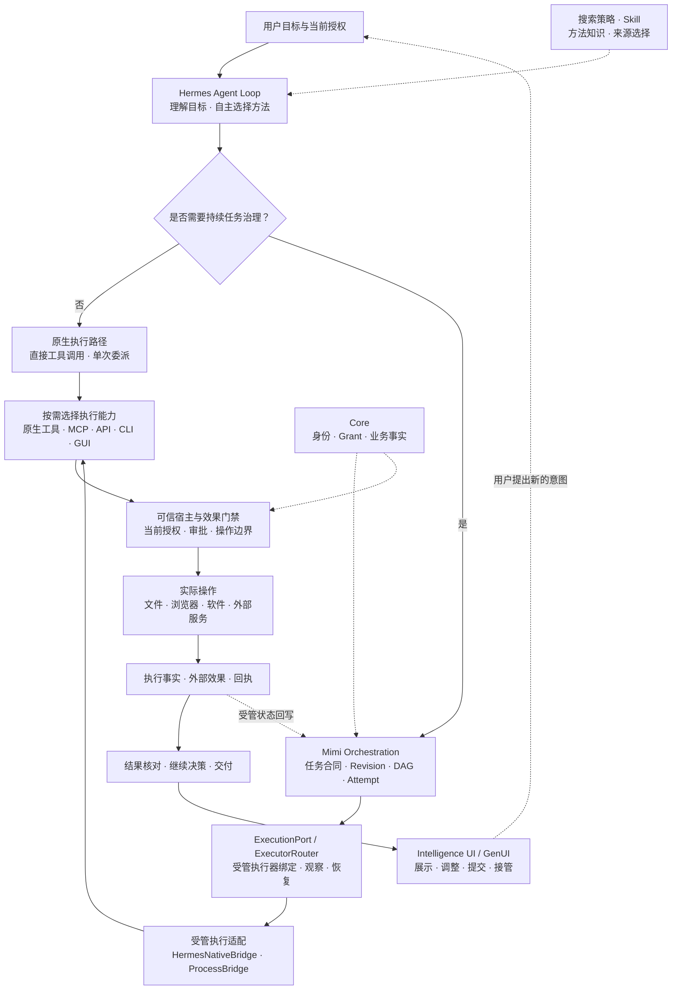

[返回 MGRS 规范总览](../MGRS.md) · 第四部分 / 六

# 第四部分 · 执行与外部效果

前三部分确立了用户委托的权能边界、单轮请求的上下文装配方式以及协作规划机制。第四部分进一步回答：**当 Agent 已经决定采取行动，Mimi Harness 如何将这一判断转化为真实的软件操作，并在执行能力、权限边界与外部效果之间建立可核验的对应关系？**

个人 Agent 的价值在于真正参与用户的日常工作流，通过 `MCP` 连接在线服务，通过 `API` 与 `CLI` 调用本地程序，通过 `GUI` 操作桌面与网页软件，在需要时委派其他 Agent 协同，并将最终结果带回主工作空间。用户在保留原有软件、账户与工作习惯的前提下，由 Mimi Harness 承担跨工具的调度与交接。

这正是 Mimi Harness 执行层的设计目标：**允许模型自主选择工具与方法，将异构的执行能力接入同一套任务与授权体系，同时保留每种执行方式自身的交互与运行特征。**

## 4.1 执行层的能力分层

Mimi Harness 复用了 Hermes 底座成熟的原生工具调用、`MCP` 接入与 `Skill` 加载机制，并将执行层划分为职责清晰的协作层次：

| 组成部分 | 在执行层中的职责 |
| --- | --- |
| **Hermes Agent Loop** | 模型判断下一步动作、选择调用接口、接收返回结果并继续推理。 |
| **搜索策略** | 指导模型何时检索、如何组织查询、优先采信哪些来源以及何时停止。 |
| **Skill** | 沉淀可复用的工作方法、操作步骤与适用前提。 |
| **原生工具与 MCP** | 向模型提供可发现、可调用的标准化操作接口。 |
| **API、CLI、GUI** | 通过不同交互协议实际操作外部系统与桌面/网页软件。 |
| **ExecutionPort / ExecutorRouter** | 为受管任务绑定、分流、观察和恢复后端执行器。 |
| **Core 与可信宿主** | 维护当前身份、对象级权限、审批凭证及实际业务操作状态。 |
| **Intelligence UI / GenUI** | 将信息与操作意图呈现为用户可理解、可调整并可直接提交的交互界面。 |

这些组件在运行期按需组合：搜索策略与 `Skill` 提供方法知识，原生工具与 `MCP` 提供标准化接口，`CLI` 与 `GUI` 提供跨软件操作能力，而宿主与任务合同在底层统一约束权限与效果边界。例如，当用户要求收集一组研究资料时，模型先依据搜索策略调用检索工具定位学术文献；遇到需要登录或复杂网页交互才能获取的原件时，再在当前授权范围内调用受控浏览器能力完成提取。

## 4.2 从模型判断到真实执行

在 Mimi Harness 中，模型负责根据目标自主选择方法，可信宿主与执行门禁负责核定并维护对应的执行条件。

普通请求沿保留的 Hermes 原生工具路径直接运行；需要任务版本追踪、跨会话持续推进、多 Worker 接力或异常恢复的工作，则进入 `Mimi Orchestration`，通过受管任务合同驱动执行：

在这一链路中，`ExecutionPort` 负责受管任务的执行器绑定与生命周期管理，常规对话中的普通工具调用直接走原生执行路径即可。同时，方法选择与权限核定保持正交：模型可以判断浏览器更适合完成某项网页操作，但该浏览器会话归属哪个身份、允许访问哪些域名与本地文件、是否允许提交写入，始终由可信宿主裁决。

## 4.3 MCP：连接外部生态与绑定连接身份

`MCP` 在 Mimi Harness 中承担外部服务连接与工具协议适配的职责，使秘秘能够直接接入用户现有的邮件、日历、文档、文献库与企业协作平台，让用户无需迁移到封闭生态即可获得完整的助理协作能力。

在连接治理上，Mimi 严格区分**工具能力可见**与**具体调用已获授权**，并将每个 `MCP` 连接的运行状态与当前身份上下文强绑定：

- **连接身份与来源绑定**：每一条活跃的 `MCP` 连接都明确绑定所属 `Principal`、`Profile`、连接实例与代次，以及关联的 `Core` 对象授权。
- **状态变更即时失效**：当用户切换账户、切换工作 `Profile` 或撤销某项数据域 `Grant` 时，与旧上下文绑定的调用授权及缓存许可立即失效；旧连接不得继续用于新请求，必须依据最新授权重新核验后方可调用对应工具。

对于尚未提供 `MCP` 适配器的传统软件或本地工具，执行层通过 `CLI` 与 `GUI` 能力提供互补的操作路径，共同构成完整的工作环境覆盖。

## 4.4 自研搜索策略：让检索为证据质量服务

搜索是 Agent 获取外部事实的核心途径，也是信息质量波动最大的环节。Mimi 沿用 Hermes 原生的 Web 搜索与内容提取工具，并在方法层引入自研搜索策略作为治理规范，指导模型在推理循环中识别事实缺口、组织查询并评估证据充分性。

这套策略由四项明确的检索原则构成：

1. **专业知识优先定位学术研究**。作为 MGRS 的检索治理原则，涉及学术、科研与专业技术问题时，优先通过 `OpenAlex` 等专业文献发现渠道定位相关论文、作者、研究成果及原始出版物。`Wikipedia` 可用于快速识别基础术语与检索方向，但采信优先级低于专业学术原作与能够支撑具体主张的权威研究资料。同时，`OpenAlex` 承担的是文献定位职责，找到目标论文后，模型仍需进一步读取论文正文与研究材料，以原始论证作为证据依据。
2. **一般检索保留英文信息源的默认高优先级**。在国际技术动态、前沿科研成果及以英文为主要发布载体的领域中，检索治理策略默认给予英文一手资料更高的发现优先级，以提升信息密度与溯源准确度。当任务涉及中国内地政策法规、本土机构公告、中文原始档案或用户明确限定的资料范围时，则直接定位对应中文原件，确保原始语境与事实准确性。
3. **优先追溯原始资料而非二手聚合**。学术结论追溯原论文，统计数据追溯原始数据表与统计口径，法律条文追溯现行正式文本，软件与工程问题追溯对应源码、官方文档或实测记录。搜索结果的标题与摘要仅用于筛选候选来源；形成正式判断前，Agent 需阅读足以支撑结论的原文段落，并保留出处位置与适用前提。社区讨论与用户评价可用于分析实践体验或观点分歧，并在引用时明确标注其经验属性。
4. **围绕真实信息缺口收窄检索并适时停止**。首轮检索锁定具体对象、文献标题或发布机构后，后续查询应直接收窄至目标来源，避免使用近义关键词反复抓取同质摘要。若目标网页存在但常规提取受阻，应转向已授权的受控浏览器、原件下载或专用文档读取工具获取内容。当核心问题已获得充分的原始证据支撑、且不存在影响结论的未决冲突时，检索即行停止并进入回答或综合阶段。

需要明确的是，搜索策略属于方法层治理原则。当前搜索插件的基础策略（`policy.md`）侧重按资料实际产生地选择语言；上述英文信息源默认优先级与 `OpenAlex` 发现优先级作为指导模型检索行为的治理规范确立，并非由搜索插件代码强制执行的固定排序算法。同时，具体允许调用哪些外部检索接口、能否访问受限数据库或下载原件，仍受第一部分与 4.2 执行门禁的读取授权边界约束。

## 4.5 Skill：让工作方法能够积累、复用和演进

`MCP` 与工具提供原子操作接口，而 `Skill` 沉淀的是组织多步工作的领域方法，例如如何执行系统性文献综述、如何按特定体例撰写研报，或在何种数据缺口下暂停并向用户请求补充。

Mimi 复用 Hermes 原生的 `Skill` 目录发现与按需加载机制，并通过 `skills_release` 建立了完整的生命周期治理：

- **从经验候选到受管发布**：在某次任务中验证有效的工作流程可提炼为经验候选，经过测试和审核后，按发布合同进入受管 `Skill` 目录并标注来源与版本。
- **阶段分离与权限隔离**：系统分别记录 `Skill` 的目录发现、候选生成、审核批准、正文加载与实际执行。加载一份包含命令行示例或工具调用建议的 `Skill`，仅向模型提供方法知识，绝不自动赋予执行该命令或调用对应外部服务的权限；所有实际动作仍需通过当前身份与任务的授权门禁。

## 4.6 统一执行网关：多后端能力路由与隔离边界

除原生工具与 `MCP` 外，个人 Agent 还需要调度外部推理模型、命令行脚本、独立 Agent CLI 以及桌面图形界面软件。由于不同后端在交互模式、运行周期与状态可观测性上差异显著，执行层将调用语义划分为三类运行合同：

- **纯推理（`Inference`）**：接收输入上下文、模型配置与结构化输出约束，返回推理结果，本身不附带文件读写、网络请求或外部工具执行权限。
- **受管 Agent 任务（`Agent Task`）**：接收任务目标、上下文引用与执行边界，由后端执行器在授权范围内自主推进，并按其实际支持的能力提供执行状态、进度或检查点，以及最终结果回执。
- **受控工具操作（`Tool Execution`）**：面向具体的命令行动作、`API` 调用或界面操作，依据当前授权执行并返回可核验的结果回执。

在架构分流上，**`ExecutorRouter` 专门负责管理受管任务的后端绑定与路由，纯推理请求与常规原生工具调用无需经过 `ExecutorRouter`。** 对于进入受管编排的任务，原生子 Agent 通过 `HermesNativeBridge` 桥接至底座的原生委派机制；需要独立进程边界的外部脚本与 CLI 工具则通过 `ProcessBridge` 接入，并遵守明确的隔离边界：

1. **执行器契约固定与运行期重检**：`ProcessBridge` 使用可信宿主预注册的可执行命令、受检环境变量与工作目录，在进程运行期间持续重检授权状态；一旦发生撤权，阻断后续步骤并尝试终止在途进程。
2. **底层凭据零透传**：外部进程不继承可信宿主、`C0` 协调层或 `Core` 的底层认证密钥与全局会话令牌。其实际可访问的数据与系统资源，还必须由执行环境中的权限及隔离机制限定。
3. **执行环境与沙箱隔离**：`ProcessBridge` 约束的是受管命令与授权参数，本身不等同于操作系统沙箱。涉及文件系统边界、网络访问限制与进程级硬隔离的防护能力，由对应的执行环境和沙箱机制承担，并与材料引用授权（`MaterialRef` 权限控制）协同落实最小权限原则（`G02`）。

## 4.7 GUI 与 Intelligence UI：操作软件与用户交互的双重界面

图形界面在 Mimi 的执行体系中承担两项相互配合但职责分明的角色：

- **`GUI` 自动化（Agent 操作外部软件）**：面向桌面应用与网页系统，Agent 通过观察屏幕状态执行点击、输入与导航操作，从而在不要求用户更换软件生态的前提下完成跨应用工作流。作为执行能力，它与 `CLI`、`MCP` 遵循同等的授权与门禁约束。
- **`Intelligence UI` / `GenUI`（用户操作秘秘生成的工作界面）**：模型将复杂信息与待定方案组织为可交互的卡片、图表、参数选择器与结构化工作对象，替代冗长的纯文本来回确认。用户在控件中的局部调整先在客户端本地交互，必要时按控件合同持久化状态；**对应的外部操作是否直接执行，则由当前有效授权决定。只有需要额外确认或用户接管的操作，才必须等待用户明确提交，不能要求已经授权的日常操作反复点击确认。**

例如，在秘秘生成的行程协调界面中，用户可以先在本地工作区内拖动调整备选时段并按控件合同保存状态；若当前任务已具备有效的日程修改授权，确认方案后即可按授权执行写入，而无需每次重新弹窗审批；仅当涉及未预先授权的外部邀请变更或资金支付等高敏感动作时，才暂停等待用户提交或由用户接管完成最终确认。

## 4.8 效果等级、审批与非幂等操作

MGRS 将现有的 ACL、审批策略、工具限制、执行 Profile 与业务操作检查等具体门禁机制，统一映射为 **`E0` 至 `E3` 四级效果风险标尺**，依据操作的真实外部后果裁决所需的授权强度：

| 效果等级 | 风险定义 | 典型操作与门禁裁决 |
| --- | --- | --- |
| **E0** | **只读（Read-only）** | 检索文献、查询邮箱、读取日历与查看文件，不改变目标业务或外部对象状态。满足有效读取 `Grant` 与 `Scope` 即可自动放行。 |
| **E1** | **有界可逆（Bounded & Reversible）** | 影响范围受控、具备明确回滚或撤销路径的局部变更（如保存草稿、可逆的状态调整）。在有效任务与操作授权范围内直接执行并留存记录。 |
| **E2** | **对外或难以逆转的效果（External or Hard-to-Reverse Effects）** | 跨越系统边界产生对外影响或撤销成本高昂的操作（如发送外部邮件、修改共享日程、对外发布内容）。可依据有效的长期委托或专项授权直接执行，不必每次重新审批；缺少有效授权时须拒绝或进入既定的可信审批流程，不得由模型自行补授权。 |
| **E3** | **高权限操作（High-Privilege Operations）** | 涉及生产环境权限变更、敏感凭据访问、跨租户操作或关键系统配置修改等高风险动作。强制触发最高级别门禁校验与显式确认。 |

同一连接器下的不同工具依据实际效果分别定级。例如查询收件箱属于 `E0` 只读操作，而通过同一邮件连接器向外发送邮件则属于 `E2` 对外效果，必须满足独立的发送授权。对于已被用户纳入有效长期委托或专项授权的常规动作，只要授权代次未变且目标对象仍在 `Grant` 范围内，门禁层依据 `G12` 原则直接放行，避免重复弹窗干扰用户。

针对不可逆或具备外部副作用的操作，Harness 为每一次执行意图分配稳定的 **`request_key` / `effect_id`** 实施幂等约束。在系统状态模型中，**执行成功、调用成功、效果发生和效果得到确认是四个相互独立的状态**。当外部请求因网络超时未返回确认回执时，首先将该次操作的外部效果记录为 **`UNKNOWN`**，保留原有请求标识与执行依据，并在同一次操作上对账。`Attempt` 的运行生命周期与外部效果状态分别维护：**只有确认底层执行进入静默停止状态（`quiet`），才释放相关资源预约；即使执行已经停止，外部效果仍可能需要独立回查。** 不能因无回执而换用新标识直接重试，也不能在状态未明时假定原执行已经终止。

## 4.9 执行效率与操作可靠性

完善的执行治理与低延迟响应并行不悖。常规工具调用在当前可信宿主与授权上下文内直接完成门禁核验，无需为每次操作额外引入审核模型或重型编排流程。

针对执行链路中的不同延迟来源，Mimi 采用分层的性能优化与缓存纪律：非敏感工具目录与 Schema 描述可在会话内复用，已建立的外部连接可在合法生命周期内保持活跃，但**任何历史缓存均不能替代实时授权校验，一旦发生路由撤销或权限变更，受影响的调用授权立即失效**。同时，`API`、`MCP`、`CLI` 与 `GUI` 依据具体**任务性质、可靠性、权限边界与执行成本**综合选择，各自承担最匹配的交互与自动化场景，`GUI` 也不必永远被限定为其他接口不可用时的最后手段。

至此，MGRS 构筑了完整的执行治理闭环：Hermes 提供核心推理与原生工具循环，搜索策略与 `Skill` 提供方法规范，`MCP`、`CLI` 与 `GUI` 延伸操作边界，统一执行网关协调多后端隔离运行，`Core` 与可信宿主刚性守护权限与回执边界，`Intelligence UI` 则让用户能够直观理解、调整并接管关键动作。

当执行动作落地之后，系统凭什么裁定产出结果真实有效、下游 Worker 如何确认已消费上游证据，以及在任务中途修改、撤权或出现 `UNKNOWN` 状态时如何完成安全恢复与最终交付？这正是第五部分（结果验收、异常恢复与成果交付）所要规范的内容。

**正式约束：** [工具与效果等级](../spec/07-tools-and-effects.md#mgrs-7) · [Skill 生命周期](../spec/08-skill-lifecycle.md#mgrs-8) · [持续恢复](../spec/11-host-and-recovery.md#mgrs-11) · [G02、G04、G09、G12](../spec/03-invariants.md#mgrs-3)。

**工程依据：** [自研搜索策略](../docs/006-search-strategy.md) · [11 月 9 日系统基线](../docs/sources/2026-11-09-system-baseline.md) · [11 月 11 日集成记录](../docs/sources/2026-11-11-integration.md)。
