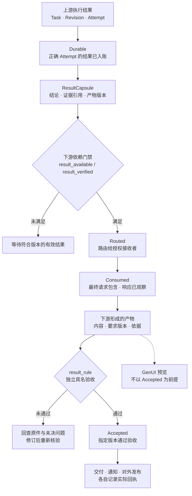
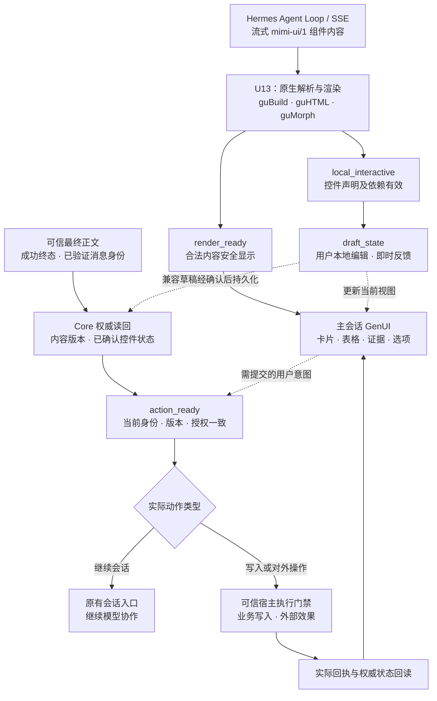

[返回 MGRS 规范总览](../MGRS.md) · 第五部分 / 六

# 第五部分 · 成果交接、验收与交付

用户让秘秘“把今天会上讨论的行动项整理成纪要，已经有人认领的和还要确认的分开，先给我审阅”。负责读取会议记录的 Agent 在转录稿里找到了一句“这个我可以先了解一下”；负责撰写纪要的 Agent 接过材料后，直接把说话人填进了“负责人”一栏。两个 Agent 都顺利完成了各自步骤，纪要文档也成功生成，但用户最在意的事实边界在交接过程中丢失了。

第四部分说明 Harness 如何确认一次操作产生了什么外部效果，第五部分则聚焦于**工作成果本身**：上游的结论怎样连同依据交给下游，谁根据用户当前的要求验收产物，以及通过验收的那一版最终交到了哪里。简单请求可以由主 Agent 当场核对并答复；当工作涉及多个 Agent、跨会话延续或产物修订时，这些关系需要留下可追溯的记录。

## 5.1 从用户要拿到的成果确定验收条件

在受管任务中，主 Agent 根据用户目标明确交付物、目标接收者和验收条件。其中，`result_rule` 负责声明产物应满足的具名验收要求，交付对象与授权范围则由任务合同及可信宿主分别维护。验收条件要具体到足以核查产物，也要保留模型选择工作方法的空间。

就这份纪要而言，用户给出了三个可以直接核对的要求：

1. 纪要覆盖会上讨论的行动项；
2. 凡是写为“已认领”的事项，都能在会议材料里找到相应依据，仅有初步意向的另列为待确认；
3. 成稿先交给用户本人审阅。

由一个 Agent 通读会议记录，还是分别提取后再汇总，可以由主 Agent 决定；但把“待确认”擅自改成“已认领”，或者把“交给我审阅”擅自扩大为“发给所有参会者”，都会改变用户委托的内容。

同一份材料可以支持不同的交付物。“我可以先了解一下”足以记入讨论纪要，也足以解释这件事为什么还要跟进；但如果用户要求交付一份每项工作都已有人明确认领的分工表，这句话就留下了一个具体缺口。若既定任务合同允许阶段性交付，Agent 可以直接提交已核实成果，并明确标注仍待确认的事项；只有当部分成果无法满足原定交付要求、需要改变验收标准或交付范围时，才应将这一决定交回用户。

[任务纪律](../spec/06-task-discipline.md#mgrs-6) · [判断边界](../docs/005-review-and-conformance.md)

## 5.2 让结论带着依据交给下一个 Agent

一次有用的交接，要让接手者既能继续工作，也能在有疑问时回到原件。MGRS 用 `ResultCapsule` 描述受管结果的交接合同，它在已有任务、结果和材料记录上关联三组信息：

| 接手者需要知道什么 | 交接合同记录什么 |
| --- | --- |
| 这份结果回答的是哪一次要求？ | `task_id`、`requirement_revision`、`attempt_id` 和 `result_id`，以及产出结果的 `producer_profile`。 |
| 每项结论能追溯到哪里？ | 结论对应的 `evidence_refs`、`artifact_refs`（指向具体版本的材料与产物引用）、适用条件和不确定性。正式合同保存的是**结论与版本化原件之间的引用**，而非拷贝整份原件；材料之间的冲突和未决问题随结果保留。 |
| 谁可以接手，接下来需要什么？ | 可信宿主确定的授权接收者，以及下游任务所需的 `next_dependency_refs`。接收方按当前授权、任务版本和结果有效性回读必要原件。 |

在纪要任务中，上游可以交回“发言人表示愿意先了解此事”，附上会议记录中对应的发言位置，并保留“是否认领尚待确认”。写稿的 Agent 收到的是一个有范围的判断：它可以直接沿用这一结论，也可以在授权范围内回读前后几句，检查同一人在会议稍后是否明确接下了任务。这样的交接只需传递与工作有关的材料和依据，无须把上游整段聊天塞进下一次模型请求。

如果用户中途把范围改为“只整理本周要交的事项”，原来的发言记录仍可作为证据；已经生成的整份纪要则属于旧要求。接手者须按新范围重新筛选，标明哪些事项有本周交付的依据，再提交对应新版本的产物。这样既能复用已经核实的材料，也能看清哪一次验收回答了哪一次要求。

[ResultCapsule 合同](../spec/05-task-result-capsule.md#mgrs-5) · [G05 与 G07](../spec/03-invariants.md#mgrs-3)

## 5.3 从结果入账到下游产物验收

假设上游已经找到了那段发言，最终纪要却仍把发言人列为负责人。要找出问题，需要知道材料在哪一步丢了，或者在哪一步被误读了。MGRS 为此区分四种可以独立核对的事实：

| 回报层级 | 核对的对象 | 在纪要任务中能确认什么 |
| --- | --- | --- |
| **`Durable` · 已入账** | 一次执行产生的结果 | 提取结果由受管任务账本持久记录，绑定正确的 `attempt_id`、任务版本与结果引用。`ResultCapsule` 在现有记录之上形成交接投影，不因此增设另一份结果权威。 |
| **`Routed` · 已路由** | 结果与授权接收者 | 这份材料已经路由到负责撰写纪要的会话，接收者与任务匹配。 |
| **`Consumed` · 已进入请求并观察到响应** | 下游的一次实际模型调用 | 写稿请求包含所需结果或规定的证据引用（`request_included`），并观察到该次请求的响应（`step_observed`）。若传入的是引用，记录所能证明的是该引用进入了请求。 |
| **`Accepted` · 已通过验收** | 指定版本的下游产物 | 对该版纪要执行了事先声明的检查，正式认领、跟进意向和待确认事项的处理符合用户要求。 |

进入下游请求的是上游材料，最终要检查的是下游根据材料写出了什么。产物验收是一项独立检查，而非模型收到材料后的自然结果：

图中的箭头表示需要独立核对的交接关系，并不表示上一个状态成立就能自动授予下一个状态。尤其是 `Consumed` 只证明结果或其引用进入最终请求并观察到响应，不能代替对产物及原件的核验。下游满足 `result_available` 或 `result_verified` 中声明的依赖门禁，也不意味着它生成的产物已通过 `Accepted`。

这些记录会导向不同的处理路径：

- **材料只到达了会话（卡在 `Routed`）**：应核对下游最终请求的装配情况，通过 `InputAdapter` 补齐必要输入后重新推理。
- **已达 `Consumed` 但未通过 `Accepted`**：说明所需结果或材料引用已进入下游最终请求并观察到响应，但这不能独自证明模型已完整读取原件或正确理解其含义。此时应回查原始依据与产物，判断是材料读取不充分、解释错误还是结论越界，而不是重新发送一遍同样的材料。

验收按任务选择合适的依据：工程产物可以用相关测试、接口回执或产物检查来验证；纪要与研究报告则需要核对关键表述是否得到原件支持，结论有没有越出材料范围。生产者的自评与验收结果分别记录。需要独立判断时，审阅者应能在授权范围内看到产物及其依据；如果两种解释都有根据，交付时应保留分歧及各自对应的材料。

[四级交接语义](../spec/05-task-result-capsule.md#mgrs-5) · [G03 与 G06](../spec/03-invariants.md#mgrs-3)

## 5.4 成果交付与 GenUI 的持续交互

工作成果可以根据任务进展，以流式预览、阶段性产物或最终交付的形式呈现在用户指定的工作空间。结果展示不以最终验收完成为前提，但必须清楚区分内容生成状态、具名验收状态与正式交付状态。对需要验收的受管成果，系统依据当前 `result_rule` 核对指定版本；尚未验收的成果仍可供用户查看与修订，但不得被标记为已经通过验收。

交付形式取决于用户希望怎样理解和使用结果，可以是一段直接回答、一份文档、一组可回读的材料引用，也可以是会话中生成的交互界面，并不要求所有工作都经过独立的交付页面。

**Intelligence UI / GenUI 使秘秘能够将工作成果组织成用户可以直接理解和操作的界面，而不局限于一次性输出的自然语言文本。** 模型可以根据任务内容生成卡片、表格、图表、参数选择器和其他结构化组件，将关键结论、证据出处、未决问题与可执行操作放在同一会话中呈现。

在流式生成与持续交互中，GenUI 依据三项独立的就绪条件运作：

- **`render_ready`**：当前内容结构可以安全呈现；
- **`local_interactive`**：相应控件满足本地交互条件，可以立即响应用户操作；
- **`action_ready`**：满足当前内容、身份、版本和权限条件，可以进入权威动作提交流程。

这三个条件不应被理解为必须按顺序完成的整页状态机。某个控件可能已经满足 `local_interactive`，允许用户筛选或编辑，而整条回答仍在流式生成。通过将流式展示、本地交互与实际业务操作资格分别判断，系统既能避免未完成的生成内容提前触发外部动作，也能防止后续流式输出覆盖用户已经作出的有效编辑。

例如，在会议纪要任务中，秘秘可以将已确认的行动项与仍待确认的事项分开显示。用户点击某一项，即可在授权范围内查看相应会议发言及原始证据；调整负责人或截止日期后，界面能够即时反映新的选择，并将需要保存的修改提交到当前任务或业务对象。这里严格区分两类事实：

- **原始历史事实**：会议上原本说了什么，仍由原始记录及其版本化引用证明，界面不能为了让最新表格看起来完整就反过来修改历史发言的含义；
- **用户后续修订事实**：用户通过 GenUI 作出的临时调整首先属于本地交互状态；经可信宿主确认保存后，才形成对应控件或业务对象的有效版本。只有当修改涉及受管任务的目标、约束或验收条件时，才通过 `amend_task` 更新任务的 `requirement_revision`，并处理受影响的下游依赖。所有修改均不得反向改写原始会议陈述。

GenUI 中的交互根据实际动作进入不同路径：本地筛选、复制和临时参数调整可以直接完成；需要保存控件状态时，依照当前消息身份、内容版本和控件合同进行持久化；需要继续模型协作时，沿用原有会话入口；涉及业务写入或外部效果时，则通过可信宿主和第四部分的执行门禁处理。已经获得有效授权的常规操作可以直接推进；超出授权的操作必须依照现行宿主政策拒绝或进入可信审批，确需用户接管的操作则交由用户完成。

**界面的可操作性不改变结果本身的权威来源。** 模型生成的内容、Hermes 原生会话记录、受管任务结果、Core 业务状态以及已确认的控件版本，各自保留明确的状态权威与版本关系。GenUI 控件状态最终仍由既有 Core 机制确认，不另设平行的事实权威。用户操作后，应依据实际写入、执行和回读结果更新界面状态，而不是由前端自行宣布业务已经完成。

因此，交付还需要区分几个具体事实：**成果已经生成**、**指定版本已经通过验收**、**用户能够在工作空间中访问**、**用户已经收到通知**，以及**内容是否真正发布到外部系统**。对于尚有缺口的部分成果，也应让用户看到哪些内容可以使用、哪些判断尚待核实，而不必因为存在一项未决问题就隐藏整份工作。用户可以继续在同一个主会话中修改要求、检查材料或发起下一步操作，原来已经形成的成果、证据和执行记录则继续保留其版本关系。

下面的示例不重新定义 `ResultCapsule` 或 GenUI 的权限。它们仅将这一节的治理关系落实成秘秘原生 `mimi-ui/1` 组件输出：一个界面可以同时显示结论、原件依据、待确认项与可编辑的局部选项。

| 会议纪要审阅 | 研究证据回读 |
| --- | --- |
|  |  |
| Worker 结果交接 | 日程操作预览 |
| --- | --- |
|  |  |

**图例由秘秘 `mimi-ui/1` 原生 `guBuild` / `guHTML` 渲染得到，使用虚构数据，是包含实际组件 DOM 的静态 SVG 预览，不是产品运行截图或真实业务执行凭据。** [查看四组组件代码与生成说明](../docs/examples/genui/NATIVE.md)；[查看其他 SVG 设计示例及 GenUI 工作流程](../docs/examples/genui/README.md#genui-在交付中的交互流程)。

### GenUI 的原生渲染与交互流程

下图把秘秘的 `mimi-ui/1` 代码渲染、局部草稿、Core 确认与真实业务执行放在同一视图。三种就绪条件分别判断，不要求整条回答完成后才能操作已就绪的本地控件，也不以界面显示代替外部效果回执。

该图是 **GenUI 与 Core / 可信宿主之间的责任关系**，不是要求所有操作按顺序经过的审批流程。完整组件输入和静态预览见 [原生渲染示例](../docs/examples/genui/NATIVE.md)，具体契约见 [GenUI 流式渲染设计](https://github.com/mor765504-gif/assisthub/blob/b7031dbc3fd5f16611486311c7007f2b633a7337/docs/plans/2026-11-07-genui-streaming-rendering.md)。

## 5.5 规范映射与跨端状态契约

第五部分的交付、验收与界面状态机制直接对应 MGRS 的核心不变量及跨端契约。`ResultCapsule` 的版本化证据引用由 [专门合同](../spec/05-task-result-capsule.md#mgrs-5) 约束：

| 规范 / 契约 | 第五部分对应的治理职责 |
| --- | --- |
| **G03** | 将结果持久化、下游消费、产物验收、用户通知和外部发布分别记账。 |
| **G04** | 交付触发非幂等外部操作时，保留稳定请求标识，未知效果先对账。 |
| **G05** | 任务要求修订后更新有效版本，使不满足新要求的旧结果及相关下游依据失效。 |
| **G06** | 区分输入持久化、最终模型请求包含、响应观察与产物验证。 |
| **G07** | 按当前 Profile、Scope 与 Grant 限制跨 Agent 材料读取及交付展示。 |
| **G08** | GenUI 和 Workshop 的派生视图不能成为新的业务事实权威。 |
| **G12** | 已获授权的常规操作直接推进，不因形式化交付流程要求反复确认。 |
| **G14** | 客户端退出、会话切换和故障恢复不清除已有结果、版本及交付记录。 |
| **Web / Mac 与后端契约** | 基于可信会话、身份和 Core 状态读回，管理跨端展示中的状态来源、版本与观测时间；GenUI 流式渲染和控件状态一致性则由专项交互契约约束。 |

[Web/Mac 与后端契约](../spec/12-web-mac-contract.md#mgrs-12) · [G01 至 G14 正式不变量](../spec/03-invariants.md#mgrs-3)

至此，第五部分打通了从“用户定义验收标准”到“结构化依据交接、四级状态核验与持续交互交付”的完整链路。第六部分（持久状态、恢复与运行观察）进一步规定：当会话切换、客户端关闭或宿主重启时，任务、产物、已确认的界面状态与未决操作怎样保持连续，并在恢复后重新取得有效的执行与交付依据。
