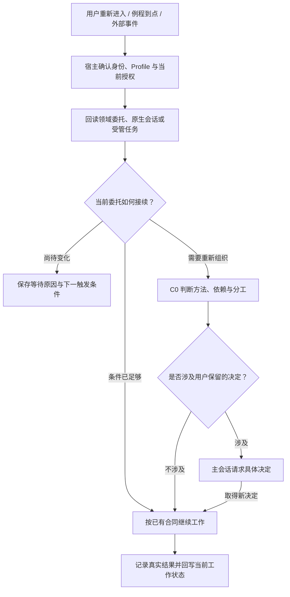
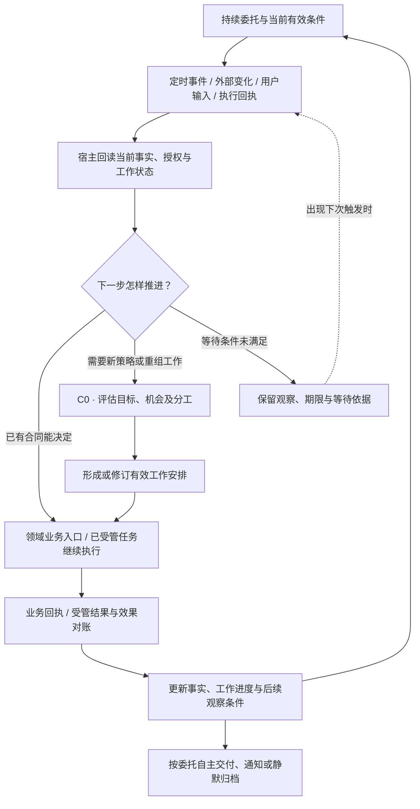
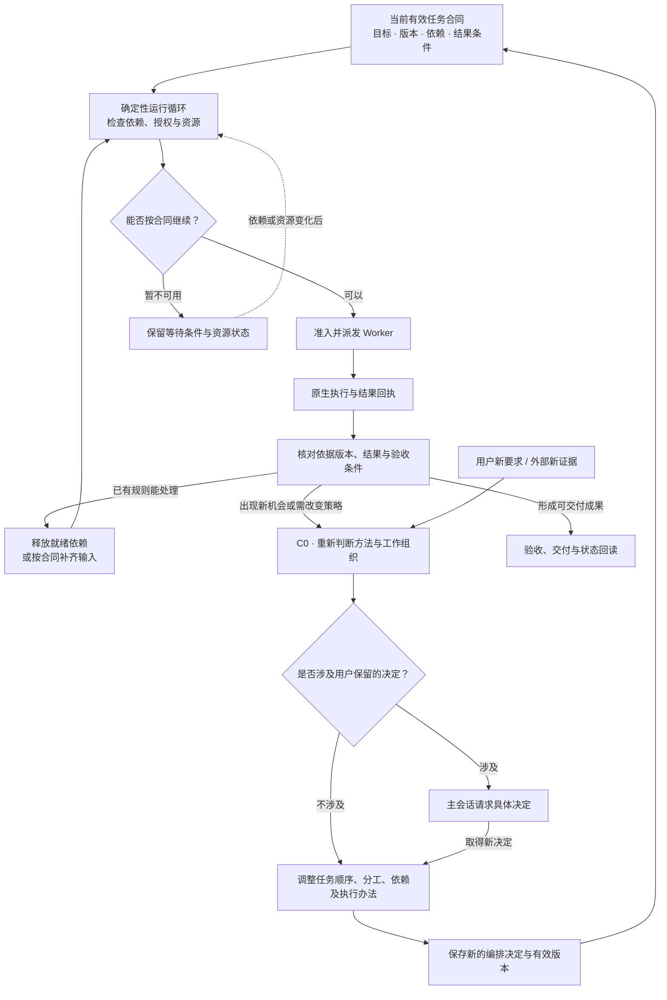

[返回 MGRS 六部分索引](../MGRS.md) · 第六部分 / 六

# 第六部分 · 持续工作与运行治理

设想周一有这样一项委托：用户交代秘秘，“帮我腾出周五下午。组会我自己协调，另一场你先找合适的时间，给我看过再发。” 秘秘当天就能查出备选空档，但整件事往往要到周四才有结果。周二，用户自己改好了组会；周三，对方回信说“那天应该可以”，却没说明指哪一个时段；周四，用户换到另一台设备追问：“周五现在怎么安排？”

称职的个人 Agent 在此刻应当给出清晰现状：哪场会已经改好、由谁修改、另一场还差什么确认，以及哪份草稿可直接审阅。在用户离开的几天里，秘秘自主推进已获授权的工作，在等待外部答复处挂起，在环境变化时动态调整计划，并在约定的决策点准确唤回用户。这段时间里，秘秘承担的是持续跟进并组织一项委托的责任——沿着“持续委托 → 事件观察 → 自主判断与执行 → 结果与经验积累 → 下一轮工作 → 跨环境接续”的完整链路，主动感知变化、积累工作经验、自主协调执行，并守住委托边界。

前五部分分别确立了委托来源、上下文装配、协作编排、执行门禁与成果交付。第六部分将它们贯通到时间维度与运行环境中：单次推理结束后，有效委托继续运转；中断、换端或迁移宿主后，已发生的客观事实、工作现场与用户修订持续生效。

## 6.1 怎样把一件事接到明天

“帮我找个空档”“等对方回信再安排”“这个月帮我留意机票”虽然都以自然语言发起，但接单后需要跨轮次保存的状态结构截然不同。找空档可在当前会话内即时完成；等回信需要登记等待对象、关联事件与后续动作；机票追踪则需持久化航线、价格阈值、有效期、检查频率与历史提醒记录。跨天接续的第一步，是准确保存尚未履行的委托承诺：

| 工作形态 | 跨轮次保留的核心状态 | 下一步触发入口 |
| --- | --- | --- |
| 会话中的直接工作 | 原生会话上下文、已给出答复、材料或草稿引用 | 用户追问时，核对关联对象现状后继续答复 |
| 有期限的领域委托 | 观察对象、触发条件、检查频率、到期时间、上次有效观察及通知回执 | 定时器到点或相关业务事件到达时，按最新条件核验 |
| 有依赖的受管任务 | task_id、当前要求版本（revision）、上游依赖结果、执行尝试、已占资源与等待原因 | 依赖就绪、资源释放、用户修订要求或执行器返回结果时重新调度 |

在标识体系上，受管任务以 task_id 跨会话接续，普通对话沿归属原生会话恢复，领域委托直接绑定业务对象——机票追踪持有独立 watch_id，周期例程按提供方与 job_id 绑定，每次实际运行再以 run_id 独立记账。用户在另一台设备打开同一项观察时，直接读取已保存的条件与上次通知状态；跨端重连只同步既有视图，不会触发重复查询或重发提醒。[例程的运行身份][routine] · [机票观察的版本与生命周期][travel]

在存储分工上，Core 维护业务事实与对象授权，Hermes 原生会话保存对话与工具轨迹，Orchestration 在宿主 SessionDB 中管理受管任务及其执行尝试，外部文档则由版本化原件引用定位。聊天摘要用于快速定位线索，而任务契约、材料版本、业务状态与当前有效授权共同决定下一步行动。

## 6.2 用户没有发新消息，工作如何往前走

持续工作的常态包含大量静默等待期——距离下次比价还有六小时、Worker 正在撰写初稿，或外部联系人尚未回信。MGRS 要求宿主将“下一次推进的触发条件”持久化落盘：定时器到点、上游结果入账、执行器返回回执、资源释放或用户补充新指令，均可唤醒编排循环重新评估。凡能通过时间戳、版本号与状态字段判定的检查均由程序直接完成，仅在需要理解新材料、权衡方案或调整计划时才发起模型推理。在可观测性上，调度器唤醒一次、出现一件待处理业务、实际调用一次模型作为三项独立事件分别计数，使后台工作在关闭客户端后仍能低成本持续推进。[编排运行循环][recover]

秘秘的秘书例程展示了这一机制的完整运转：例程启动后先通过 Core 同步 Moodle 作业与课程，按用户所属分组展开课表，再纳入邮件事项与到期订阅提醒，核对外部已办结事项后按剩余可用时间排程。若课表缺失，系统如实标注空档计算依据不足；若单次邮件同步失败，则保留该项缺口并照常推进其余有据可查的安排。最终输出的排程清单明确列出被替换的旧安排、无法排入的事项以及各自还缺多少分钟。[秘书例程源码][tick] · [发布仓对应实现][tickprod]

推进还意味着跟上用户在秘秘之外已经完成的动作（例如自行提交了作业或直接回复了邮件）。开发仓的邮件核对逻辑在匹配候选邮件时保持审慎分寸：即使发件人、主题与时间高度吻合，只要邮件与任务之间缺少可靠的持久绑定，系统便只将其记为“待核线索”，而不擅自销项。回到开头的周五日程例，那封“应该可以”的回信会触发上下文核查——只有确认对方明确指向哪一个时段，系统才据此更新备选方案。[邮件与等候事项的核对依据][reconcile]

持续委托同样具备清晰的收尾与控制语义：一次性协调任务在验收交付后完结，限期观察在到期后自动终止，周期例程则支持用户的细粒度调整。现有实现将“暂停例程运行”与“延后询问是否保留”拆分为两个独立操作——后者仅调整确认提醒的节奏，例程本身继续按约运行。同时，系统分别记录已完成运行次数、最近一次结果及用户上次查看时间（历史记录不完整时仅报告已观测到的下界）。[例程结果与查看记录][routine] · [暂停、暂缓提醒与继续保留][routineguard]

### 从定时巡检到持续演化闭环

例程、外部观察、模型判断与多 Agent 执行可以组成同一条持续演化的工作链。新的观察、用户输入或执行回执到来时，宿主先读取当前委托与授权：已经约定的处理方式直接交给对应业务入口，需要分工的任务由受管执行器按合同推进；当新证据带来更好的方案、任务之间出现取舍，或原有方法不再合适时，C0 可以主动调整后续工作的组织方式。业务回执与受管结果分别核对，并将新的事实、工作状态与观察条件带回下一轮。这让持续委托能够不断产生和完成新的工作，又不必为每次例程触发都进行一次模型规划（参见 MGRS 设计决定 D04、D08 与 D15）：

## 6.3 持续观察、自主执行与经验积累

“每六小时检查一次机票”与“每六小时打扰用户一次”是截然不同的产品体验。发布仓的机票追踪用例（每六小时巡检、低于人民币 1,300 元才考虑提醒）将后台判断拆解为三道独立关卡：[发布仓机票追踪测试][traveltest]

1. 检查节流：到点触发时，若上一轮比价仍在队列或正被执行器占用，跳过重复派发；
2. 条件完备性校验：取得报价后，核验币种、有效期、行李额度与优惠资格——缺少关键行李信息的低价票不构成有效提醒，依赖特定优惠条件的报价必须附带前提说明；
3. 打扰与有效性门禁：同类报价若已通知过用户，再次提醒必须达到约定的实质降幅；同时校验用户当地静默时段，并在临发送前二次确认该委托未被用户刚刚取消。[候选报价与再次提醒条件][travelcond] · [发送与回执][travelsend]

人类接管是委托边界触发的特定分支，而非持续工作的默认终点。当任务完全落入用户预先授予的长期委托范围内时，秘秘直接闭环执行并静默归档结果——例如在既定授权规则下自动重排冲突的例行日程、归集周报素材或分发已批准的常规纪要，仅在授权范围发生变化或遇到用户显式保留的决策时才主动询问。

同样的时机分寸也体现在能力改进上。开发仓的设计实践中，当用户急需一份处理好的 ZIP 文件而秘秘在后台发现了可优化同类流程的新工具时，系统优先按期交付 ZIP 文件，将工具改进建议归入既定的 07:45 早报，待用户审阅确认后再行安装验证。[文件交付与早报的原始讨论][issue276] · [该讨论的工程检查点][comment276]

### 从运行日志到可复用的观察记忆

后台持续运行的价值，在于让秘秘随着时间推移更理解用户的工作环境——例如连续三天追踪某项申请后识别出新增的材料要求，或从多次会议准备中总结出固定的文档清单（参见《为什么秘秘方向错了 · 2.0》）。MGRS 为此区分三层状态：

| 状态层次 | 职责与生命周期 | 治理与存储归属 |
| --- | --- | --- |
| 运行记录 | 记录单次检查执行了什么动作、取得什么原始返回。 | 留存于当次任务或例程运行账本，用于排障与审计。 |
| 持续观察记忆 | 保存跨例程可复用、带来源与有效期的动态认知（如 cron-observations 作用域内的进度变化与环境规律）。 | 后台 Agent 在已授权范围内写入，后续任务按相关性召回，随外部变化更新或过期失效。 |
| 长期个人事实与偏好 | 保存经过用户确认或长期稳定的个人习惯、偏好与核心档案。 | 统一由 Core 事实权威管理，支持随时查阅、纠正与撤回，不另设平行记忆库。 |

通过这条正向路径，后台观察在既有授权下安全写入 Core 管理的受控作用域，在后续任务中按上下文相关性进入投影视图，并在新证据推翻旧判断时及时更新或废弃。[开发仓关于后台观察的产品复盘][retro] · [主动建议对当前身份与偏好的核验][proactive]

### 从持续实践到可复用的工作方法

除了记住“外部世界发生了什么”（事实学习），秘秘反复把某一类事情做好之后，还应当沉淀“这类事情该怎么做好”的程序性经验。例如，在连续多次筹备研究组会后，系统逐步收敛出一套“定位原始文献 → 归纳核心争议 → 校验材料缺口 → 生成议程卡片”的稳定工作流。

MGRS 无需为此另建平行记忆库，而是将持续实践与既有 Skill 生命周期直接打通（参见 MGRS Skill 设计与开放议题 Q06）：

- 观察记忆保存跨周期的动态事实与环境状态；
- 任务历史与回执保存具体执行路径、工具组合与验收结果；
- 程序性经验提炼：经过多次验证的高效做法可从任务历史中提炼为 Skill 候选，经测试与受管发布审核后进入 Skill 目录，供后续同类任务按需加载复用，同时受第一部分与第四部分的执行权限边界约束。

## 6.4 双循环协作：确定性推进与 C0 动态组织

设想一份跨校项目报告的协作流水线：Worker A 负责整理申请条件，Worker B 负责核对费用，Worker C 依据核验后的申请条件起草正文。当 A 率先交回结果而 B 仍在等待校方回信时，只要 C 的输入依赖仅指向 A，调度器便立即唤醒 C 开始起草；B 的费用缺口继续留在原节点追踪，仅在最终成稿合并阶段参与整体验收。

C0 负责持续决定哪些工作值得做、应该怎样组织；确定性运行循环负责让已经决定的工作可靠地发生。两者共享任务事实，但不互相取代。

在确定性调度层，系统明确区分等待依赖（Dependency）、等待执行能力（Capability）、等待资源槽位（Resource）与人工挂起（Hold）。工作槽位满载时任务进入资源等待；外部进程执行器无法确认必需输入已进入执行上下文时，任务停留在能力检查门禁（WAIT_CAPABILITY），避免无效占用槽位，使其他就绪节点得以优先推进，并通过防饿死策略保障多任务公平调度。[受管任务的准入与资源判断][admission]

这种分工也体现在工坊的运行中定向指导。多个 Worker 并行工作时，用户无需逐个打开 Worker 窗口，只需在主会话中直接下达补充或修正，系统将其精确路由至目标子任务节点（task_id）及受影响的下游依赖，而同级独立节点继续按原合同运行：

- 补充材料（append_context）：“顺便参考这个附件”——追加输入引用，不改变任务要求版本；
- 修订要求（amend_task）：“第三个案例删掉”——递增 requirement_revision，重评并使受影响的下游中间结果失效；
- 调整依赖与时序：“等这份做完再开下一份”——更新执行依赖边并记录新的编排版本（遵循 G05），使受影响下游重新对齐依据，而非静默改写任务图。

反馈粒度同步对齐执行器能力：原生受管 Worker 在下一次模型请求装配时补入新输入，并分别记录 request_included 与 step_observed；对于尚不支持动态消费确认的外部执行器，界面清晰展示指令处于等待排队、需重启新尝试还是目标已终结。[工坊运行中补充与定向指导的设计记录][steer] · [原生受管输入与响应观察][input] · [工坊候选设计的适用范围][steerpr]

## 6.5 用户离开后仍能掌握工作

用户对持续任务的干预应当精确到具体动作维度，而非只有一个模糊的“暂停”开关：

- set_hold（任务节点暂缓准入）：管理指定任务节点的新执行准入，保留已完成阶段成果，不等同于冻结整张任务 DAG 或强行终止在途 Worker（整图级暂停由独立的计划级受管动作处理）；
- stop_task（停止当前尝试）：登记停止意图并终止指定执行代次的当前运行，核验执行停止状态；
- resume_task（停止后的接续决定）：负责在确认旧尝试状态后沿当前有效合同恢复推进；
- 人工 Hold 解除：工坊或任务上显式设置的人工挂起，必须通过对应的解除控制动作取消，而不是让 resume_task 隐含清除所有阻塞条件。[受管路径的挂起、停止与恢复][controls] · [工坊人工挂起][hold]

跨窗口延续的不仅是任务进度，还包括时间预算、费用消耗与排障经验。开发仓 #275 记录了这一完整实践：项目暂停期间可整理既有材料，工程规则更新后暂停状态依然保持，直至收到明确解除指令才由原负责人与队列沿既有证据继续推进；同时，累计已花预算、截止期限以及同一根因的排查次数跨窗口持续生效，切换模型、更换 Worker 或重开会话均不会重置已消耗额度。这一机制同样约束个人任务：若委托截止至周四，到期时系统即交回现有进展与未决缺口；若同一检索路径反复失败且无新证据，主 Agent 在剩余预算内切换方法或向用户说明缺失条件。[暂停与恢复的原始讨论][issue275] · [接班时如何处理已有成果][comment275]

多界面协同则按用户注意力成本分配呈现重心：

- 主会话：聚焦“我现在需要决定什么”以及已授权事项的最终交付；
- 工坊：透明展示“哪一步受阻、正在占用哪些资源、可对哪个任务节点调整指令”；
- GenUI：将方案对比、版本历史与证据引用整合为可局部修订的工作界面；
- 晨报：集中汇总无需即时打断的变化，分栏呈现等待他人答复、待用户拍板、临近截止与昨日用量。数据源不可用时单独标注栏目缺口，费用未知的调用独立计数，确保用户清晰区分“今日无待办”与“今日尚未读取到待办”。[晨报各栏目及覆盖情况][brief]

## 6.6 持久工作环境与跨端接班

关闭网页标签、退出 Mac 客户端与宿主机器休眠产生不同的系统状态：关闭网页仅断开前端连接；退出 Mac 客户端需区分界面关闭与后台服务驻留；宿主休眠则会暂停本机的事件监听、网络访问与本地执行。MGRS 要求如实记录三者的状态边界——受托工作可跨越断线与重启延续，但宿主休眠期间必须如实留下观察空档，唤醒后按当前条件重新检查，不补造休眠期内未实际观测到的历史记录。

Mac 启动器通过单实例启动锁避免并发拉起宿主，遇到活跃宿主时先验证健康状态再重连，无法确认本地监听者时进入明确等待或报错分支；原生客户端在最后一个窗口关闭后退出，而后台编排宿主则从持久化账本接续已受理任务并重新核验身份与权限。[Mac 启动与重连][mac] · [原生编排的接续与排空][orchread]

### 持久工作环境与抽象状态的协同

个人 Agent 跨天延续的不只是 JSON 任务记录和聊天历史，还包括它实际操作的工作现场——例如昨天在受控浏览器中已登录网站、填写一半的申请表单与暂存的上传附件。MGRS 将“持久工作环境”与“抽象任务状态”清晰分层并协同维护：

- Core、SessionDB 与 Hermes：保存结构化业务事实、会话历史、任务契约与执行回执；
- 持久工作环境：承载工作区文件、受控工具环境、浏览器会话上下文及需要延续的本地/远程计算资源（可落位于本地宿主、受控容器或专属 VM）；
- ProductRuntime：负责运行环境的装配、所有权绑定与生命周期管理，确保 C0 与 Worker 在已授权环境中操作，环境中的文件与草稿状态不会因为切换推理模型而丢失。

同时必须区分：保存了工作环境，不等于保存了外部系统当前的真实状态。浏览器虽然保留了登录态与本地表单草稿，但在重新接管继续提交前，Agent 仍须核对远端表单是否已被提交、对方条件是否更新，或用户是否已从其他设备作出修改——这与抽象任务状态的版本核验属于同一治理纪律。

宿主接班时遵循严格的写入与状态接续纪律：

1. 写入代次隔离（writer epoch）：单宿主重启取得编排写入权时递增 writer epoch，拒绝旧进程残留的迟到写入，同时保留旧尝试返回的合法回执供核对归属；
2. 先观察后派发：新宿主启动后先回查尚未确认结束的在途尝试（Attempt），对于已受理但尚未启动的就绪任务直接沿原 task_id 派发，无需用户重复下单；
3. 跨端界面状态一致恢复：按 GenUI 控件合同，已保存值从 Core 权威读回（同页切换会话保留隔离的本地草稿，刷新后恢复已确认版本，确保控件位置与数值标签严格一致，如修复滑块值恢复为 30 时视觉位置停留在 25 的渲染偏差）。若多端提交发生版本冲突，前端回读最新版本引导用户处理受影响项。[编排写入代次][store] · [启动时回查未结束的尝试][recover] · [原始实测记录][genobs] · [历史渲染修复及回读][pr465] · [控件状态合同][gen]

面对局部硬件或网络异常，系统按可用能力边界实施降级：外部断网时继续处理已获准读取的本地材料，依赖实时网络的任务则标注最后有效观察时间；磁盘满或持久化写入失败时，宿主明确拒绝接单。计划关停时，ProductRuntime.close() 先停止新请求接入并排空已接受的例程，再依次关闭各组件；若清理阶段报错，则完整保留底层 Store 供后续排查。[宿主关闭顺序][hostclose] · [持久接单与编排回滚][orchread]

## 6.7 执行停在哪里，外部事情办到了哪一步

当后台执行因超时、断线或宿主切换失去联系时，恢复机制必须分别回答两个独立问题：本地旧执行者是否已经彻底停止？远端外部服务是否已经受理并产生效果？ 例如，用户授权发送改期邀请后网络中断，即便确认本地进程已退出，邮件服务仍可能已发出通知；反之，收到远端受理回执也不代表本地工作槽位与文件锁已经释放。

| 已取得的证据 | 允许作出的调度决定 | 仍须核对的边界 |
| --- | --- | --- |
| 本地执行器取得 quiet 停止证据 | 释放该尝试占用的本地进程句柄与资源槽位 | 已提交至远端服务的外部操作实际状态 |
| 取得匹配的远端回执或目标对象新版本 | 登记外部操作客观结果，更新关联任务与业务状态 | 仍在途的本地执行者及尚未释放的预约资源 |
| 仅有超时、断线、宿主换代或界面断开 | 保留原尝试与未决效果（UNKNOWN），执行安全的只读回查 | 旧执行是否进入 quiet、远端效果是否已生效 |
| 远端不支持幂等反查且重试会引发重复副作用 | 保持动作未决（UNKNOWN），向用户或核验方展示具体对象与疑点 | 不依赖该结果且无资源争用的独立节点照常推进 |

在状态裁决上，quiet 证据、远端回执与 writer epoch 各自回答独立问题，不能互相替代：本地执行器进入 quiet 决定资源槽位何时可安全释放；远端操作回执决定外部副作用是否已发生以及能否安全重试；writer epoch 则负责排除旧写入者对编排账本的并发干扰。不同后端按自身能力提供对应证明——原生委派桥读回持久化状态并在丢失活绑定后核验静默，受控进程桥（ProcessBridge）则直接核查其托管进程及进程组的停止状态。[原生委派的冷恢复][native] · [外部进程的停止证据][process]

发布仓的 WorkBuddy 适配器给出了标准对账范式：外发动作前先持久化本次尝试，取得远端任务标识后登记为“已受理”（未取得标识则保持 UNKNOWN 供后续回查）；即便远端自报执行完成，适配器仍会枚举实际生成的产物清单并与约定交付物逐一比对，将缺失项精确收敛为“任务已结束但缺少指定附件”，便于后续围绕单一缺口定向补救。[发布仓 WorkBuddy 提交、查询与产物回读][workbuddy]

## 6.8 数据自主权、环境迁移与备份回滚

备份与迁移治理的根本目标，是保障用户对自身数据与工作历史的完整自主权（参见 Mimi 产品哲学）——无论因硬件故障恢复、版本升级回滚，还是在托管环境与自部署设备之间迁移，用户都不应因为更换算力服务商或推理模型而丢失记忆与在途工作。

### 跨运行环境迁移与计算信任边界

当用户将工作空间从云端托管环境迁回自有设备，或切换底层计算与模型提供方时，运行治理需满足四项迁移不变量：

1. 模型无关的状态合同：记忆事实、任务版本、材料引用（MaterialRef）与执行回执采用独立于具体模型厂商的结构化存储，更换模型不破坏历史上下文与任务契约；
2. 运行所有权与密钥重新绑定：跨环境迁移以可信的所有权移交记录为基础。目标宿主接管前，须确认旧宿主已停止相应写入，或通过共同有效的租约、fencing 与外部权限撤销机制阻断旧执行者。目标环境在重新验证 Principal、Profile、授权与凭据后取得新的运行代次；不能仅通过复制状态数据库和递增本地 writer epoch 宣称迁移完成；
3. 未决外部操作清晰归属：迁移时刻仍处于 UNKNOWN 状态的外部调用，连同其 request_key 与最后观测回执一并移交新宿主继续对账，防止跨环境重复外发；
4. 零访问机密推理的运行边界：在支持加密计算的托管场景中，托管方仅提供受隔离的算力与密文存储通道，不持有用户的明文数据与解密密钥。其技术前提在于结合硬件隔离执行环境、远程证明（Remote Attestation）与条件化密钥释放——让用户先验证远端运行的确是经过审计的可信代码，再将解密密钥仅释放给符合证明条件的执行环境，从而通过远程证明与条件化密钥释放建立可验证的明文访问边界。

### 备份隔离与版本回滚

在单机恢复与版本升级场景中，Core 同步校验数据库快照及其引用的外部文件清单与完整性校验和；恢复目标在写入时获得全新的存储代次与恢复标识，并默认带有隔离标记。Memory 服务在加载恢复快照时，逐一核对数据 scope、版本号、授权权威代次与最新撤回记录，确认与当前授权一致后才解除隔离正式激活——确保周一记录、周二撤回的偏好在周三从周一备份恢复后仍处于受阻状态。[Core 快照与恢复][backup] · [Memory 范围及撤回记录核对][memcheck] · [恢复后的激活][memrestore]

编排回滚规程要求先停止接收新任务，保持结果收取通道畅通，待在途任务对账排空后再卸载组件。开发仓的隔离迁移记录（从数据库版本 18 及 48 个关联文件迁移至版本 42）验证了这一边界：迁移后全量完整性校验通过，兼容协议的旧 Socket 客户端可继续执行探活与工具列表查询，而旧版直接读取器打开新格式时则被明确拦截报错。完整的回滚演练将可执行程序、数据格式、关联材料与 UNKNOWN 未决操作纳入同一恢复范围。[编排回滚与排空][orchread] · [固定版本的迁移记录][live]

## 6.9 怎样验证秘秘真的替用户持续办了事

衡量持续运行能力的第一个指标，是用户究竟减少了多少协调、判断与跟进劳动——如果一份报告拆给三个 Worker 后仍需用户逐个催促、手动搬运结果，即便底层接口全部返回成功，产品目标依然落空。系统应当在已授权范围内自主推进工作、沉淀有效观察与可复用方法、在静默期克制不扰，仅在真正需要人类权衡时准确提问。评估周度运行质量时，需同时统计自主完成率、持续观察带来的有效更新、跨任务经验复用收益（一项经过确认的方法沉淀为 Skill 并在后续任务中被实际使用后，是否减少了重复规划、无效工具调用或人工干预，同时保持相应的结果质量）、人工拍板次数以及样本中原本需要决策的总量，防止通过漏报事项刷出虚假的“低打扰率”。[持续工作价值的历史复盘][retro]

| 验证场景 | 核心观测证据 |
| --- | --- |
| 用户离开后独立节点就绪 | 从依赖满足到自动启动的调度延迟、自主推进完成率、合格产物是否按约交付 |
| 周期例程与持续观察运行一周 | 应巡检窗口数、有效观察与方法沉淀率、漏检原因、精准提醒与重复打扰比例、暂停/调整响应 |
| 跨任务经验复用收益 | 已确认 Skill 在后续同类任务中的实际调用率，以及调用后重复规划、无效工具调用与人工干预的下降幅度（同时保持 result_rule 验收质量） |
| 在途改口或收紧授权 | 修订落入的 task_id 与版本、后续请求包含证据、旧版结果失效情况、撤权后的零越界读取 |
| 断网、重启与跨环境迁移 | 已接任务与工作现场连续性、所有权交接完整性、零重复外发、原尝试与 UNKNOWN 对账准确性 |
| 多端重开与版本升级 | 业务对象、交付产物与 GenUI 控件是否指向同一已确认版本，未决状态是否如实呈现 |
| 长期常驻资源与成本 | 空闲期模型调用次数、CPU/内存/磁盘占用、整任务 Token 费用与就绪延迟的平衡 |

在工程验证纪律上（参见 MGRS 第 13 章[可靠性度量][spec13]），持续工作能力的验证需要将结构正确性（SOURCE_PRESENT / CONFIGURED）、受控机制行为（CONTROLLED_PASS）、真实模型推理与跨组件衔接（PROVIDER_PASS）、实机设备连续运行（DEVICE_PASS）以及生产环境长期效果（PRODUCTION_PASS）分别观察与独立记账：源码对齐证明对应版本之间的实现关系，受控测试证明声明条件下的机制行为，真实模型实验进一步观察规划与执行能否衔接，而长期设备与生产运行则检验工作是否真正穿越时间和故障持续完成。各项证据互相补充，不应通过一次局部成功推导完整产品的长期可靠性。[真实模型实验与结果读回][trialpr] · [已安装环境的定向验证][deploycanary] · [发布仓源码晋级记录][pr23]

回到开头的“帮我腾出周五下午”：到了周四，用户打开秘秘即可看到组会已由本人调整妥当，另一场会议列出了两个候选时段及对方尚未明确偏好的回信依据，向对方确认具体时段的回复草稿（以及对应的两套改期备选草稿）已准备就绪，静候本人审阅。秘秘在几天内自主完成了所有具备依据的环节，将唯一保留给用户的决定准确带回眼前。

在核心不变量上，本章集中落实了 G14（跨断线、客户端退出、重启与迁移的状态连续性），并与 G03（分项状态记账）、G04（非幂等去重与未知效果对账）、G05（要求修订与依赖变更后的版本更新） 及 G08（派生界面不构成独立事实权威） 共同构成持续运行的治理闭环。相关正式条文见[单宿主与持久恢复][spec11]、[可靠性度量][spec13]及[实施分期][spec14]。

[routine]: https://github.com/mor765504-gif/assisthub/blob/71662538bc6368b42fa486ea05ffdc983f2e9d60/core/assisthub_core/ui26_routines.py#L188-L276
[travel]: https://github.com/mor765504-gif/assisthub/blob/71662538bc6368b42fa486ea05ffdc983f2e9d60/core/assisthub_core/travel/service.py#L247-L292
[tick]: https://github.com/mor765504-gif/assisthub/blob/71662538bc6368b42fa486ea05ffdc983f2e9d60/adapters/secretary_tick/cli.py#L25-L64
[tickprod]: https://github.com/mor765504-gif/Mimi-Superagent/blob/b6d3fcaafb90ea9840ebd4ebe3394a8c81bdade4/backend/adapters/secretary_tick/cli.py#L25-L64
[reconcile]: https://github.com/mor765504-gif/assisthub/blob/71662538bc6368b42fa486ea05ffdc983f2e9d60/core/assisthub_core/reconcile.py#L8-L22
[routineguard]: https://github.com/mor765504-gif/assisthub/blob/71662538bc6368b42fa486ea05ffdc983f2e9d60/core/assisthub_core/ui26_routines.py#L336-L409
[traveltest]: https://github.com/mor765504-gif/Mimi-Superagent/blob/b6d3fcaafb90ea9840ebd4ebe3394a8c81bdade4/backend/core/tests/test_travel_watch.py#L11-L43
[travelcond]: https://github.com/mor765504-gif/assisthub/blob/71662538bc6368b42fa486ea05ffdc983f2e9d60/core/assisthub_core/travel/service.py#L290-L331
[travelsend]: https://github.com/mor765504-gif/Mimi-Superagent/blob/b6d3fcaafb90ea9840ebd4ebe3394a8c81bdade4/backend/core/assisthub_core/travel/service.py#L332-L381
[issue276]: https://github.com/mor765504-gif/assisthub/issues/276
[comment276]: https://github.com/mor765504-gif/assisthub/issues/276#issuecomment-6078768016
[retro]: https://github.com/mor765504-gif/assisthub/blob/71662538bc6368b42fa486ea05ffdc983f2e9d60/docs/reports/%E4%B8%BA%E4%BB%80%E4%B9%88%E7%A7%98%E7%A7%98%E6%96%B9%E5%90%91%E9%94%99%E4%BA%86-2.0-20261028.md#L46-L98
[proactive]: https://github.com/mor765504-gif/assisthub/blob/71662538bc6368b42fa486ea05ffdc983f2e9d60/deploy/hermes/ui26_proactive_hook.py#L38-L87
[admission]: https://github.com/mor765504-gif/assisthub/blob/71662538bc6368b42fa486ea05ffdc983f2e9d60/deploy/hermes/plugins/mimi_orchestration/runtime.py#L539-L656
[steer]: https://github.com/mor765504-gif/assisthub/blob/d9f5fba032781e2c30039a36bb65d5614219ca6b/docs/plans/2026-10-29-cc-workshop-scheduling-injection.md#L38-L83
[input]: https://github.com/mor765504-gif/assisthub/blob/71662538bc6368b42fa486ea05ffdc983f2e9d60/deploy/hermes/plugins/mimi_orchestration/input_adapter.py#L153-L211
[steerpr]: https://github.com/mor765504-gif/assisthub/pull/428
[controls]: https://github.com/mor765504-gif/Mimi-Superagent/blob/b6d3fcaafb90ea9840ebd4ebe3394a8c81bdade4/backend/deploy/hermes/plugins/mimi_orchestration/runtime.py#L189-L235
[hold]: https://github.com/mor765504-gif/assisthub/blob/71662538bc6368b42fa486ea05ffdc983f2e9d60/engineering/parallel_control/ui26_workshop_hold.py#L35-L110
[issue275]: https://github.com/mor765504-gif/assisthub/issues/275
[comment275]: https://github.com/mor765504-gif/assisthub/issues/275#issuecomment-6078341586
[brief]: https://github.com/mor765504-gif/assisthub/blob/71662538bc6368b42fa486ea05ffdc983f2e9d60/core/assisthub_core/tools/brief.py#L1-L24
[mac]: https://github.com/mor765504-gif/assisthub/blob/71662538bc6368b42fa486ea05ffdc983f2e9d60/mac/Mimi.swift#L211-L315
[orchread]: https://github.com/mor765504-gif/assisthub/blob/71662538bc6368b42fa486ea05ffdc983f2e9d60/deploy/hermes/plugins/mimi_orchestration/README.md#L56-L77
[store]: https://github.com/mor765504-gif/assisthub/blob/71662538bc6368b42fa486ea05ffdc983f2e9d60/deploy/hermes/plugins/mimi_orchestration/store.py
[recover]: https://github.com/mor765504-gif/assisthub/blob/71662538bc6368b42fa486ea05ffdc983f2e9d60/deploy/hermes/plugins/mimi_orchestration/runtime.py#L846-L872
[genobs]: https://github.com/mor765504-gif/assisthub/blob/b7031dbc3fd5f16611486311c7007f2b633a7337/docs/reports/2026-11-11-audit/genui-stream-turn-observations.md#L3-L15
[pr465]: https://github.com/mor765504-gif/assisthub/pull/465
[gen]: https://github.com/mor765504-gif/assisthub/blob/71662538bc6368b42fa486ea05ffdc983f2e9d60/docs/plans/2026-11-07-genui-streaming-rendering.md#L158-L185
[native]: https://github.com/mor765504-gif/Mimi-Superagent/blob/b6d3fcaafb90ea9840ebd4ebe3394a8c81bdade4/backend/deploy/hermes/plugins/mimi_orchestration/native_bridge.py#L81-L110
[process]: https://github.com/mor765504-gif/assisthub/blob/71662538bc6368b42fa486ea05ffdc983f2e9d60/deploy/hermes/plugins/mimi_orchestration/process_bridge.py#L212-L249
[workbuddy]: https://github.com/mor765504-gif/Mimi-Superagent/blob/b6d3fcaafb90ea9840ebd4ebe3394a8c81bdade4/backend/adapters/workbuddy/actions.py#L149-L225
[backup]: https://github.com/mor765504-gif/Mimi-Superagent/blob/b6d3fcaafb90ea9840ebd4ebe3394a8c81bdade4/backend/core/assisthub_core/backup.py#L165-L251
[memcheck]: https://github.com/mor765504-gif/assisthub/blob/71662538bc6368b42fa486ea05ffdc983f2e9d60/core/assisthub_core/memory_service.py#L589-L642
[memrestore]: https://github.com/mor765504-gif/assisthub/blob/71662538bc6368b42fa486ea05ffdc983f2e9d60/core/assisthub_core/memory_service.py#L842-L880
[live]: https://github.com/mor765504-gif/assisthub/blob/b7031dbc3fd5f16611486311c7007f2b633a7337/docs/reports/2026-11-11-audit/continuation-20261114.md#L17-L29
[trialpr]: https://github.com/mor765504-gif/assisthub/pull/451
[deploycanary]: https://github.com/mor765504-gif/assisthub/pull/454
[pr23]: https://github.com/mor765504-gif/Mimi-Superagent/pull/23
[spec13]: https://github.com/mor765504-gif/MGRS/blob/main/spec/13-reliability-and-promotion.md#mgrs-13
[hostclose]: https://github.com/mor765504-gif/assisthub/blob/71662538bc6368b42fa486ea05ffdc983f2e9d60/deploy/mimi_cli/mimi_product_runtime.py#L739-L801
[spec11]: https://github.com/mor765504-gif/MGRS/blob/main/spec/11-host-and-recovery.md#mgrs-11
[spec14]: https://github.com/mor765504-gif/MGRS/blob/main/spec/14-implementation-phases.md#mgrs-14
